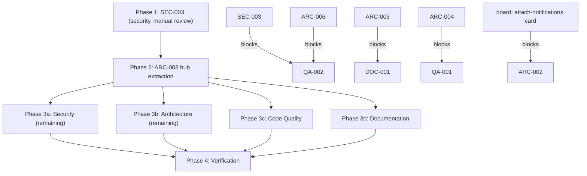

# Project Audit Report

> **Project**: par-term-emu-core-rust
> **Date**: 2026-10-15
> **Stack**: Rust (Cargo workspace: `par-term-emu-core` + `par-mux` + root), PyO3 Python 3.12+ bindings, WebSocket streaming server, TypeScript web frontend
> **Audited by**: Claude Code Audit System (4 parallel domain agents: architecture, security, code quality, documentation)
> **Audited at**: commit `7565bbc` (parsight index ~5 commits stale — stale-index dead-code candidates were manually verified as false positives and discarded)

---

## Executive Summary

The project is in strong shape: no critical findings in any domain, security posture is strong (constant-time comparisons everywhere, comprehensively capped graphics parsers, argv-only process spawns, nine fuzz targets over the untrusted-input parsers), and documentation is machine-gated to an unusual degree (nine drift gates, all green at HEAD). The most impactful findings are structural: the 1:1-mirrored Python surface (597 flat methods across `Terminal` + `PtyTerminal`) is the dominant maintenance tax, the two agent-state TypeScript extensions are forks of the same reporter that have already demonstrated the divergent-fix failure mode once, and `terminal/mod.rs` remains a ~4,000-line hub file. One time-sensitive item: the `Cargo.lock` pins rustls 0.23.45, which carries four RUSTSEC advisories published 2026-10-14 — a one-command lockfile bump closes all four. Estimated effort for the top issues: the rustls bump is minutes, the rustdoc link fixes plus gate extension about a day, the TS single-sourcing and `terminal/mod.rs` extraction are multi-day structural moves.

### Issue Count by Severity

| Severity | Architecture | Security | Code Quality | Documentation | Total |
|----------|:-----------:|:--------:|:------------:|:-------------:|:-----:|
| 🔴 Critical | 0 | 0 | 0 | 0 | **0** |
| 🟠 High     | 3 | 0 | 0 | 1 | **4** |
| 🟡 Medium   | 3 | 1 | 2 | 1 | **7** |
| 🔵 Low      | 2 | 3 | 1 | 3 | **9** |
| **Total**   | **8** | **4** | **3** | **5** | **20** |

Deduplication notes: the forked agent-state TS extensions were found independently by Architecture and Code Quality (one issue, ARC-002); the parser-complexity cluster found by Code Quality absorbed Architecture's match-ladder finding (QA-001); the `terminal/mod.rs` size finding absorbed Code Quality's god-object survey note (ARC-003).

---

## 🟠 High Priority Issues

### [ARC-001] Python API surface is two god-classes — 389 methods on `Terminal`, 208 on `PtyTerminal`
- **Area**: Architecture
- **Location**: `python/par_term_emu_core_rust/_native.pyi` (9,344 lines; `Terminal` 4,601 lines / 389 methods, `PtyTerminal` 1,786 lines / 208 methods), generated from `src/python_bindings/terminal/` (18 themed `*_api.rs`) and `src/python_bindings/common.rs` (17 `macro_rules!` generators) plus `par-term-emu-derive`
- **Description**: The binding layer mirrors the Rust `Terminal` 1:1 into one flat Python class. Interface Segregation is violated at a scale that forced custom metaprogramming (a proc-macro crate + 17 declarative macros) just to keep the mirroring affordable. CLAUDE.md codifies the cost: every new capability touches at least five artifacts (Rust impl, themed binding, pyi regen, API_REFERENCE.md, Python tests).
- **Impact**: The flat surface is the repo's dominant maintenance tax and main sync-drift risk. Themed files and stub-drift gates treat the symptom; each new method still fans out across five files with no cohesive boundary slowing growth.
- **Remedy**: Freeze flat-method growth on `Terminal`/`PtyTerminal`. New API areas ship as separate pyclasses — the repo already has the pattern (`ScreenshotConfig` 33 methods, `StreamingConfig` 42, `WidthConfig`, `Macro`, `types/` data classes). Add a release-note ratchet counting `Terminal` methods per version so the surface only shrinks or holds.

### [ARC-002] Forked agent-state TS extensions with one-way back-port drift *(found by Architecture + Code Quality)*
- **Area**: Architecture (duplication: Code Quality)
- **Location**: `crates/par-mux/integrations/extensions/par-mux-agent-state.ts` (353 lines) vs `par-mux-omp-agent-state.ts` (543 lines); three byte-identical functions (`sendRequestAttempt`, `drainStateQueue`, `sendRequestNow`), four near-identical (similarity 0.98+), ~250 lines of wire/reporting logic existing twice
- **Description**: The two installed extensions are parallel forks of the same reporter. A comment — "The omp asset's queue, back-ported" — records a measured race (a 23 µs seq-swap on the e2e wire that silently dropped a broadcast) fixed in the omp variant and manually copied back. Divergence has already produced once-divergent behavior.
- **Impact**: The next fix lands in one fork and the other silently keeps the bug; the back-port comment proves this failure mode is real. Also the repo's only genuine large-scale duplication (parsight grouped everything else as `genuine_variation`). The pair has no test harness.
- **Remedy**: Single-source via the repo's existing generation pattern (as with `_native.pyi` and `include/terminal_core.h`): one template with dialect knobs (integration id, `nestedOmpSession` guard, retryable-error pattern, env-tunable durations), generating both files at build time with a drift check. Confirm single-file installability constraints before restructuring — that may be why the copy exists.
- **Constraint**: Must sequence after the in-progress board card "par-mux attach: notifications on agent state change" — that work plausibly edits these same files.

### [ARC-003] `crates/par-term-emu-core/src/terminal/mod.rs` remains a ~4,000-line hub file
- **Area**: Architecture (corroborated by Code Quality's file-size survey; parsight `god_objects`: Critical, `Terminal` highest-betweenness type, in-degree 140)
- **Location**: `crates/par-term-emu-core/src/terminal/mod.rs` (3,992 lines, 247 functions, 293 symbols; struct fields ~lines 1110–1230; 20+ sub-struct `Default` impls in the first ~1,100 lines)
- **Description**: The sub-struct decomposition and `EventBroker` capability were the right structural moves, and 30 sibling files already exist (`colors.rs` 1,005, `write.rs` 1,135, `screen.rs` 705, `search.rs` 661, …). But `mod.rs` still carries the struct definition, every sub-struct's definition and `Default`, and the largest remaining impl block.
- **Impact**: Merge contention and change-amplification on every core feature; the file is where parallel work (including other audit domains' fixes — see DOC-001) collides.
- **Remedy**: Continue the proven extraction. Two mechanical first slices: (1) move state sub-struct definitions + `Default` impls (~500+ lines) into `terminal/state.rs`; (2) move remaining themed impl blocks out the way `colors`/`screen`/`search` already moved. Target: `mod.rs` holds struct + constructors + `process()` plumbing only (~1,500 lines). No public paths change — sub-structs are already `pub(crate)`.
- **Blocks**: DOC-001 (its terminal/mod.rs link fixes would target lines this extraction moves).

### [DOC-001] Broken intra-doc links in the two crates.io-published Rust crates; the rustdoc gate only covers par-mux
- **Area**: Documentation
- **Location**: 17 rustdoc errors under `-D warnings`: `crates/par-term-emu-core/src/cell.rs:242`, `terminal/progress.rs:232-234`, `terminal/mod.rs:3105-3113`, `debug.rs:4`, `graphics/animation.rs:6`, `graphics/placeholder.rs:7-8`, `src/python_bindings/common.rs:8`, `src/python_bindings/screenshot_config.rs:6`; gate: Makefile `mux-rustdoc-check`
- **Description**: `RUSTDOCFLAGS="-D warnings" cargo doc` fails with 13 errors in `par-term-emu-core` and 4 in the root crate (exit 101 both). Classes: public docs linking private items (`Cell` → `PackedColor`, `reset` → `HostConfig`), unescaped brackets parsed as links (`params[0]`… in progress.rs), unresolved module links. The `mux-rustdoc-check` gate runs only `cargo doc -p par-mux`, so these two crates drifted undetected. Both are published on crates.io, so docs.rs renders the broken links to downstream Rust consumers.
- **Impact**: Rust embedders reading docs.rs hit dead links in `Cell` (the central data type) and the graphics/progress modules. The existing gate creates a false sense of coverage.
- **Remedy**: Fix the 17 link errors (escape `\[`/`\]` in progress.rs; reword `PackedColor`/`HostConfig` references as non-link prose). Extend the gate: rename to `rustdoc-check` covering `-p par-mux --features mux-bin`, `-p par-term-emu-core`, and the root (`--no-default-features --features python-test`), all `-D warnings`, wired into `checkall`.
- **Blocked by**: ARC-003 (same file; land the extraction first, then fix links at their new locations).

---

## 🟡 Medium Priority Issues

### [ARC-004] `tmux_control.rs` is a single-file parser monolith
- **Area**: Architecture
- **Location**: `crates/par-term-emu-core/src/tmux_control.rs` (2,094 lines, 90 functions; `TmuxNotification` impl at :369, `TmuxControlParser` at :426; `parse_line` CC 40, `notification_type` CC 38)
- **Description**: Lives in core by documented necessity (DESIGN.md deviation note), but nothing forces one file — the notification enum plus classification impl (lines 20–415) is cleanly separable from the parser state machine (415+).
- **Impact**: The mux protocol grammar, notification taxonomy, and parse state are entangled in a top-6 complexity file; every protocol addition re-reads all of it.
- **Remedy**: Split into `tmux_control/{mod.rs, notification.rs, parser.rs}` re-exporting current paths (same pattern as the `grid/` and `pty_session/` splits).
- **Blocks**: QA-001's `parse_line` entry (split first).

### [ARC-005] `#[doc(hidden)] pub` promotions are an unfenced cross-crate encapsulation leak
- **Area**: Architecture
- **Location**: `crates/par-term-emu-core/DESIGN.md` "Promoted items" table; the promoted items (`Terminal::{grid, graphics, pixel_width, pixel_height}`, `Cell::{c, flags, width}`, `PtyInputHandle`, `Terminal::resize_deferred`, …)
- **Description**: The root shell reaches core internals through visibility promotions. `doc(hidden)` is documentation, not access control: any external Rust embedder of the published `par-term-emu-core` crate can construct or mutate `Cell` fields or write `Terminal::grid` directly, bypassing every invariant, and semver tooling will flag changes to these items as public breaks.
- **Impact**: Core invariants (cell flags consistency, grid dimensions vs cursor state) are externally violable; the promoted set is frozen only by prose — nothing fails when it grows.
- **Remedy**: Turn the DESIGN.md table into a gate (like `core-version-check`): grep the member's `#[doc(hidden)] pub` set and fail when it differs from the recorded list. Policy going forward: promote methods, never fields.

### [ARC-006] Duplication pockets in the binding layer *(resize_pixels pair found by Architecture + Code Quality)*
- **Area**: Architecture (duplication: Code Quality)
- **Location**: `src/python_bindings/pty.rs:237` vs `src/python_bindings/terminal/mod.rs:163` (`resize_pixels`, 0.98-similar); `src/python_bindings/streaming.rs:1159/1252` (`encode_server_message`/`encode_client_message` near-identical, each duplicated again at :1302/:1328); `src/streaming/py_convert.rs:127` (`system_stats_to_py_dict`, cyclomatic 51, hand-rolled despite the `par-term-emu-derive` py-dict macro existing for exactly this)
- **Impact**: Each pocket is a place where a fix or signature change lands in one copy; the complexity-51 hand conversion is the kind of exhaustive match that silently misses a new enum variant.
- **Remedy**: Extract the shared pixel-resize wrapper; fold the encode pairs into one generic over message direction; extend the derive macro to the stats struct and delete the hand-rolled converter (the derive's exhaustive-variant pattern is what `variants_are_exhaustively_converted` already enforces elsewhere).
- **Blocks**: QA-002 (the allow-cleanup on streaming files should land on the final signature shape).

### [SEC-001] rustls 0.23.45 carries four fresh RUSTSEC advisories (published 2026-10-14)
- **Area**: Security
- **CWE/OWASP**: CWE-1104 / OWASP A06 Vulnerable Components
- **Location**: `Cargo.lock` (rustls 0.23.45); spec `Cargo.toml:110` (`rustls = { version = "0.23.40", optional = true }`)
- **Description**: `cargo audit` reports 4 vulnerabilities, all published 2026-10-14, all fixed in 0.23.46: RUSTSEC-2026-0346 (medium, `Debug` impls for client session values expose TLS secrets), 0347 (low, buffered app data sent to outer server after ECH rejection), 0348 (low, Brotli certificate decompression can allocate up to 1 GiB before authentication), 0349 (low, unauthenticated ServerHello can downgrade later connections to classical key exchange). rustls terminates TLS for the streaming server (`build_rustls_config` in `src/streaming/config.rs`) and underpins reqwest's TLS in the frontend downloader.
- **Impact**: On a deployment exposing the streamer over TLS on a non-loopback interface: session-key leakage via debug logging, and memory-pressure DoS from unauthenticated peers.
- **Remedy**: Lockfile-only: `cargo update -p rustls` (the `0.23.40` spec already admits 0.23.46), then re-run `cargo audit` and the streaming test suite. Sequence with the next dependency-refresh commit (both touch `Cargo.lock`).

### [QA-001] Cyclomatic complexity cluster on untrusted-input parsers *(absorbed Architecture's match-ladder finding)*
- **Area**: Code Quality (also flagged by Architecture)
- **Location**: `terminal/sequences/csi/style.rs:14` (`handle_csi_style`, CC 50), `grid/export.rs:21` (`push_sgr_style`, CC 49), `graphics/kitty/parse.rs:24` (`parse_chunk`, CC 46), `screenshot/renderer.rs:295` (`render_block_element`, CC 45), `terminal/sequences/csi/mod.rs:36` (`csi_dispatch_impl`, CC 43), `keyboard.rs:333` (`encode_legacy`, CC 42), `tmux_control.rs:570` (`parse_line`, CC 40), plus `mux/attach/render/input_route.rs:499` (`route_mouse`, CC 39 — in-flight attach work, exclude from remediation)
- **Description**: Eight functions sit in parsight's Critical complexity band. Verified structure: flat parameter/variant dispatchers (per-param match arms, each short), not spaghetti. All parse bytes from the PTY (untrusted child output).
- **Impact**: High regression risk on protocol changes — one misplaced arm mis-renders output. Mitigated today by the nine cargo-fuzz targets and golden wire tests, so this is a maintainability ceiling, not a live defect.
- **Remedy**: Not urgent. Where a natural seam exists (SGR param loop in `handle_csi_style`, sub-param dispatch in `push_sgr_style`), extract per-topic helpers in the established `sequences/{csi,osc,dcs}/` pattern; split `parse_line` as part of ARC-004. Keep fuzz green through any split. Table-driven matches would flatten them; do it on next touch, not as standalone churn.

### [QA-002] `#[allow(clippy::too_many_arguments)]` at 19 sites, most undocumented
- **Area**: Code Quality
- **Location**: concentrated in `src/streaming/protocol.rs:1477,1745`, `src/streaming/server/send.rs:63`, `src/streaming/py_convert.rs:126`, `src/python_bindings/streaming.rs:38,1004`, `src/python_bindings/common.rs:2525,2646`, plus ~10 more across `src/python_bindings/`
- **Description**: Long parameter lists are suppressed rather than modeled. One site does it right — `crates/par-mux/src/mux/attach/render/pane_chrome.rs:35` carries `reason = "the tmux half rule reads as a flat ... tuple"`. The rest are bare allows on wire-conversion and PyO3 wrapper functions.
- **Impact**: Call sites become position-sensitive; adding a field to a streaming message touches every positional call. The derives already handle most of this, so residual risk is moderate.
- **Remedy**: Where args map 1:1 to a protocol message's fields (the majority), a bare allow is defensible — add the `reason =` matching pane_chrome.rs. Where args are genuinely independent options, take a small params struct.
- **Blocked by**: ARC-006 and SEC-003 (both reshape binding/streaming signatures; land those first so the cleanup targets the final shape).

### [DOC-002] Docstring Example coverage is warn-only — 274 documented pymethods lack an Example; pty.rs/streaming.rs excluded from the runner entirely
- **Area**: Documentation
- **Location**: `scripts/check_docstring_examples.py` (exit 0 while printing `MISSING` lines); gaps in `src/python_bindings/common.rs`, `types/screen.rs`, `types/shell.rs`; exclusion note "pty.rs/streaming.rs excluded (deferred DOC-117 wave)"
- **Description**: The gate executes the 187 Example blocks that exist (excellent), but missing examples are informational: 274 documented pymethods have no Example against CLAUDE.md's "Args, Returns, and Example sections" convention. Worse, the two files a Python integrator consults most — `pty.rs` (the headline PTY API) and `streaming.rs` — are excluded from execution entirely.
- **Impact**: Python users of `PtyTerminal` and `StreamingServer` get docstrings whose examples, if present, are unverified, and most methods have no copy-paste example at all.
- **Remedy**: Close the deferral: include `pty.rs`/`streaming.rs` in the runner (needs `make dev` in the loop — batch with binding-touching work). Add a ratchet floor to the gate (fail when documented-pymethods-without-Example exceeds a threshold that only decreases), and batch-add examples to the top-used classes first.

---

## 🔵 Low Priority / Improvements

### Architecture

- **[ARC-007] Single `Arc<RwLock<Terminal>>` serializes PTY processing against every query** — `crates/par-term-emu-core/src/pty_session/mod.rs`. Design note, not an impairment: `UpdateWaiter` + generation counters bound the damage; consumers are interactive. When it bites, export from a snapshot copy (`GridSnapshot` exists for replay) rather than under the live read lock.
- **[ARC-008] Per-client broadcast bound permits ~128 MiB per stalled client** — `crates/par-mux/src/mux/server/mod.rs:77-84` (`CLIENT_QUEUE_DEPTH = 4096`, worst-case math documented). Deliberate, documented, same-user exposure class. Consider an aggregate cross-client cap or smaller depth now that typical line sizes are known.
- (Architecture's match-ladder hot spots merged into QA-001.)

### Security

- **[SEC-002] htpasswd legacy hash formats (`{SHA}`, MD5-crypt) accepted for HTTP Basic Auth** — `src/streaming/auth_hash.rs:12-20`, CLI `src/bin/streaming_server/cli.rs:268-274`. Weak-hash-by-choice: comparisons are constant-time and docs recommend bcrypt, but an operator picking `{SHA}` gets trivially crackable auth on a shell-exposing server. Remedy: startup warning for non-bcrypt formats (mirroring the `allow_api_key_in_query` warning pattern) + SECURITY.md deprecation note. Do not drop support silently.
- **[SEC-003] OSC 52 clipboard write has no parity gate with `allow_clipboard_read`** — `crates/par-term-emu-core/src/terminal/sequences/osc/clipboard.rs:32-37`. Read-back is gated (default false) but the write path always accepts up to ~1 MiB of attacker-controlled text into `clipboard_content`; hosts that propagate it to the system clipboard get an ungated write channel from any program in the terminal. Remedy: add `allow_clipboard_write` (default true, preserving behavior) with the same setter/binding pattern as the read flag. **Security-related change: requires explicit opt-in/manual review before committing per project rule.** Promoted to Phase 1 because its binding edits collide with Code Quality files.
- **[SEC-004] Frontend download falls back to TLS-only integrity for releases without a `.sha256` sidecar** — `src/bin/streaming_server/frontend_download.rs:243-251`. Everything else is done well (fixed repo URL, 50 MiB streamed cap, fail-closed sidecar parsing, traversal-safe unpack). Remedy: pin the expected digest in the binary per release channel, or make the sidecar mandatory past a cutoff version; recommend the embedded-binary path (`web-build-static`) as the default in docs.
- (unsafe-libyaml 0.2.11 unmaintained is verified-acknowledged: already carried in `deny.toml` with a documented remediation path — not re-filed.)

### Code Quality

- **[QA-003] Small near-duplicate Rust pairs (each 14–21 lines)** — `pty_session/lifecycle.rs:578,605` (`try_wait`/`wait`, 0.97), `python_bindings/terminal/mod.rs:753,778` (`named_progress_bars`/`get_named_progress_bar`), `grid/export.rs:290,319` (`export_visible_screen_styled{,_lines}`). The `resize_pixels` pair is filed under ARC-006. Individually trivial, collectively a drift risk — fold into future touches of these files, not a dedicated pass.

### Documentation

- **[DOC-003] ENH-059 opus doc cites a content-hashed build artifact** — `docs/opus/ENH-059-streamer-csp-header.md:23` (`_next/static/chunks/3m9s--a71bpty.css`) regenerates on every web build. Rewrite to the stable directory with a note that filenames are content-hashed per build.
- **[DOC-004] Three path-shaped prose spans lack the `<!-- doc-path: example -->` waiver** — `crates/par-mux/skills/par-mux/SKILL.md:205` (fix the embedded source, never the installed copy, or `--install-skill` overwrites it), `docs/REGIONAL_FLAG_LIMITATION.md:105`, `docs/opus/ENH-055-env-var-docs-gate.md:96`. They recur as false-positive broken links in every doc-link audit.
- **[DOC-005] opus design docs cite bare line numbers** — e.g. `docs/opus/ENH-055-env-var-docs-gate.md` (`render/mod.rs:392-398`, `pane.rs:789-806`) against a style guide that reserves line numbers for commit-pinned material. Add the generating commit SHA to each opus doc's header or convert citations to symbol names.

---

## Detailed Findings

> Agent-internal IDs map to final IDs as follows — Architecture: ARC-201→ARC-001, ARC-202→ARC-002 (+QA agent's QA-001), ARC-203→ARC-003 (+QA-005), ARC-204→ARC-004, ARC-205→ARC-005, ARC-206→ARC-006 (+part of QA-004), ARC-207→ARC-007, ARC-208→ARC-008, ARC-209→merged into QA-001. Code Quality: QA-002→QA-001, QA-003→QA-002, QA-004→QA-003 (resize_pixels→ARC-006), QA-005→ARC-003. Security and Documentation IDs unchanged.

### Architecture & Design

The workspace split, version train, drift gates, and concurrency design are sound; the Critical section is empty on evidence. Beyond the numbered issues above: the three-crate DAG (core ← par-mux ← root shell) with exact `=x.y.z` lockstep pins and a `core-version-check` gate; sync-by-construction tooling for the five-artifact problem (generated pyi with stub-drift, cbindgen header with two gates, protobuf golden tests); feature-flag taxonomy with per-flag rationale and RUSTSEC-driven dependency shaping; `EventBroker` capability-oriented handlers; mux server seams (accept/dispatch/broadcast/reap/persist) with push-based output and every memory bound carrying its rationale. Parsight dead-code candidates in `attach/` (`run_handshake`, `forward_keys`, `agent_entry_lines`, `sidebar_workspace_rows`) were all verified live-called — stale-index false positives, no finding. Known/board-tracked items (attach render churn from the 2026-10-12 completed decomposition family, CI dispatch-only shape, flaky tests, app-exit cascade) were verified as known and not re-reported.

### Security Assessment

No critical or high findings. Posture is strong: constant-time comparisons (`subtle::ct_eq`) on API key, Basic Auth, and hash verification, with timing-equalized dummy bcrypt preventing username enumeration; streaming server defaults loopback with a loud unauthenticated-public-bind warning, WS origin checking, CSP + X-Frame-Options DENY, message/frame size caps, token-bucket rate limiting, `max_clients`, zeroized passwords, `hide_env_values` on secret CLI args; mux IPC Unix socket 0o600 in a 0o700 dir, Windows named-pipe peer verification comparing process-token user SIDs fail-closed; graphics parsers comprehensively capped (`image` Limits reader, 16384 dimension / 64 Mi-pixel caps, sixel 4096², kitty 64 MiB, iTerm2 100 MB) with TOCTOU hardening on kitty file-media; all process spawns argv-only; FFI null-guards every entry point; nine cargo-fuzz targets over the untrusted parsers; persistence restore treats the state file as untrusted; no hardcoded secrets. The rustls lockfile staleness (SEC-001) is the one time-sensitive item. No hostile reproduction was performed; verification was read-only plus `cargo audit`.

### Code Quality

No correctness bugs, no reachable panic on untrusted input, no lock-across-await, no blocking sleep inside async tasks — verified, not assumed. Zero TODO/FIXME markers (grep's four `XXX` hits are test-string literals). 21 `#[allow]` locations total: 19 `too_many_arguments` (QA-002), 1 test-module `dead_code`, 2 `missing_docs` under a documented shrink-only allow-list. Error handling is exceptional: six `unwrap/expect` in sampled production code, each with a documented impossibility (`persist.rs` save-path invariants, `ffi.rs` "interior NUL replaced" one line after the replacement). `unsafe` confined to the C FFI with SAFETY comments, enforced by `clippy::undocumented_unsafe_blocks`. Test coverage is good (>70%): 3,876 Rust `#[test]` + 105 tokio/PyO3 across ~45 suites, 671 Python test functions across 37 files, 9 fuzz targets, 11 golden wire fixtures, FFI layout asserts, feature-isolation test. Assertions are specific; platform skips carry reasons; timing tests use poll-until helpers. Prior refactor cycle verified landed (`management_chord` now CC 17). Estimated debt: low; the TS extension fork (ARC-002) is the one place a fix to one shipped file silently misses its twin.

### Documentation Review

No critical findings; the primary surfaces (README, API_REFERENCE, MUX.md, CONFIG_REFERENCE, FFI_GUIDE, VT docs) are present, current, and machine-gated green. Nine automated doc-drift gates run green at HEAD (API-reference parity diffed bidirectionally against the compiled stub, FFI guide vs cbindgen header, MUX.md command tables, env-var reads vs CONFIG_REFERENCE, pinned-test citations, SECURITY caps table, stub docstrings, offline lychee — 968 links, 0 errors). Docstring examples are executed (187 blocks run on import). Cross-repo design record kept resolvable (`docs/par-mux.md` pointer, `MUX_DECISIONS.md` one-liners for every D-number). Accuracy spot-checks passed (README quickstart symbols, all 42 example files, XTPUSHCOLORS implementation claim matches code+tests). The high finding (DOC-001) is that the rustdoc gate's par-mux-only scope let 17 intra-doc link errors accumulate in the two crates.io-published crates. Known Phase B attach-TUI MUX.md/CHANGELOG churn was excluded per the brief; any MUX.md edits must sequence after that owed update.

---

## Remediation Roadmap

### Immediate Actions (Before Next Deployment)
1. [SEC-001] `cargo update -p rustls` → 0.23.46 (closes four RUSTSEC advisories; lockfile-only; sequence with the next dependency-refresh commit)
2. [DOC-001] Fix the 17 rustdoc link errors + extend the gate to all three crates (downstream docs.rs consumers see the breakage today)

### Short-term (Next 1–2 Sprints)
1. [ARC-002] Single-source the agent-state TS extensions (after the in-progress attach-notifications card lands)
2. [ARC-005] Gate the `#[doc(hidden)] pub` promoted set
3. [SEC-002] Startup warning for legacy htpasswd formats + SECURITY.md note
4. [SEC-003] `allow_clipboard_write` flag (manual review required — security change)
5. [SEC-004] Frontend-download digest pinning or mandatory sidecar
6. [ARC-008] Aggregate cross-client broadcast cap
7. [DOC-003]/[DOC-004]/[DOC-005] small doc hygiene fixes

### Long-term (Backlog)
1. [ARC-001] Freeze `Terminal`/`PtyTerminal` flat growth; new areas as separate pyclasses + method-count ratchet
2. [ARC-003] Extract `terminal/state.rs` and themed impls from the 4,000-line hub
3. [ARC-004] Split `tmux_control.rs` into notification/parser modules
4. [ARC-006] Fold binding-layer duplication pockets; derive-macro the stats converter
5. [QA-001] Extract per-topic helpers at natural seams in the complexity-cluster parsers
6. [QA-002] Document or struct-ify the 19 `too_many_arguments` allows
7. [DOC-002] Close the pty.rs/streaming.rs docstring-runner exclusion + example ratchet

---

## Positive Highlights

1. Sync-by-construction tooling: the Rust↔Python↔docs↔FFI consistency problem is machine-gated (stub-drift, ffi-header-check/ffi-surface-check, protobuf goldens, nine doc gates), not convention — all green at HEAD.
2. Error-handling discipline: six documented-impossible `unwrap/expect` in sampled production code across the whole core; all 30+ `panic!` sites verified inside test modules.
3. Security engineering depth: constant-time auth comparisons with dummy-bcrypt enumeration defense, fail-closed Windows named-pipe SID verification, TOCTOU-hardened kitty file media, comprehensively capped image decoders, argv-only process spawns.
4. Persistence restore treats on-disk state as untrusted (versioned envelope, `UnsupportedVersion` quarantine, fresh-start instead of panic).
5. The design record is rare-quality: `DESIGN.md` documents the workspace split as executed, including every promoted item and deviation.
6. Docstring examples are executed (187 blocks run on import) — most projects never verify examples.
7. Concurrency is clean: no lock-across-await, blocking work correctly on dedicated threads, every memory bound carrying its rationale in a comment.
8. Prior audit cycles verifiably landed: the 2026-10-12 decomposition targets (renderer.rs, modal.rs, management_chord) re-measured at healthy complexity.

---

## Audit Confidence

| Area | Files Reviewed | Confidence |
|------|---------------|-----------|
| Architecture | ~35 (manifests, DESIGN.md, binding layer, hub files, mux seams) | High |
| Security | ~45 (streaming server, auth, mux IPC, parsers, FFI, Cargo.lock + `cargo audit`) | High |
| Code Quality | ~55 (core parsers, bindings, ~45 test suites, 37 Python test files) | Medium — parsight `god_objects` analytics timed out; file-size survey stood in, and dead-code candidates from the stale index were manually cleared as false positives |
| Documentation | ~40 (all docs/ surfaces, README, CHANGELOG, gates run live) | High |

*Caveat: the parsight index was ~5 commits stale during the audit (indexer wedge, filed upstream); every line-number-bearing finding was re-verified against the live tree by the agents.*

---

## Remediation Plan

> This section is generated by the audit and consumed directly by `/fix-audit`.
> It pre-computes phase assignments and file conflicts so the fix orchestrator
> can proceed without re-analyzing the codebase.

### Phase Assignments

#### Phase 1 — Critical Security (Sequential, Blocking)
<!-- Empty of Critical-severity findings. SEC-003 is promoted here (severity Low) per the
     conflict-file rule: its binding-layer edits collide with Code Quality files, and it is
     the one security change requiring manual review before commit. -->
| ID | Title | File(s) | Severity |
|----|-------|---------|----------|
| SEC-003 | OSC 52 clipboard write gate (`allow_clipboard_write` flag + binding) | `crates/par-term-emu-core/src/terminal/sequences/osc/clipboard.rs`, `src/python_bindings/` setter | Low |

#### Phase 2 — Critical Architecture (Sequential, Blocking)
<!-- No Critical-severity architecture issues. ARC-003 is promoted (High) because it
     explicitly blocks DOC-001: the extraction moves the very lines DOC-001 fixes. -->
| ID | Title | File(s) | Severity | Blocks |
|----|-------|---------|----------|--------|
| ARC-003 | Extract `terminal/state.rs` + themed impls from the hub file | `crates/par-term-emu-core/src/terminal/mod.rs` (+ new `terminal/state.rs`) | High | DOC-001 |

#### Phase 3 — Parallel Execution

**3a — Security (remaining)**
| ID | Title | File(s) | Severity |
|----|-------|---------|----------|
| SEC-001 | rustls 0.23.45 → 0.23.46 lockfile bump (4 RUSTSEC advisories) | `Cargo.lock` | Medium |
| SEC-002 | Startup warning for legacy htpasswd formats | `src/streaming/auth_hash.rs`, `src/bin/streaming_server/cli.rs`, `docs/SECURITY.md` | Low |
| SEC-004 | Frontend-download digest pinning / mandatory sidecar | `src/bin/streaming_server/frontend_download.rs` | Low |

**3b — Architecture (remaining)**
| ID | Title | File(s) | Severity |
|----|-------|---------|----------|
| ARC-001 | Freeze Python flat-surface growth; pyclass-per-area + ratchet | `src/python_bindings/`, release tooling | High |
| ARC-002 | Single-source the agent-state TS extensions (generate both) | `crates/par-mux/integrations/extensions/*.ts` | High |
| ARC-004 | Split `tmux_control.rs` into notification/parser modules | `crates/par-term-emu-core/src/tmux_control.rs` | Medium |
| ARC-005 | Gate the `#[doc(hidden)] pub` promoted set | `crates/par-term-emu-core/DESIGN.md` + check script | Medium |
| ARC-006 | Fold binding-layer duplication pockets; derive-macro stats converter | `src/python_bindings/pty.rs`, `terminal/mod.rs`, `streaming.rs`, `src/streaming/py_convert.rs` | Medium |

**3c — Code Quality (all)**
| ID | Title | File(s) | Severity |
|----|-------|---------|----------|
| QA-001 | Extract per-topic helpers in the complexity-cluster parsers | `sequences/csi/style.rs`, `grid/export.rs`, `graphics/kitty/parse.rs`, `screenshot/renderer.rs`, `sequences/csi/mod.rs`, `keyboard.rs`, `tmux_control.rs` | Medium |
| QA-002 | `reason =` or params-struct for the 19 `too_many_arguments` allows | `src/streaming/protocol.rs`, `server/send.rs`, `py_convert.rs`, `src/python_bindings/*` | Medium |
| QA-003 | Fold small near-duplicate pairs on next touch | `pty_session/lifecycle.rs`, `python_bindings/terminal/mod.rs`, `grid/export.rs` | Low |

**3d — Documentation (all)**
| ID | Title | File(s) | Severity |
|----|-------|---------|----------|
| DOC-001 | Fix 17 rustdoc links; extend gate to all three crates | `cell.rs`, `terminal/progress.rs`, `terminal/mod.rs`, `debug.rs`, `graphics/animation.rs`, `graphics/placeholder.rs`, `python_bindings/common.rs`, `screenshot_config.rs`, `Makefile` | High |
| DOC-002 | Include pty.rs/streaming.rs in docstring runner; example ratchet | `scripts/check_docstring_examples.py`, `src/python_bindings/{pty,streaming,common}.rs`, `types/{screen,shell}.rs` | Medium |
| DOC-003 | Replace content-hash artifact citation with stable directory | `docs/opus/ENH-059-streamer-csp-header.md` | Low |
| DOC-004 | Add `doc-path` waivers to three false-positive spans | `crates/par-mux/skills/par-mux/SKILL.md` (source, not installed copy), `docs/REGIONAL_FLAG_LIMITATION.md`, `docs/opus/ENH-055-env-var-docs-gate.md` | Low |
| DOC-005 | Commit-pin or symbolize opus doc line-number citations | `docs/opus/*.md` | Low |

### File Conflict Map
<!-- Files touched by issues in multiple domains. Fix agents must read current file state
     before editing — a prior agent may have already changed these. -->

| File | Domains | Issues | Risk |
|------|---------|--------|------|
| `crates/par-term-emu-core/src/terminal/mod.rs` | Architecture + Documentation | ARC-003, DOC-001 | ⚠️ Read before edit (sequenced by Phase 2 → 3d) |
| `src/python_bindings/common.rs` | Architecture + Code Quality + Documentation | ARC-001, ARC-006, SEC-003 (binding setter), QA-002, DOC-001, DOC-002 | ⚠️ Read before edit |
| `src/python_bindings/pty.rs` | Architecture + Code Quality + Documentation | ARC-001, ARC-006, QA-002, DOC-002 | ⚠️ Read before edit |
| `src/python_bindings/terminal/mod.rs` | Architecture + Code Quality | ARC-001, ARC-006, QA-002, QA-003 | ⚠️ Read before edit |
| `src/python_bindings/streaming.rs` | Architecture + Code Quality + Documentation | ARC-006, QA-002, DOC-002 | ⚠️ Read before edit (ARC-006 → QA-002 ordering below) |
| `src/streaming/py_convert.rs` | Architecture + Code Quality | ARC-006, QA-001, QA-002 | ⚠️ Read before edit |
| `crates/par-term-emu-core/src/tmux_control.rs` | Architecture + Code Quality | ARC-004, QA-001 | ⚠️ Read before edit (ARC-004 → QA-001 ordering below) |
| `src/python_bindings/screenshot_config.rs` | Code Quality + Documentation | QA-002, DOC-001 | ⚠️ Read before edit |

### Blocking Relationships
<!-- Explicit dependency declarations from audit agents.
     Format: [blocker issue] → [blocked issue] — reason -->
- ARC-003 → DOC-001: the extraction moves the terminal/mod.rs lines DOC-001's link fixes target
- ARC-004 → QA-001: split tmux_control.rs first; QA-001's `parse_line` entry then applies to the smaller parser module
- ARC-006 → QA-002: the encode-pair fold and stats-converter migration reshape streaming/binding signatures the allow-cleanup targets
- SEC-003 → QA-002: SEC-003 adds a binding setter in the same python_bindings files; land it first to avoid churn (it is Phase 1 for this reason)
- ARC-002 → (external) board card "par-mux attach: notifications on agent state change" (in progress): both edit the agent-state reporting path; sequence the consolidation after it lands
- DOC-002 → (batching note) needs `make dev` in the loop; batch with binding-touching work (ARC-006 or SEC-003)
- SEC-001 → (batching note) sequence with the next dependency-refresh commit; both touch `Cargo.lock`
- Any `docs/MUX.md` edits → (external) after the Phase B attach-TUI MUX.md/CHANGELOG update already owed on the board

### Dependency Diagram

