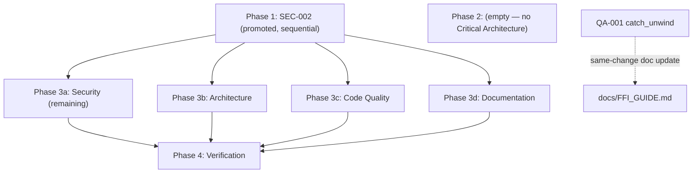

# Project Audit Report

> **Project**: par-term-emu-core-rust
> **Date**: 2026-11-27
> **Stack**: Rust (Cargo workspace: par-term-emu-core, par-mux, root crate), Python 3.12+ via PyO3, TypeScript/Next.js (web frontend)
> **Audited by**: Claude Code Audit System
> **Audited tree**: main @ c1efe217 (v0.91.0), clean; parsight index current

---

## Executive Summary

The codebase is in excellent health: no critical findings in any domain, a 4,976-test suite against ~300K LOC, zero TODO/FIXME markers in production code, and a mechanical drift-gate system (~20 checks) that enforces surface, header, schema, doc, and version discipline at build time. The four High findings are concentration and containment risks rather than active defects: the flat `Terminal` hub (in-degree 175), multi-thousand-line par-mux daemon leaf modules, missing `catch_unwind` containment on the C FFI surface, and ~200 duplicated lines across the two shipped agent-state extensions. The most security-relevant finding is a default posture issue (unauthenticated loopback streamers accept PTY input from any local user). Estimated effort to remediate all High and Medium items is roughly 2–3 weeks; the strongest asset is the gate infrastructure, which keeps every other discipline mechanically honest.

### Issue Count by Severity

| Severity | Architecture | Security | Code Quality | Documentation | Total |
|----------|:-----------:|:--------:|:------------:|:-------------:|:-----:|
| 🔴 Critical | 0 | 0 | 0 | 0 | **0** |
| 🟠 High     | 2 | 0 | 2 | 0 | **4** |
| 🟡 Medium   | 5 | 2 | 2 | 2 | **11** |
| 🔵 Low      | 5 | 4 | 3 | 2 | **14** |
| **Total**   | **12** | **6** | **7** | **4** | **29** |

---

## 🔴 Critical Issues (Resolve Immediately)

None found in any domain.

---

## 🟠 High Priority Issues

### [ARC-001] `Terminal` is a containment hub without an encapsulation boundary
- **Area**: Architecture
- **Location**: `crates/par-term-emu-core/src/terminal/mod.rs:200-330`, `crates/par-term-emu-core/src/terminal/state.rs:89-97`, `scripts/check_terminal_fields.py:37`
- **Description**: `Terminal` is simultaneously the parse target (`impl Perform`), the state holder (53 fields at the frozen baseline), the event-broker host, the query API, and the input surface for Python bindings, streaming, C FFI, par-mux panes, and the screenshot renderer. parsight rates it Critical blast radius (in-degree 175, ~1,120 direct upstream references at depth 2, matching `crates/par-term-emu-core/DESIGN.md:151-158`). The ARC-001 sub-struct decomposition groups state but does not restrict access: every sub-struct field is `pub(crate)`, so any module inside the core member can reach any state. The freeze gates (`api-surface-check`, `terminal-fields-check`) are a recorded owner decision (DESIGN.md:160-171), so this is a managed structural fact rather than an unmanaged defect — but it remains the single dominant coupling point of the workspace.
- **Impact**: Any cross-cutting change (new state, new event kind, new security flag) fans out to five consumer surfaces simultaneously; the field-count ratchet prevents growth but cannot shrink the reachability graph.
- **Remedy**: Extend the capability-parameter pattern already used for `&mut EventBroker` (`event_broker.rs`) to more handler seams — hand `&mut MarginState`, `&mut GraphicsState`, etc. to sequences handlers instead of `&mut Terminal` — so reachability narrows inside the frozen surface. Continue lowering the field baseline with each extraction.

### [ARC-002] par-mux daemon leaf modules exceed the repo's own decomposition standard
- **Area**: Architecture
- **Location**: `crates/par-mux/src/mux/scrape.rs` (2,364 lines), `crates/par-mux/src/mux/pane.rs` (2,163), `client.rs` (1,956), `layout.rs` (1,876), `ipc.rs` (1,650), `host_probe.rs` (1,459), `foreground.rs` (1,141)
- **Description**: The mux member has excellent mid-level seams (`server/`, `dispatch/`, `command/`, `tree/`, `persist/`, `hooks/`, `attach/`), but the leaf concern files are multi-KLOC monoliths: `pane.rs` concentrates PTY lifecycle, pane state, `OutputSink`, and `ShellPaneFactory` in one unit; `client.rs` carries the `NotificationLedger` (parsight bridge symbol, in-degree 62); `scrape.rs` alone is larger than the entire `tree/` submodule. The terminal core keeps its own files mostly under ~1,000 lines, so the mux side is measurably out of line with the repo's own convention.
- **Impact**: The daemon's correctness-critical core is hard to review in one sitting, concentrates merge conflicts, and makes blast radius opaque — the condition the terminal core's decomposition was run to fix.
- **Remedy**: Apply the same phase-boundary decomposition used for the terminal core: split `pane.rs` into lifecycle/state/output seams and `scrape.rs` into pattern-source/matcher/report seams, following the `dispatch/` per-topic template. No Python bindings exist for mux, so no binding sync.

### [QA-001] FFI exports lack panic containment (catch_unwind)
- **Area**: Code Quality
- **Location**: `src/ffi.rs` (all ~40 `#[no_mangle] pub extern "C"` exports, e.g. lines 752-962)
- **Description**: The C ABI exports null-guard their inputs but none wrap their body in `catch_unwind`. A panic anywhere in the call chain (allocation failure, a grid invariant bug) unwinds out of `extern "C"` and aborts the C host process — a guaranteed abort on modern Rust rather than UB, but still an unrecoverable process kill triggered by an internal bug in an opt-in library surface. The codebase already applies the pattern elsewhere (`crates/par-mux/src/mux/server/broadcast.rs:117` wraps client-callback dispatch in `catch_unwind(AssertUnwindSafe(...))`), so the FFI surface is an inconsistent application of an established practice.
- **Impact**: Any latent panic in the terminal core kills the embedding C application instead of surfacing an error code. The `ffi` feature ships an xcframework (ARC-112) for third-party embedding, so the blast radius is the embedder's whole process.
- **Remedy**: Add a `catch_unwind(AssertUnwindSafe(...))` wrapper at every export (a small macro or `ffi_guard` helper returning `null_mut()` / the established error sentinel), map the payload to the existing error convention, and pin it with a test that panics inside a guarded export. Document the no-abort guarantee in `docs/FFI_GUIDE.md` (that file enumerates every export and must be updated in the same change).

### [QA-002] Copy-paste duplication between the two shipped agent-state extensions
- **Area**: Code Quality
- **Location**: `crates/par-mux/integrations/extensions/par-mux-agent-state.ts` (367 lines) and `crates/par-mux/integrations/extensions/par-mux-omp-agent-state.ts` (565 lines)
- **Description**: The omp variant is a superset seeded from the base extension. Four functions are byte-identical AST copies (`sendRequestAttempt`, `drainStateQueue`, `sendRequestNow`, `updateSessionRef`) and four more are ≥0.98-similarity near-copies (`reportSession`, `sendState`, `releaseAgent`). Roughly 200 lines of shared queueing/reporting logic exist in two places.
- **Impact**: This is shipped integration code. A bug fix or protocol change applied to one file silently misses the other, and the extensions drift in behavior while looking consistent to users.
- **Remedy**: Extract the shared core (queue, timer, request/report plumbing) into one module under `crates/par-mux/integrations/` with per-variant configuration (endpoint shape, state vocabulary), reducing both entry files to thin adapters.

---

## 🟡 Medium Priority Issues

### Architecture

- **[ARC-003] Every Python wheel hardwires the entire streaming-server dependency tree** — `pyproject.toml:74-81` builds wheels with `streaming`, pulling tokio, axum, rustls, bcrypt, md-5, sha1, zeroize, sysinfo into every install, including consumers who never open a socket. A CVE in any of those crates lands on library users who only parse VT streams. Remedy: evaluate an `auth` feature splitting the digest-auth crypto deps out of the default wheel, or document the accepted posture in SECURITY.md.
- **[ARC-004] pillow is a hard runtime dependency the shipped package never uses** — `pyproject.toml:54-56` installs pillow for every consumer, but the shipped Python layer contains zero PIL imports; screenshots are rendered in Rust. Only `tests/test_screenshot.py` imports PIL, and the identical pin already exists as the optional `image` extra. Remedy: drop the hard dependency; point tests at the extra.
- **[ARC-005] Permanent legacy re-export facade at the crate root** — `src/lib.rs:149-175` carries ~70 `#[doc(hidden)]` `Py*` aliases documented as unremovable (`#[deprecated]` has no effect on `use` items), gated by `reexports-check`/`doc-hidden-check`. Controlled debt, but the public Rust namespace stays wider than the documented three-tier API. Remedy: accept as policy, or retire aliases behind a `legacy` module at a major-version boundary.
- **[ARC-006] workflows README contradicts the CI trigger it documents** — `.github/workflows/README.md` says "manual-dispatch only — none run on push or PR", but `ci.yml:5-6` fires on `pull_request` since ARC-004. No gate covers the workflows README, so this drift survived all doc gates. Remedy: update the trigger column; consider extending a drift gate to the workflows README.
- **[ARC-007] The root crate concentrates five artifact roles in one package** — workspace root + PyO3 extension + Rust-library facade + `par-term-streamer` binary + C-FFI crate, with the workspace's largest feature matrix (20 features, 35 deps). Feature-combination breakage risk concentrates here (mitigated by gates, at ongoing gate cost). Accepted direction per ARC-007/ARC-106; next seam if cost grows is extracting `streaming` into its own member.

### Security

- **[SEC-001] Unauthenticated loopback streamer grants PTY write access to every local user** (CWE-306 / OWASP A07) — `src/streaming/config.rs:492` (`default_read_only: false`): with defaults, a streamer binds 127.0.0.1, accepts any connection with no credentials, and allows input. The fail-closed startup gate only refuses non-loopback binds, so on a shared multi-user host any local user can attach and type into the owner's shells. Exploit scenario: an unprivileged user on a shared build server injects commands into an admin's PTY. Remedy: when no auth is configured, default `default_read_only: true` (opt out explicitly) or emit a loud startup warning plus a SECURITY.md callout — extend the existing fail-closed philosophy to loopback.
- **[SEC-002] Minisign release-authenticity gate is warn-and-proceed, not fail-closed** (CWE-494 / OWASP A08) — `crates/par-term-emu-core/src/self_update.rs:159-161`: an absent `.minisig` sidecar returns `SignatureStatus::Absent` and the update proceeds on the SHA-256 gate alone; `install.ps1:183-192` and `install.sh` behave the same when the minisign CLI is missing. The code documents this as an activation contract pending a first signed release — the flip to hard-refusal has not happened. Exploit scenario: an attacker with GitHub release write access publishes a backdoored binary without the sidecar and every self-updating deployment accepts it. Remedy: sign the next release, then change the absent-sidecar branch to a hard refusal in `verify_release_signature` and both installers.

### Code Quality

- **[QA-003] WindowSession god-object pressure in the attach TUI** — `crates/par-mux/src/mux/attach/render/`: `session.rs` (1,556 lines, fan-in 31), `mod.rs` (1,657, fan-in 53), `navigate.rs` (1,171), `input_route/mouse.rs` (1,000), `modal_settings.rs` (1,877). Parsight's 90-day hotspots concentrate almost entirely on `WindowSession` (`pump` churn 1,419, `handle_event` 1,110, `frame` 981, `management_chord` 904). The type is the single integration point for renderer state, chord routing, modals, notifications, and daemon events; the complexity leaders are healthy flat dispatch tables, but the churn concentration is empirical evidence of refactor magnetism. Remedy (not urgent): at the next feature touching this area, carve cohesive clusters out (`ModalStack`, `ChordRouter`) instead of adding fields.
- **[QA-004] Committed build artifacts in `web_term/`** — the built Next.js static export (including versioned `_next/static/` chunks) is tracked in git as a serve-from-repo deployment model. Repo inflation per rebuild, noisy diffs, stale-build risk. Remedy: prefer a release-time build step or CI artifact; at minimum add a gate failing when `web_term/` is older than the frontend sources.

### Documentation

- **[DOC-001] ARCHITECTURE.md verification banner is four releases stale** — banner reads "Last verified against v0.87.0 (2026-11-22)" while HEAD is 0.91.0; releases 0.88.0–0.91.0 shipped after the last verification pass. CONTRIBUTING.md's "Before tagging" step 1 requires refreshing the banner at every cut, and the banner itself promises a per-cut cadence — four cuts exceeds the disclosed trail, leaving the crate-layout, module-list, and CI-summary sections (including ARC-002's protocol-module split and the otel additions) formally unverified. Remedy: run the verification pass the banner describes against HEAD, refresh to v0.91.0, and make the per-cut refresh actually happen (it is already written into the release checklist).
- **[DOC-002] RUST_USAGE.md has zero file-transfer coverage** — the 0.90.0 release added `Terminal::transfer_summaries()` (SEC-010, payload-free snapshots) for Rust embedders plus `get_transfer`/`take_completed_transfer`, recorded in the CHANGELOG, but the Rust embedder guide never mentions the file-transfer tracking API at all. The Python side is documented (API_REFERENCE.md File Transfer section). Remedy: add a "File Transfer Tracking" subsection to RUST_USAGE.md covering `transfer_summaries()`, the completed-transfer ring, and the payload accessors.

---

## 🔵 Low Priority / Improvements

### Architecture
- **[ARC-008]** In-tree test bulk: `crates/par-mux/src/mux/server/tests.rs` is 3,667 lines inside src; the integration suites already live in `crates/par-mux/tests/` — this unit-test file could follow them.
- **[ARC-009]** `pyo3` reaches into the core member via the `python` feature (PyErr conversions in `crates/par-term-emu-core/src/lib.rs`): a documented orphan-rule compromise coupling the pure core to Python error shapes; a wrapper-type alternative exists but costs more than it buys.
- **[ARC-010]** Derive-crate version exception (`derive` versions independently, gated by `derive-version-check`): correct but extra cognitive load the version train otherwise removes.
- **[ARC-011]** Release packaging by exclusion: the root `[package] exclude` list is hand-maintained; no gate checks the sdist/wheel file list (release gates check versions and notes only).
- **[ARC-012]** `TerminalEvent` keeps growing as a single enum; every new terminal feature appends to it plus `event_fields.rs`/`_native.pyi` in the same commit — the freeze gates do not cover this enum's size.

### Security
- **[SEC-003]** Per-client input rate limiting defaults off (`src/streaming/config.rs:503`, `input_rate_limit_bytes_per_sec: 0`): caps exist per-frame but no byte-rate ceiling by default; minor given the local-only default.
- **[SEC-004]** Duplicate crypto-crate versions in `Cargo.lock`: `sha2` 0.10.9 + 0.11.1 (0.10 arrives via bcrypt 0.19.3) and `tokio-tungstenite` 0.29.0 + 0.30.0 — extra supply-chain surface in the auth/TLS path.
- **[SEC-005]** OSC 7 cwd acceptance defaults on (`terminal/state.rs:972`): remote-emitted cwd reports are trusted by default for mux git badges and persistence; the dangerous downstream uses are already mitigated (`git_status.rs` pins `core.fsmonitor=false`, scrubs `GIT_DIR`/`GIT_WORK_TREE`, disables prompts) — defense-in-depth only.
- **[SEC-006]** Web frontend loads Google Fonts from fonts.googleapis.com: external third-party dependency for a locally served terminal; minor privacy/availability note.

### Code Quality
- **[QA-005]** Stale scratch directory at repo root: `claude_scratch/` holds untracked one-off sync reports from a past documentation session. Delete when convenient.
- **[QA-006]** A handful of ~150-line phase-structured functions: `cmd_agent_start` (`crates/par-mux/src/mux/dispatch/agents.rs:223`), `reflow_smaller` (`crates/par-term-emu-core/src/grid/reflow.rs:799`), `update_release_with_key` (`crates/par-term-emu-core/src/self_update.rs:368`). All clearly phase-commented with correct lock discipline; split only if they keep growing. `reflow_smaller` is a bounds-conscious xterm.js port where the complexity is intrinsic.
- **[QA-007]** Shared template across `scripts/check_*.py` gate scripts (~5 shapes at ~0.88 similarity): idiomatic for standalone gate scripts, low risk. Fine to leave.

### Documentation
- **[DOC-003]** ADVANCED_FEATURES.md does not cover the OSC 99 detailed-notifications API: `take_notifications_detailed()` is in the README feature matrix and API_REFERENCE.md but absent from the feature-guides doc. Remedy: add a short subsection, or accept API_REFERENCE as the single home.
- **[DOC-004]** CONTRIBUTING.md quotes a stale Rust version: says `rust-version` "1.99 today" but all three manifests say `1.100`. Remedy: drop the parenthetical number so the paragraph cannot drift again.

---

## Detailed Findings

### Architecture & Design

Full report from the audit-architecture agent (parsight survey + impact + direct reads of manifests, entry points, state, server, and binding layers; index fresh at c1efe217):

- **No critical findings.** The dependency graph is acyclic with correct direction (`par-mux` → `par-term-emu-core` → nothing; root re-exports both; `derive` standalone), threading is bounded and documented, and every unbounded-growth vector traced carries an explicit, gated cap.
- High items are **managed, ratcheted risks** (hub concentration; mux leaf monoliths) rather than active defects. Overall architecture health: **Good — trending excellent** at the seams the project has deliberately decomposed, with the two High items being the remaining concentration points.
- Medium findings ARC-003 through ARC-007 and low findings ARC-008 through ARC-012 as summarized above. Supporting detail: the legacy facade (ARC-005) is explicitly documented in-source as unremovable and gate-enforced (`reexports-check`, `doc-hidden-check`); the five-role root crate (ARC-007) is what makes `check-feature-combos` and the Windows cross-target checks necessary; ARC-012's enum growth is checked only for exhaustiveness (by the derive crate), not size.

### Security Assessment

Full report from the audit-security agent (OWASP sweep, auth/crypto/validation call-site tracing via parsight, manifest review, secrets scan, recent-changes review):

- **No critical or high-severity exploitable issues.** Every surface checked out with systematic hardening already in place (SEC-001 through SEC-214 remediations referenced throughout the code). The two medium findings concern **default posture rather than code defects**.
- Secrets scan of all tracked files found no real credentials — the AKIA-pattern hits were base64 protobuf wire bytes in generated TypeScript, false positives.
- Verified strengths: constant-time compares via `subtle` on every auth path (`src/streaming/server/http.rs:203-229`), `zeroize` on secret drops, auth throttling with exponential backoff, origin allowlist with loopback-only fail-safe default (SEC-005), par-mux control socket at tmux-grade (per-UID `0700` dir, `0600` socket, peer-euid verification failing closed, Windows owner-only DACL at `crates/par-mux/src/mux/ipc.rs:102-195`), tar extraction rejecting `..`/absolute/link/device/FIFO entries with byte caps (`src/bin/streaming_server/frontend_download.rs:427-521`), upload staging sanitized to bare filenames at `0600` in a `0700` dir, OSC 52 capability-gated both directions, Kitty APC payloads capped (SEC-116), image decoding bounded via `image::Limits` + 25MP pixel cap, CI actions pinned by full SHA, cargo-deny enforcing advisory/yanked/registry policy, nine cargo-fuzz targets on hostile-input parsers, and startup failing closed on non-loopback unauthenticated binds.

### Code Quality

Full report from the audit-code-quality agent (parsight analytics — dead code, duplication, god objects, complexity, hotspots — plus sampled reads of core business logic and tests):

- **Critical: 0. High: 2. Medium: 2. Low: 3.** Overall code health: **Excellent**. Estimated technical debt: **Low**.
- Test coverage: 27 inline Rust test modules, 16 par-mux integration suites (15,432 LOC), 10 root-crate Rust suites, 45 Python test files (685 test functions, 12,171 LOC), 9 frontend vitest suites. 4,976 Rust `#[test]` functions against ~300K LOC is a very high test-to-code ratio; estimated coverage >70%. Key untested areas: frontend components other than `Terminal`; the FFI surface (Rust-side tests only, no C-host smoke test). The 213 `#[ignore = "load-sensitive"]` tests are a documented policy covered by `make test-rust-sensitive`/`checkall-ci include-ignored`, not debt.
- Debt markers: **zero TODO/FIXME** in production Rust; 37 `#[allow(...)]` sites across ~300K LOC with zero crate-level blanket suppressions; `clippy.toml` bans `std::env::set_var`/`remove_var` with cited rationale (QA-196); zero bare `except:` in Python — all 16 broad handlers carry justified `# noqa: BLE001` and re-raise/report.
- Positive highlights: zero production `.unwrap()` in the core crate and 3 in all of par-mux (~24 genuine unwraps total, mostly test tempfile setup); a typed error taxonomy end to end (`PtyError`/`ScreenshotError`/`GraphicsError`/`PersistError` with `From<…> for PyErr` in `crates/par-term-emu-core/src/lib.rs:80-117`); high cyclomatic numbers landing on healthy flat-dispatch shapes (`tmux_control/line/mod.rs:17` at 43, `emit.rs:58` at 39 — intrinsic protocol complexity, not nesting); ~22 gate scripts with api-surface/terminal-fields freeze checks, cbindgen header drift gates, and proto golden tests; comment hygiene stating constraints (lock disciplines, wire adjacency contracts, race fences).

### Documentation Review

Full report from the audit-documentation agent (parsight doc_links + docstring sampling + full reads of the 30-doc corpus; all `make checkall` doc gates verified green on this tree):

- **Critical: 0. High: 0. Medium: 2. Low: 2.** Overall documentation health: **Excellent**. The four findings above are the drift that lives *outside* gate coverage — the gates themselves (`stub-docs-check`, `doc-links-check`, `env-docs-check`, `mux-docs-check`, `rustdoc-check`, `api-surface-check`, `pinned-tests-check`, `release-check`) are green.
- Inventory verified: README excellent (badges, four install paths including checksum-verified installers, five runnable quick-start blocks, all 41 listed example files exist); API_REFERENCE.md 2,650 lines covering Terminal, PtyTerminal, 60+ data classes, enums, streaming, replay, FFI, with recent APIs spot-checked present and matching `_native.pyi`; ARCHITECTURE.md 1,307 lines with Mermaid diagrams; Keep-a-Changelog format through 0.91.0 with a live `[Unreleased]` section; CONTRIBUTING.md with gates/feature matrix/fuzzing policy; ops guides (STREAMING.md, MUX.md, CONFIG_REFERENCE.md gate-enforced at 113 rows, TROUBLESHOOTING.md, BUILDING.md, BENCHMARKING.md).
- Docstring coverage is gate-verified: 1,025/1,371 stub defs documented with 346 allow-listed (100% of required defs, enforced by `stub-docs-check`); Rust side linted by `rustdoc-check`.
- One parsight `doc_links` broken-mode hit was verified as a non-issue: `docs/MUX.md:1016` citing `antigravity-cli/settings.json` is an intentional reference to the external app's own settings file, not a repo link; the real link gate (lychee, 1,387 links) reports 0 errors.

---

## Remediation Roadmap

### Immediate Actions (Before Next Deployment)
1. **SEC-001** — flip the no-auth loopback default to read-only (or add a loud startup warning); narrow, self-contained edit in `src/streaming/config.rs`.
2. **SEC-002** — sign the next release, then flip the absent-sidecar branches to hard refusal in `self_update.rs` + `install.sh` + `install.ps1` (closes a documented activation window).
3. **QA-001** — add `catch_unwind` containment to the FFI exports with a panic-test pin and the `docs/FFI_GUIDE.md` update in the same change.

### Short-term (Next 1–2 Sprints)
1. **QA-002** — extract the shared core of the two agent-state extensions.
2. **DOC-001** — refresh the ARCHITECTURE.md verification pass to v0.91.0 (rides the next release cut per the existing checklist step).
3. **DOC-002** — add the file-transfer tracking section to RUST_USAGE.md.
4. **ARC-006** — correct the workflows README trigger column.
5. **ARC-004** — drop the pillow hard dependency (point tests at the `image` extra).
6. **SEC-003/SEC-004** — default input rate limit; dedupe crypto-crate versions via a bcrypt/tokio-tungstenite alignment pass.

### Long-term (Backlog)
1. **ARC-001** — capability-parameter extraction to narrow `Terminal` reachability (continuous, per-feature).
2. **ARC-002** — decompose the par-mux leaf monoliths (`pane.rs`, `scrape.rs` first) at phase boundaries.
3. **QA-003** — carve `ModalStack`/`ChordRouter` out of `WindowSession` when the next TUI feature lands.
4. **ARC-003/ARC-007** — dependency-surface and root-crate slimming decisions.
5. All Low items as convenient cleanup.

---

## Positive Highlights

1. **Drift-check gate system without peer**: ~20 mechanical gates in `make checkall` (api-surface, terminal-fields, ffi-header/surface, mux-schema, mux-docs, completions, caps-table, env-docs, stub-drift, reexports, doc-hidden, core-version, derive-version, version-train) make surface, header, schema, doc, and version drift compile-and-gate-level errors rather than review burdens.
2. **Memory-bounded by design**: every queue carries a documented `/// cap:` annotation and an enforced bound (`MAX_TERMINAL_EVENTS` 10,000, bell queue 1,024, per-session PTY input byte budget, graphics `OutputMemoryBudget`), with `caps-table-check` keeping SECURITY.md honest.
3. **Panic/error discipline**: zero production `.unwrap()` in the core crate, typed error taxonomy end to end, zero TODO/FIXME markers, 37 justified `#[allow]` sites in ~300K LOC, zero crate-level lint suppressions.
4. **Credential handling is exemplary**: constant-time compares, `zeroize`, `hide_env_values`, legacy hash formats refused by default, throttled auth with no reset-on-success trap, tmux-grade control-socket permissions failing closed on peer identity.
5. **Codegen-enforced protocol contracts**: the derive crate makes protocol↔protobuf↔Python-dict conversions exhaustive at compile time, pinned byte-for-byte by golden tests, with ten fuzz targets on the hostile-input parsers.
6. **Test-to-code ratio**: 4,976 Rust tests plus 685 Python test functions against ~300K LOC, with load-sensitive tests labeled, justified, and still covered by the CI-parity gate.
7. **Documentation is enforced, not aspirational**: eight doc gates including a mux-docs gate that fails when docs name a `--flag` the CLI does not define, and an env-docs gate diff-checking every environment variable read in code against the documented table; lychee covers 1,387 links with 0 errors.
8. **DRY at the binding layer**: the `TerminalAccess` trait + `impl_terminal_*` macro family serves `PyTerminal` and `PyPtyTerminal` from single macro bodies, eliminating ~155 historical hand-copies.

---

## Audit Confidence

| Area | Files Reviewed | Confidence |
|------|---------------|-----------|
| Architecture | ~45 (manifests, entry points, state/server/binding layers, parsight graph) | High |
| Security | ~30 (auth/crypto/validation call sites, manifests, installers, socket/PTY surfaces, secrets scan) | High |
| Code Quality | ~60 sampled + full parsight analytics over ~300K LOC | High |
| Documentation | 30 docs + stub coverage sample + gate verification | High |

---

## Remediation Plan

> This section is generated by the audit and consumed directly by `/fix-audit`.
> It pre-computes phase assignments and file conflicts so the fix orchestrator
> can proceed without re-analyzing the codebase.

### Phase Assignments

#### Phase 1 — Critical Security (Sequential, Blocking)
<!-- No Critical Security issues existed. SEC-002 is promoted here because it
     modifies `crates/par-term-emu-core/src/self_update.rs`, a conflict file
     also targeted by Code Quality (QA-006); landing it first keeps the
     conflict out of parallel execution. -->
| ID | Title | File(s) | Severity |
|----|-------|---------|----------|
| SEC-002 | Minisign gate warn-and-proceed, not fail-closed | `crates/par-term-emu-core/src/self_update.rs`, `install.sh`, `install.ps1` | Medium (promoted) |

#### Phase 2 — Critical Architecture (Sequential, Blocking)
<!-- Empty: no Critical Architecture issues. -->
| ID | Title | File(s) | Severity | Blocks |
|----|-------|---------|----------|--------|
| — | — | — | — | — |

#### Phase 3 — Parallel Execution
<!-- All remaining work, safe to run concurrently by domain. -->

**3a — Security (remaining)**
| ID | Title | File(s) | Severity |
|----|-------|---------|----------|
| SEC-001 | Loopback no-auth streamer default grants PTY write | `src/streaming/config.rs`, `src/bin/streaming_server/main.rs` | Medium |
| SEC-003 | Input rate limiting defaults off | `src/streaming/config.rs` | Low |
| SEC-004 | Duplicate sha2/tokio-tungstenite in lockfile | `Cargo.lock` | Low |
| SEC-005 | OSC 7 cwd acceptance defaults on | `crates/par-term-emu-core/src/terminal/state.rs` | Low |
| SEC-006 | Frontend loads Google Fonts externally | `web-terminal-frontend/` | Low |

**3b — Architecture (remaining)**
| ID | Title | File(s) | Severity |
|----|-------|---------|----------|
| ARC-001 | Terminal hub: containment without encapsulation | `crates/par-term-emu-core/src/terminal/mod.rs`, `state.rs`, `perform.rs` | High |
| ARC-002 | par-mux leaf modules exceed decomposition standard | `crates/par-mux/src/mux/scrape.rs`, `pane.rs`, `client.rs`, `layout.rs`, `ipc.rs`, `host_probe.rs`, `foreground.rs` | High |
| ARC-003 | Wheels hardwire streaming dependency tree | `pyproject.toml` | Medium |
| ARC-004 | pillow hard dep unused by shipped package | `pyproject.toml` | Medium |
| ARC-005 | Permanent legacy re-export facade | `src/lib.rs` | Medium |
| ARC-006 | Workflows README contradicts ci.yml trigger | `.github/workflows/README.md` | Medium |
| ARC-007 | Root crate concentrates five artifact roles | `Cargo.toml` | Medium |
| ARC-008 | In-tree server test bulk | `crates/par-mux/src/mux/server/tests.rs` | Low |
| ARC-009 | pyo3 reaches into core member | `crates/par-term-emu-core/Cargo.toml`, `src/lib.rs` (core member) | Low |
| ARC-010 | Derive-crate version exception | `derive/Cargo.toml` | Low |
| ARC-011 | Release packaging by exclusion, no drift gate | `Cargo.toml` | Low |
| ARC-012 | TerminalEvent enum growth uncovered by freezes | `crates/par-term-emu-core/src/terminal/event.rs` | Low |

**3c — Code Quality (all)**
| ID | Title | File(s) | Severity |
|----|-------|---------|----------|
| QA-001 | FFI exports lack catch_unwind | `src/ffi.rs` (+ `docs/FFI_GUIDE.md`) | High |
| QA-002 | Duplicated agent-state extensions | `crates/par-mux/integrations/extensions/par-mux-agent-state.ts`, `par-mux-omp-agent-state.ts` | High |
| QA-003 | WindowSession god-object pressure | `crates/par-mux/src/mux/attach/render/` (session.rs, mod.rs, navigate.rs, input_route/mouse.rs, modal_settings.rs) | Medium |
| QA-004 | Committed build artifacts in web_term/ | `web_term/` | Medium |
| QA-005 | Stale claude_scratch/ directory | `claude_scratch/` | Low |
| QA-006 | ~150-line phase-structured functions | `crates/par-mux/src/mux/dispatch/agents.rs`, `crates/par-term-emu-core/src/grid/reflow.rs`, `crates/par-term-emu-core/src/self_update.rs` | Low |
| QA-007 | Shared template across check_*.py scripts | `scripts/check_docstring_examples.py` et al. | Low |

**3d — Documentation (all)**
| ID | Title | File(s) | Severity |
|----|-------|---------|----------|
| DOC-001 | ARCHITECTURE.md banner four releases stale | `docs/ARCHITECTURE.md` | Medium |
| DOC-002 | RUST_USAGE.md missing file-transfer API | `docs/RUST_USAGE.md` | Medium |
| DOC-003 | ADVANCED_FEATURES.md missing OSC 99 guide | `docs/ADVANCED_FEATURES.md` | Low |
| DOC-004 | CONTRIBUTING.md stale Rust version | `CONTRIBUTING.md` | Low |

### File Conflict Map
<!-- Files touched by issues in multiple domains. Fix agents must read current file state
     before editing — a prior agent may have already changed these. -->

| File | Domains | Issues | Risk |
|------|---------|--------|------|
| `crates/par-term-emu-core/src/self_update.rs` | Security + Code Quality | SEC-002 (absent-signature branch), QA-006 (`update_release_with_key` length) | ⚠️ Read before edit — SEC-002 is sequenced in Phase 1 so QA-006 never races it |
| `crates/par-term-emu-core/src/terminal/state.rs` | Architecture + Security | ARC-001 (sub-struct governance), SEC-005 (`accept_osc7` default flip) | ⚠️ Read before edit — SEC-005 is a default flip (no new fields), so it does not trip the ARC-001 baseline gates, but both agents must work from current file state |

Soft adjacency (different files, same subsystem, coordinate only if both run): QA-004 (`web_term/` committed build) and SEC-006 (`web-terminal-frontend/` Google Fonts).

### Blocking Relationships
- QA-001 → docs/FFI_GUIDE.md: the no-abort guarantee and any signature notes must land in the same change that adds `catch_unwind`, because that document enumerates every export (`ffi-header-check`/`ffi-surface-check` will not force this, so it is a process dependency, not a gate one).
- ARC-001 → (constraint, not a blocker): any fix adding a `Terminal` field or method must ship state as a `pub(crate)` sub-struct in `terminal/state.rs` and lower the `terminal-fields-check`/`api-surface-check` baselines in the same commit.
- ARC-002 → (sequencing hazard, not a blocker): if the `scrape.rs`/`pane.rs` decomposition proceeds, any fixes targeting those files must land strictly before or after the split, never concurrent with it. No currently filed issue targets those files.

Otherwise: no explicit blocking relationships identified — no issue depends on another domain's work landing first.

### Dependency Diagram

