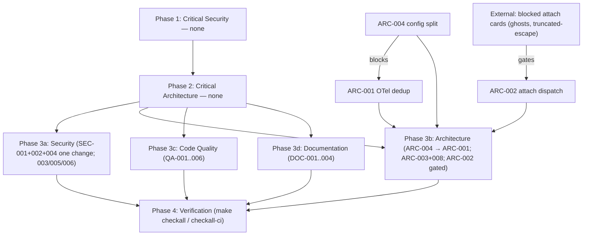

# Project Audit Report

> **Project**: par-term-emu-core-rust
> **Date**: 2026-11-06
> **Stack**: Rust (Cargo workspace: terminal core `crates/par-term-emu-core`, par-mux multiplexer `crates/par-mux`, root crate with PyO3 bindings / streaming server / C FFI), Python 3.12+ bindings (PyO3), TypeScript (Next.js web frontend, agent extensions)
> **Audited by**: Claude Code Audit System (HEAD `b1e970c4`, clean tree)
> **Board tag**: every finding below is filed on the kanban board tagged `audit-2026-11-06`

---

## Executive Summary

The project is in strong health: zero critical findings across all four domains, an unusually dense gate system (`make checkall` runs ~25 fail-fast legs including doc-sync and surface-freeze checks), zero TODO/FIXME debt in ~275K lines of Rust, and a security posture rated strong with exemplary par-mux IPC hygiene. The two high-severity findings share a theme — the repo's proven anti-drift discipline (shared code, template + check gate) has not been applied to two places that need it most: the OpenTelemetry metrics layer is hand-duplicated across the streamer and par-mux (~1,100 near-clone lines, drift already visible), and the attach-client input dispatch concentrates the workspace's highest complexity (cyclomatic 63/44/42) on its highest-churn code, the exact function class that already produced one shipped key-handling bug. Estimated effort to clear the two high and seven medium findings is roughly one to two weeks of agent work; the fifteen low findings are hardening and hygiene.

### Issue Count by Severity

| Severity | Architecture | Security | Code Quality | Documentation | Total |
|----------|:-----------:|:--------:|:------------:|:-------------:|:-----:|
| 🔴 Critical | 0 | 0 | 0 | 0 | **0** |
| 🟠 High     | 2 | 0 | 0 | 0 | **2** |
| 🟡 Medium   | 2 | 2 | 3 | 0 | **7** |
| 🔵 Low      | 4 | 4 | 3 | 4 | **15** |
| **Total**   | **8** | **6** | **6** | **4** | **24** |

Three findings were reported by two domains each and merged at dedup: ARC-001 (architecture + code quality), ARC-002 (architecture + code quality), ARC-004 (architecture + code quality). The 27 raw agent findings therefore resolve to 24 issues.

---

## 🔴 Critical Issues (Resolve Immediately)

None found. No correctness bug, resource leak, security hole, or structural defect rose to this level in any domain.

---

## 🟠 High Priority Issues

### [ARC-001] OpenTelemetry metrics layer duplicated across streamer and par-mux (~1,100 lines of near-clones)
- **Area**: Architecture (+ Code Quality; merges the code-quality agent's OTel finding)
- **Location**: `src/streaming/metrics.rs` (109 lines), `src/streaming/metrics/otel.rs` (467 lines), `crates/par-mux/src/mux/metrics.rs` (109 lines), `crates/par-mux/src/mux/metrics/otel.rs` (446 lines)
- **Description**: The streamer and the mux daemon each carry a hand-maintained copy of the same OTel layer. `parse_otlp_headers` is byte-identical (`src/streaming/metrics.rs:66` = `crates/par-mux/src/mux/metrics.rs:66`); `OtelExporter::export` measures 0.997 similarity and `init()` 0.978. This is not generated code — no template or shared crate backs it. Drift has already begun: the streaming copy carries a header-parsing unit test the par-mux copy lacks, while par-mux alone gained `OtelProtocol::parse`. Both manifests' comments admit the coupling ("patterned on the streamer's kanban-01a18331") but nothing shares the code.
- **Impact**: Every bug fix or instrument change must be applied twice and will eventually be applied once. ARC-002 in the project decision record documented this exact failure mode for the VS Code extension forks (fixed twice in two hand-maintained TS copies, then cured by template generation); this is the same disease in production Rust code with no cure applied.
- **Remedy**: Extract the shared layer into `par-term-emu-core` behind an `otel` feature (both consumers already depend on core and have feature-forwarding infrastructure), or into a micro-crate. Keep per-binary env gates (`PAR_TERM_STREAMER_OTEL_ENABLED` / `PAR_MUX_OTEL_ENABLED`) and instrument lists as thin per-binary config. Extend the existing `cargo tree -d` single-otel-tree check into `checkall` as the drift gate.
- **Estimate**: L

### [ARC-002] Attach-client input dispatch concentrates maximum complexity on the highest-churn code
- **Area**: Architecture (+ Code Quality; merges the code-quality agent's QA-001)
- **Location**: `crates/par-mux/src/mux/attach/input.rs:540` (`csi_key`, complexity 63), `crates/par-mux/src/mux/attach/render/input_route.rs:613` (`route_mouse`, complexity 44; the single most-churned production function in the repo) and `mouse_hit` (complexity 23, churn 222 events/14d), `crates/par-mux/src/mux/attach/render/modal.rs:341` (`copy_mode_char`, complexity 42); the wider god-file set is `attach/render/mod.rs` (2,315 lines, 152 symbols), `attach/render/session.rs` (1,519 lines), `attach/input.rs` (1,448 lines)
- **Description**: `csi_key` hand-unrolls what are linear codepoint maps as nested match arms (kitty F-keys `57376..=57387` and `57426..=57435` both map arithmetically; the `~`-final arm is near-linear with gaps). `route_mouse` is a single decision tree spanning every popup/menu state. Project memory records a shipped bug caused exactly by a missing arm in this function class (`csi_key` had no CSI-u arm, dropping Shift+Enter).
- **Impact**: Every new key or mouse dialect means hand-editing a 60+-arm match; the omission-bug class already happened once, and the churn numbers say this is where every change lands. Regression probability is highest exactly where change frequency is highest, and agent edits into these large files carry the known long-payload corruption risk.
- **Remedy**: Replace the two kitty codepoint ranges with arithmetic mapping or `const` lookup tables; convert the `~`-final arm to a small table; split `route_mouse` into per-modal-state handlers so each decision tree stays under ~15 branches; move Selection/state types out of `render/mod.rs`. Re-run the mux_attach suites (`--features mux-bin,attach` — mux-bin alone false-greens) after the change.
- **Estimate**: L

---

## 🟡 Medium Priority Issues

### Architecture

### [ARC-003] No `[workspace.dependencies]`; shared dependency versions hand-repeated across three manifests
- **Location**: `Cargo.toml:58-152`, `crates/par-term-emu-core/Cargo.toml:21-66`, `crates/par-mux/Cargo.toml:31-113`
- **Description**: `log`, `serde`, `serde_json`, `uuid`, `base64`, `parking_lot`, `flate2`, `regex`, `unicode-width`, `libc`, `tempfile` each carry independent version strings in all three manifests. The opentelemetry 0.33 trio is pinned identically in root and par-mux with comments warning the pins "must move together" — enforced only by convention and a `cargo tree -d` eyeball check. The lockfile shows the cost: base64 0.22.1 and 0.23.1 both compile in.
- **Impact**: A shared-dependency bump touches up to three manifests and is silently tolerated until versions diverge past unification (exactly what happened with base64). Dependency versions are the one dimension of the version train left to manual repetition.
- **Remedy**: Hoist shared deps into `[workspace.dependencies]` with member references `workspace = true`; keep member-unique deps local. Land outside a release window (the version-train legs read the same manifests).
- **Estimate**: S

### [ARC-004] `mux/config.rs` is a 3,433-line config monolith
- **Area**: Architecture (+ Code Quality; merges the code-quality agent's config.rs god-file finding)
- **Location**: `crates/par-mux/src/mux/config.rs` (91 symbols, 17+ types, three separate `Default` impl regions, fan-in 40; churn hotspots `reload_client_chords` 17 complexity/187 events, `reload_report` 24/120)
- **Description**: Daemon `[daemon]` config, client/TUI `[client]` settings, TOML parsing/merging, reload reporting, client chords, sound settings, and management policy live in one file — the largest non-generated Rust source in the workspace.
- **Impact**: Guaranteed merge contention for parallel sessions touching par-mux settings; every settings-dialog addition (a standing project rule) lands here.
- **Remedy**: Split along the existing type seams into a `config/` directory (daemon / client / chords / reload), mirroring the themed-file decomposition already applied to `terminal/` and `attach/render/`.
- **Estimate**: M

### Security

### [SEC-001] Cleartext credential transport accepted on non-loopback binds with no TLS
- **Location**: `src/bin/streaming_server/main.rs:553` (`warn_if_unauthenticated`), `src/streaming/config.rs` (`tls: Option<TlsConfig>`, never required)
- **Description**: The unauthenticated-bind warning fires only when no auth is configured. When an operator sets `--api-key` or `--http-user/--http-password` but leaves TLS off (the default), credentials cross the network in base64 cleartext on every request (CWE-319 / OWASP A02).
- **Impact**: `par-term-streamer --host 0.0.0.0 --api-key xyz` on a LAN host lets any network observer capture the API key from the WS handshake and get full interactive-shell access over the PTY.
- **Remedy**: In `main.rs` startup validation, warn loudly (or refuse without an explicit `--allow-cleartext-auth` override) when auth is configured, TLS is off, and the host is non-loopback.
- **Estimate**: S

### [SEC-002] Unauthenticated non-loopback bind of an interactive shell is warn-only, not opt-in
- **Location**: `src/bin/streaming_server/main.rs:553-571`
- **Description**: Binding a non-loopback interface with no auth exposes a full PTY shell to anyone who can reach the port; the server prints the SEC-002 banner and serves anyway (CWE-16 / OWASP A05). Default host is loopback, so exposure requires operator action — but for the highest-stakes misconfiguration this server has, "warn and run" is weak where the analogous `allow_pane_create` is fail-closed and opt-in.
- **Impact**: A fat-fingered `--host 0.0.0.0` from a copied systemd unit, or a warning scrolled past in container logs, leaves an internet-reachable unauthenticated shell.
- **Remedy**: Refuse to start when non-loopback and unauthenticated unless an explicit flag (e.g. `--allow-unauthenticated`) is passed; keep the banner for the explicit case.
- **Estimate**: S

### Code Quality

### [QA-001] Reconnect backoff policy duplicated between the two streaming watchers
- **Location**: `src/streaming/roster_watcher.rs:37-47,162-167` and `src/streaming/tree_watcher.rs:48-53,122-126`
- **Description**: Byte-identical copies of `BACKOFF_INITIAL` (100ms), `BACKOFF_MAX` (5s), `BACKOFF_STABLE` (30s) and an identical `next_backoff` body in both files. The tree watcher's doc comment claims the policy is "shared with the roster watcher" while actually being a second copy.
- **Impact**: A tuning change to one watcher silently leaves the other on the old redial policy; the comment actively misleads the next editor.
- **Remedy**: Hoist the constants and `next_backoff` into one `pub(super)` `watcher_common.rs` module and import from both.
- **Estimate**: S

### [QA-002] The two agent-state TypeScript extensions are hand-maintained duplicates
- **Location**: `crates/par-mux/integrations/extensions/par-mux-agent-state.ts` and `par-mux-omp-agent-state.ts` (both `include_str!`-embedded via `crates/par-mux/src/mux/integrations/extensions.rs:27-31`)
- **Description**: Verified NOT template-generated (unlike the VS Code extensions). parsight exact-match groups show `sendRequestAttempt`, `drainStateQueue`, `sendRequestNow`, `updateSessionRef` byte-identical; `reportSession`, `sendState`, `releaseAgent` at 0.98-0.99 similarity.
- **Impact**: Any fix to the queue-drain or request logic must be applied twice; drift means one installed integration behaves differently from the other.
- **Remedy**: Extract shared logic into one base module the two thin entry files import at build time (a concat step in the installer, since both ship as single self-contained `.ts` assets), or generate both from one template in `integrations/`.
- **Estimate**: M

### [QA-003] Screenshot rendering holds the GIL for the full render
- **Location**: `src/python_bindings/common.rs:2577` (`screenshot`) and `:2706` (`screenshot_to_file`); zero `py.detach` calls in the file
- **Description**: The PyO3 bindings release the GIL on blocking PTY I/O (`py.detach` at `src/python_bindings/pty.rs:155,524,560,892`) but not around screenshot rendering, which can process an entire grid plus scrollback into a PNG.
- **Impact**: Any Python thread (event loop, UI timer) stalls for the duration of every screenshot call on large terminals.
- **Remedy**: Wrap the render + encode section in `py.detach` like the pty write paths; no `Python` object is touched inside. Method bodies only — the ARC-001 api-surface baselines are unaffected, but the full `make checkall` gate must pass.
- **Estimate**: S

---

## 🔵 Low Priority / Improvements

### Architecture

### [ARC-005] Flat frozen Python surface is a strategic watch item, not a defect
- **Location**: `python/par_term_emu_core_rust/_native.pyi` (10,272 lines), `src/lib.rs:156-178` (legacy `#[doc(hidden)]` Py* re-exports)
- **Description**: The flat `Terminal` class is frozen by baseline gates (ARC-001 policy) with a documented per-area-pyclass migration direction already in use (`ScreenshotConfig`, `StreamingConfig`).
- **Remedy**: Continue the documented pattern; opportunistically lift method clusters (clipboard, bookmarks) into their own pyclasses when next touched.
- **Estimate**: S

### [ARC-006] Root `tests/` mixes Python and Rust suites in one directory
- **Location**: `tests/` (`test_capability.py` beside `test_coprocess.rs`, `test_flag_emoji.rs`, `ffi_dirty_ranges_alloc.rs`)
- **Description**: Works mechanically (pytest and cargo filter by extension) but runner expectations are not obvious from the layout.
- **Remedy**: Document the convention in the TESTING docs, or move root Rust integration tests under `tests/rust/`.
- **Estimate**: S

### [ARC-007] Built frontend output partially tracked in git; drift check is dispatch-only
- **Location**: `web_term/` (32 tracked files), `.github/workflows/ci.yml`
- **Description**: Next.js build output is committed so the streamer can serve it, but the "web-term-drift" check runs only on manual `workflow_dispatch`, not PRs. A frontend edit without `make web-build-static` ships stale assets until the next manual dispatch.
- **Remedy**: Promote the drift check to a required PR leg (it is a cheap hash compare), or untrack `web_term/` and ship it only through the sha2-verified release artifact path (SEC-203) that already exists.
- **Estimate**: S

### [ARC-008] MSRV is a moving target (`rust-version = "1.99"`) with no stated policy
- **Location**: `Cargo.toml:12`, `crates/par-term-emu-core/Cargo.toml:8`, `crates/par-mux/Cargo.toml:8`
- **Description**: 1.99 matches the current toolchain, but for a published library this requires every crates.io consumer to run the newest stable while edition stays 2021 — it reads as "MSRV tracks the maintainer's toolchain", not a support policy.
- **Remedy**: State the policy in CONTRIBUTING.md (e.g. "MSRV tracks latest stable at each release cut"), or lower it to the oldest toolchain CI actually exercises.
- **Estimate**: S

### Security

### [SEC-003] Weak htpasswd hash formats accepted without a load-time warning
- **Location**: `src/streaming/auth_hash.rs:126-197` (`verify_md5_crypt`, `verify_sha1_apache`, `verify_htpasswd_hash`)
- **Description**: Supporting apr1/md5crypt and `{SHA}` is deliberate compatibility, but these are fast hashes — brute-forceable if the password file leaks. Nothing warns the operator at startup (CWE-916).
- **Remedy**: On loading an entry whose hash is `$apr1$`/`{SHA}`/`$1$`, log a warning recommending bcrypt; document in the streamer help.
- **Estimate**: S

### [SEC-004] Cleartext secrets on the CLI command line
- **Location**: `src/bin/streaming_server/main.rs` (arg docs at lines 41-60; masked print at 690 is correct)
- **Description**: `--api-key <secret>` and `--http-password secret` are the documented primary forms; both are readable in `ps`/shell history for the server's lifetime (CWE-214). The safer forms exist (`--http-password-file` with 0600 check, hash forms) — a prominence gap, not a missing control.
- **Remedy**: Reorder help text to present the file/env forms first; note the `ps` exposure next to the clear-text flags. Bundle with the SEC-001/SEC-002 startup-validation change in `main.rs`.
- **Estimate**: S

### [SEC-005] `allow_api_key_in_query` places credentials in URLs
- **Location**: `src/streaming/server/mod.rs:666-668`
- **Description**: Query-string keys leak into browser history and intermediary logs (CWE-598). It is opt-in and startup-warned, so acceptable as documented.
- **Remedy**: None required; consider logging the warning once per session rather than per connection.
- **Estimate**: S

### [SEC-006] Frontend archive extraction unpacks non-regular entries; checksum binds to the same release
- **Location**: `src/bin/streaming_server/frontend_download.rs:307-311` (`archive.unpack(web_root_path)`)
- **Description**: The pipeline is otherwise solid (repo-pinned HTTPS URL, size caps SEC-007, SHA-256 verification SEC-203), but the `.sha256` sidecar comes from the same release it attests, so a compromised release yields arbitrary writes via symlink/hardlink entries that `Archive::unpack` honors (CWE-494 + CWE-59). Tar's entry-name sanitization covers the main historical `../` vector.
- **Remedy**: Replace `unpack` with a per-entry loop extracting regular files only, rejecting/ignoring symlink, hardlink, and directory-link entries.
- **Estimate**: S

### Code Quality

### [QA-004] One genuinely uncalled public method; parsight dead-code list otherwise false positives
- **Location**: `crates/par-mux/src/mux/pane.rs:807` (`MuxPane::resize_with_cell_pixels`, zero workspace call sites; `tree/layout_ops.rs:659` implements the equivalent logic itself)
- **Description**: `save_to_with_origin` (`crates/par-mux/src/mux/persist/save.rs:498`) also has no callers but is a deliberate `#[deprecated since 0.58.1]` window pointing at `save_off_lock` (ARC-119) — correctly managed. All other parsight dead-code rows checked (`write_line`, `server::dispatch`, `CompiledCond::is_vacuous`, `MuxPane::input_handle`, `MuxPane::resize_deferred`, `reply_is_error`) have real call sites or dispatch/feature-gate callers.
- **Remedy**: Verify the `par-term` external consumer (MuxPane is pub in the published rlib) before removing `resize_with_cell_pixels`; if unused there, delete it and lower any affected baseline.
- **Estimate**: S

### [QA-005] Same predicate name, different semantics in two modules
- **Location**: `crates/par-mux/src/mux/server/protocol.rs:97` (checks `%error` line prefix) vs `crates/par-mux/src/mux/hooks/mod.rs:464` (checks JSON `error` key)
- **Description**: Not duplication (verified different reply formats), but the shared name `reply_is_error` invites a wrong-file edit.
- **Remedy**: Rename the hooks one to `json_reply_is_error`.
- **Estimate**: S

### [QA-006] `MuxClient::send` returns Ok on daemon error replies
- **Location**: `crates/par-mux/src/mux/client.rs` (control-socket send path)
- **Description**: Error signaling rides in the reply payload rather than the `Result`, a documented sharp edge tests compensate for.
- **Remedy**: If the API surface allows, add a `send_checked`-style variant as the recommended path (a bounded variant already exists internally in the tree watcher); keep the tmux-compatible default.
- **Estimate**: S

### Documentation

### [DOC-001] Single undocumented public function in the core crate
- **Location**: `crates/par-term-emu-core/src/pty_session/io.rs:24` (`pub fn write`)
- **Description**: Core crate has 1099/1100 public functions documented; `write` is the only gap. Python bindings are 27/27; `_native.pyi` coverage is gate-enforced by `stub-docs-check`.
- **Remedy**: Add a one-paragraph doc comment (Args/Returns style matching siblings). Optionally extend `rustdoc-check` toward `missing_docs` for the core member so the gap cannot reappear.
- **Estimate**: S

### [DOC-002] `MUX_FEATURE_MATRIX.md` is orphaned and frozen at a stale version
- **Location**: `MUX_FEATURE_MATRIX.md` (repo root; 278 lines recorded 2026-10-19 against par-mux 0.62.0, now eight releases behind)
- **Description**: Referenced from nowhere (not in README's Documentation list, `docs/README.md` index, `docs/MUX.md`, or CLAUDE.md). Root-level placement makes a point-in-time record look like maintained current-state documentation.
- **Remedy**: Move into a docs archive dir and add one line to `docs/README.md` "Archives", or keep at root with a "snapshot as of 0.62.0" status line plus an index link. Moving out of the root is the lower-drift option.
- **Estimate**: S

### [DOC-003] README "What's New" scope note does not match the section's actual span
- **Location**: `README.md:36-37` (note), section lines 39-67
- **Description**: The note promises "unreleased work on main and the last three releases" but the section carries fourteen releases (0.63.0 through 0.79.0). Content is accurate; only the promise is wrong.
- **Remedy**: Trim the section to the promised window (older paragraphs' detail already lives in CHANGELOG.md) or correct the note to describe the actual span.
- **Estimate**: S

### [DOC-004] No CI/build status badge on the README
- **Location**: `README.md:3-10` (badge block)
- **Description**: PyPI/crates.io/downloads/platform/license badges present, no GitHub Actions badge, although `ci.yml`/`deployment.yml` run. The style guide's README template lists build status among expected badges.
- **Remedy**: Add a GitHub Actions badge for the main CI workflow to the badge row.
- **Estimate**: S

---

## Detailed Findings

### Architecture & Design
**Verdict: Good.** Guardrail density is unusually high and effective; the gaps are one real duplication (ARC-001) and oversized files (ARC-002/004), all in otherwise actively gated code.
- The ARC-007 workspace split is a model refactor: zero public-path breaks, an invariants section with verification (stub identity, test-count preservation), an explicit dependency DAG, and a doc-hidden promotion baseline gate.
- Drift is gated everywhere it matters: `checkall` runs ~25 fail-fast legs (api-surface, terminal-fields, doc-hidden, version-train self-test, completions, ffi-header/surface, stub-check which verified 516 documented signatures during the audit). Generated surfaces cannot silently rot.
- The derive crate (`ProtoConvert`, `PyDictConvert`, `pyo3_get_all`) eliminates per-field conversion boilerplate across protobuf, Python-dict, and pyclass layers, with golden wire-byte tests.
- Feature architecture is deliberate: true headless `sim` profile with a `compile_error!` misuse guard, double-gated OTel, `mux_feature_isolation.rs`, `check_features.sh` asserting the zero-feature member build.
- Concurrency design is honest: the single `Arc<RwLock<Terminal>>` ceiling is documented as accepted in DESIGN.md with real mitigations (`UpdateWaiter` generation counter, `TextExportSnapshot`); EventBroker unifies queued polling and push observers.
- A candidate finding (VS Code extension TS duplication) was verified and dropped: those files are template-generated by `scripts/gen_extensions.py` with an `extensions-check` gate.

### Security Assessment
**Verdict: Strong.** The two medium findings are operator-misconfiguration states the code warns about but does not prevent (SEC-001/002); the four lows are hardening.
- par-mux IPC is exemplary: socket 0600, socket dir 0700, per-connection peer-credential checks failing closed on Unix (`euid_matches` treats None as foreign) and Windows (token-SID comparison refusing every lookup error), repeat-offender sleep bounding the accept loop.
- Upload pipeline: filenames sanitized to bare names, spool files 0600 in a 0700 directory, size/concurrency/age caps.
- self-update is fail-closed end to end: HTTPS-only with `--proto-redir =https`, download caps, checksum-required with missing-sidecar refusal, staged install with rollback.
- Auth plumbing uses `subtle` constant-time compares and `zeroize`; bcrypt recommended; unmaintained deps replaced with documented RUSTSEC rationale.
- TLS key material permission-checked (0600 required); rustls, no OpenSSL.
- WS hardening: 10s pre-auth handshake timeout, frame size caps, per-client rate limiter, Origin allowlist, default-deny CORS, CSP + anti-framing headers.
- Fail-closed capability gates (`allow_pane_create`, `kitty_file_media`, `csp_allow_blob_connect`); graphics decoders bounded (`GraphicsLimits` 25MP cap + `image::Limits`); nine cargo-fuzz targets covering every untrusted-input parser; C FFI null-checked with SAFETY comments on all 270 unsafe sites; no committed secrets; dependencies current (rustls 0.23.46, tokio-tungstenite 0.29, bcrypt 0.19.3, image 0.25.10, Next 16.4.3, React 19.3.1); docs/SECURITY.md (1,508 lines) matches the code.

### Code Quality
**Verdict: Good.** Estimated debt is low-moderate, concentrated in the attach-TUI subsystem and config.rs rather than spread through the codebase.
- Zero real TODO/FIXME markers in ~275K lines of Rust (4 grep hits are test-input characters). 42 `#[allow(...)]` sites all carry `reason =` strings or are covered by the documented policy at `src/lib.rs:63`.
- Test coverage: 4,596 `#[test]` + 119 `#[tokio::test]` functions across Rust, 684 Python tests across 45 files, 8 integration suites in `crates/par-mux/tests/`. Estimated coverage >70%. The 235 `#[ignore]` tests are all labeled load-sensitive with an explicit runbook (`make test-rust-sensitive`; `checkall-ci` runs them via nextest `include-ignored`) — documented policy, not skipped coverage.
- Test quality is high: behavioral naming, exact-state assertions, semantic comments explaining terminal quirks, wire-golden fixtures, wait helpers with proven pre-fix failures.
- No module-level untested areas: zero-in-file-test files (e.g. `attach/render/input_route.rs`, `tmux_control/parser.rs`) are covered by sibling test directories and integration suites.
- Production error handling is disciplined: invariant `expect`s carry justification strings, `From<DomainError> for PyErr` is centralized, blocking PTY paths release the GIL, deprecated APIs carry directed replacements.
- Files >500 lines: 13 production files led by `mux/config.rs` (3,433), `streaming/protocol.rs` (3,071, largely derived code), `python_bindings/common.rs` (2,860), `src/ffi.rs` (2,467), `attach/render/mod.rs` (2,315). The parsight god-object list also flags the generated completion script — generated output, not a defect.

### Documentation Review
**Verdict: Excellent.** No gap meaningfully blocks onboarding or causes incorrect usage.
- Documentation freshness is mechanically enforced: `mux-docs-check` (every control verb and clap flag must appear in docs/MUX.md), `mux-schema-check`, `env-docs-check` (54 env-var reads verified), `stub-docs-check`, `ffi-header-check`/`ffi-surface-check` (both directions), `api-surface-check`/`terminal-fields-check`, `doc-links-check`, `rustdoc-check`, `caps-table-check`, `completions-check`, `pinned-tests-check`.
- README quick-start examples actually execute (smoke-tested against the built extension, including `screenshot_to_file` to a real PNG).
- parsight's repo-wide broken-link scan returned only five rows, none a real defect (style-guide generic examples and runtime user-machine paths).
- Version claims consistent everywhere checked (Rust 1.99+/Python 3.12+ in README, QUICKSTART, docs/BUILDING.md, manifests; "39 example scripts" exactly right).
- `docs/README.md` is a complete task-oriented index that disclaims the archive directories; the only genuinely orphaned doc is `MUX_FEATURE_MATRIX.md` at the root (DOC-002).
- Changelog: Keep-a-Changelog format, standing empty `[Unreleased]` heading, breaking changes flagged in changelog and README, entries cite cards/commits/files/pinning tests.

---

## Remediation Roadmap

### Immediate Actions (Before Next Deployment)
1. SEC-001 + SEC-002 (+ SEC-004 bundled): the streamer should refuse (or loudly gate behind an explicit flag) an unauthenticated non-loopback bind and warn-and-refuse-or-flag cleartext auth transport. One sequenced change in `main.rs` startup validation.

### Short-term (Next 1–2 Sprints)
1. ARC-004 first (config.rs split), then ARC-001 (OTel extraction) — ARC-001's mux-side wiring runs through `reload_report` in config.rs; land the split before the move.
2. ARC-003 (`[workspace.dependencies]` hoist) — outside a release window.
3. ARC-002 (attach dispatch de-complexification) — gated on the two blocked attach cards: sequence after the truncated-escape card's recording artifact closes and coordinate with the stale-frame ghosts card (same subsystem).
4. QA-001 (backoff dedup), QA-002 (TS extension dedup), QA-003 (GIL release around screenshots) — all small, independent.

### Long-term (Backlog)
1. All Low findings: ARC-005..008, SEC-003..006, QA-004..006, DOC-001..004.

---

## Positive Highlights
1. Gate discipline is exceptional: ~25 fail-fast legs in `make checkall` including a dozen doc-sync gates; documentation freshness, API surface freezes, and version trains are mechanically enforced rather than aspirational.
2. Zero TODO/FIXME debt and zero real dead code at scale; the one true zero-caller public method (QA-004) is an outlier, not a pattern.
3. par-mux IPC security is exemplary (0600 socket, 0700 dir, fail-closed peer credentials on both platforms, accept-loop spin bounding).
4. Fail-closed design culture: `allow_pane_create` and friends default off with pinning tests; self-update is checksum-required with staged rollback; TLS keys permission-checked.
5. Load-sensitive tests are explicitly labeled and separately gated (`make test-rust-sensitive`, nextest `include-ignored` in CI parity) instead of being silently flaky.
6. Themed-file decomposition (ARC-003 pattern) is consistently applied across `terminal/sequences/`, `pty_session/`, `attach/render/`, and `mux/server/` — the codebase is actively kept under control architecturally.
7. Documentation examples actually execute: the docs agent smoke-tested the README quick-start against the built extension, all clean.
8. Nine cargo-fuzz targets cover every untrusted-input parser; `deny.toml`, deps-audit workflow, SHA-pinned CI actions, and documented RUSTSEC exclusion rationale round out strong supply-chain hygiene.

---

## Audit Confidence

| Area | Files Reviewed | Confidence |
|------|---------------|-----------|
| Architecture | ~40 (full parsight graph, all 3 manifests, DESIGN.md, Makefile, CI) | High |
| Security | ~30 (IPC, PTY, streaming/auth/TLS, FFI, graphics decoders, fuzz, manifests) | High |
| Code Quality | ~35 (parsight analytics + manual verification of every dead-code lead) | High |
| Documentation | ~25 (all docs/ files, README, CHANGELOG, pyi, docstring sampling) | High |

All four agents verified candidate findings against source before reporting (three plausible findings dissolved on inspection and were dropped).

---

## Remediation Plan

> This section is generated by the audit and consumed directly by `/fix-audit`.
> It pre-computes phase assignments and file conflicts so the fix orchestrator
> can proceed without re-analyzing the codebase.

### Phase Assignments

#### Phase 1 — Critical Security (Sequential, Blocking)
None. No critical security findings this cycle.

#### Phase 2 — Critical Architecture (Sequential, Blocking)
None. No critical architecture findings this cycle. The ARC-004 → ARC-001 sequencing dependency is enforced inside Phase 3b below.

#### Phase 3 — Parallel Execution

**3a — Security (remaining)**
| ID | Title | File(s) | Severity |
|----|-------|---------|----------|
| SEC-001 | Cleartext credential transport on non-loopback no-TLS binds | `src/bin/streaming_server/main.rs`, `src/streaming/config.rs` | Medium |
| SEC-002 | Unauthenticated non-loopback shell bind is warn-only | `src/bin/streaming_server/main.rs` | Medium |
| SEC-004 | Cleartext CLI secrets prominence in help text | `src/bin/streaming_server/main.rs` | Low |
| SEC-003 | Weak htpasswd hash formats lack load-time warning | `src/streaming/auth_hash.rs` | Low |
| SEC-005 | api-key-in-query per-connection logging | `src/streaming/server/mod.rs` | Low |
| SEC-006 | Archive unpack accepts non-regular entries | `src/bin/streaming_server/frontend_download.rs` | Low |

SEC-001, SEC-002, SEC-004 are one sequenced change to `main.rs` startup validation/help — implement as a single unit.

**3b — Architecture (remaining)**
| ID | Title | File(s) | Severity | Order |
|----|-------|---------|----------|-------|
| ARC-004 | Split mux/config.rs (3,433 lines) | `crates/par-mux/src/mux/config.rs` | Medium | 1st |
| ARC-001 | Deduplicate OTel metrics layer (~1,100 lines) | `src/streaming/metrics.rs`, `src/streaming/metrics/otel.rs`, `crates/par-mux/src/mux/metrics.rs`, `crates/par-mux/src/mux/metrics/otel.rs` | High | 2nd (after ARC-004) |
| ARC-003 | Hoist `[workspace.dependencies]` | all three `Cargo.toml` manifests | Medium | 3rd (outside release windows) |
| ARC-002 | De-complexify attach input dispatch + god files | `crates/par-mux/src/mux/attach/input.rs`, `attach/render/input_route.rs`, `attach/render/modal.rs`, `attach/render/mod.rs`, `attach/render/session.rs` | High | gated on external cards |
| ARC-005 | Python surface migration (watch item) | `python/par_term_emu_core_rust/_native.pyi`, `src/lib.rs` | Low | opportunistic |
| ARC-006 | Document/move root tests/ layout | `tests/` | Low | any |
| ARC-007 | web_term drift check on PRs (or untrack) | `.github/workflows/ci.yml`, `web_term/` | Low | any |
| ARC-008 | State MSRV policy | all three `Cargo.toml`, `CONTRIBUTING.md` | Low | with ARC-003 |

**3c — Code Quality (all)**
| ID | Title | File(s) | Severity |
|----|-------|---------|----------|
| QA-001 | Dedupe watcher reconnect backoff | `src/streaming/roster_watcher.rs`, `src/streaming/tree_watcher.rs` | Medium |
| QA-002 | Dedupe agent-state TS extensions | `crates/par-mux/integrations/extensions/par-mux-agent-state.ts`, `par-mux-omp-agent-state.ts`, `src/mux/integrations/extensions.rs` | Medium |
| QA-003 | Release GIL around screenshot render | `src/python_bindings/common.rs` | Medium |
| QA-004 | Verify+remove resize_with_cell_pixels if unused upstream | `crates/par-mux/src/mux/pane.rs` | Low |
| QA-005 | Rename hooks reply_is_error to json_reply_is_error | `crates/par-mux/src/mux/hooks/mod.rs` | Low |
| QA-006 | Add send_checked variant to MuxClient | `crates/par-mux/src/mux/client.rs` | Low |

**3d — Documentation (all)**
| ID | Title | File(s) | Severity |
|----|-------|---------|----------|
| DOC-001 | Document PtySession::write | `crates/par-term-emu-core/src/pty_session/io.rs` | Low |
| DOC-002 | Archive/label MUX_FEATURE_MATRIX.md | `MUX_FEATURE_MATRIX.md`, `docs/README.md` | Low |
| DOC-003 | Fix README What's New scope note | `README.md` | Low |
| DOC-004 | Add CI badge to README | `README.md` | Low |

### File Conflict Map

| File | Domains | Issues | Risk |
|------|---------|--------|------|
| `src/bin/streaming_server/main.rs` | Security (3 issues) | SEC-001, SEC-002, SEC-004 | One sequenced change |
| `Cargo.toml` (all three manifests) | Architecture (2 issues) | ARC-003, ARC-008 | Land ARC-008 together with ARC-003 |
| `README.md` | Documentation (2 issues) | DOC-003, DOC-004 | Read before edit; trivial |
| `crates/par-mux/src/mux/config.rs` | Architecture + Code Quality | merged into ARC-004 | Resolved by merge — single issue |
| `src/streaming/metrics*.rs`, `crates/par-mux/src/mux/metrics*.rs` | Architecture + Code Quality | merged into ARC-001 | Resolved by merge — single issue |
| `crates/par-mux/src/mux/attach/{input.rs, render/input_route.rs, render/modal.rs}` | Architecture + Code Quality | merged into ARC-002 | Resolved by merge — single issue |

### Blocking Relationships
- ARC-004 → ARC-001: the metrics dedup moves code wired into `reload_report` in config.rs; split config.rs first to avoid a mid-refactor move (code-quality agent's note).
- External card `01a1a556b675` (truncated escape sequences under burst) → ARC-002: `csi_key` is that fix's site; land ARC-002's input.rs work only after that card's recording artifact closes it.
- External card `01a189b5ca17` (stale-frame ghost fragments) shares the `attach/render` subsystem with ARC-002 — coordinate, do not interleave.
- ARC-003 → release-cut work: land the manifest hoist outside a release window; `scripts/set_version_train.py`, `core-version-check`, and CI version legs read the same manifests; rerun the version legs after.
- ARC-001 → any future point fix in the four metrics files: fixes applied to either copy before the extraction get redone or lost in consolidation.
- SEC-001 + SEC-002 + SEC-004: same file (`main.rs`), one sequenced change; any Code Quality pass on `main.rs` runs after.
- QA-003: method bodies only (api-surface baselines unaffected) but the full `make checkall` gate must pass before claiming done.

### Dependency Diagram

