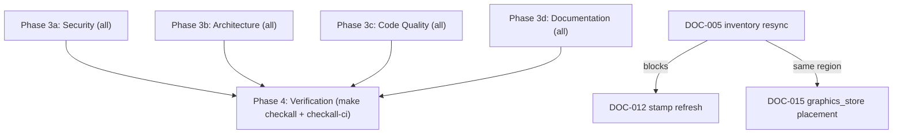

# Project Audit Report

> **Project**: par-term-emu-core-rust (v0.79.0, HEAD `01392a55`)
> **Date**: 2026-11-06 (evening Opus re-audit, post-remediation)
> **Stack**: Rust workspace (par-term-emu-core + par-mux + root), Python 3.12+ via PyO3, TypeScript (Next.js web terminal, shipped agent-state extensions), C FFI
> **Audited by**: Claude Code Audit System — Opus 5 deep audit (`/opus-audit`)

This is a re-audit of the tree **after** this morning's `audit-2026-11-06` remediation
(19 fixed, 2 stale, 1 deferred). Board tag for this cycle: `audit-2026-11-06-opus`.

---

## Executive Summary

The post-remediation tree is in good shape: no Critical findings in any domain, the
version train and drift-gate ecosystem verified clean, and zero verified dead code in a
282K-line workspace. The most serious new finding is a memory-retention bug in the iTerm2
OSC 1337 file-transfer path (SEC-001, orchestrator-verified): untrusted PTY output can
orphan in-progress transfers that no cap or sweep ever reclaims, up to 50 MiB each. The
attach client's `WindowSession` orbit remains the dominant structural concern — new
evidence extends the known ARC-002 backlog card from three hot functions to the type
boundary itself (40+ fields, 23 impl blocks across 19 files). Documentation is gate-enforced
and near-perfect structurally, but carries two runtime-false claims in API_REFERENCE.md.
Estimated effort for the top issues: SEC-001 is a two-file additive fix (S); the three High
code-quality items are M–L each; the two High doc fixes are S each.

### Issue Count by Severity

| Severity | Architecture | Security | Code Quality | Documentation | Total |
|----------|:-----------:|:--------:|:------------:|:-------------:|:-----:|
| 🔴 Critical | 0 | 0 | 0 | 0 | **0** |
| 🟠 High     | 0 | 1 | 4 | 2 | **7** |
| 🟡 Medium   | 3 | 0 | 3 | 7 | **13** |
| 🔵 Low      | 2 | 3 | 4 | 14 | **23** |
| **Total**   | **5** | **4** | **11** | **23** | **43** |

Known-open items from prior cycles were excluded from these counts and are referenced,
not re-reported: the `[ARC-002]` de-complexify card (updated with new scope evidence by
QA-003 below), the two blocked attach-corruption cards, `[ARC-005]` pyclass migration
(watch), and the `--api-key-file` enhancement backlog card.

---

## 🔴 Critical Issues (Resolve Immediately)

None. The morning remediation cleared this tier; nothing in this pass rises to it.

---

## 🟠 High Priority Issues

### [SEC-001] Orphaned iTerm2 multipart file transfers retain unbounded memory
- **Area**: Security (CWE-400/CWE-770 uncontrolled resource consumption)
- **Location**: `crates/par-term-emu-core/src/terminal/graphics.rs:216-270` (`handle_multipart_file_start`), `crates/par-term-emu-core/src/terminal/file_transfer.rs:145` (`start_download`, no count cap), `:153-195` (`append_data` caps a single transfer at 50 MiB but never runs on an orphan), `:68-104` (only `completed_transfers` is bounded at 32)
- **Description**: Every `OSC 1337 ; MultipartFile=…` starts a `FileTransfer` in `active_transfers` and installs it as the terminal's `iterm_multipart_buffer`. A subsequent `MultipartFile` start silently replaces the buffer (`graphics.rs:262`) without failing or cancelling the previous transfer. The old `transfer_id` becomes unreachable — `FilePart` appends only to the *current* buffer — so nothing ever completes, fails, or evicts the orphaned entry. **Orchestrator-verified against source**: the buffer replacement drops only the buffer struct; the manager's HashMap entry and its accumulated `data` (up to 50 MiB each) plus `params` (up to the 1 MiB OSC cap) survive forever. This sits outside the 256 MiB evicting graphics-store budget that governs the analogous kitty path. (The inline-image branch is self-cleaning: replacing the buffer frees the old chunks.)
- **Impact**: A program whose output the terminal processes — including a remote host via ssh, which `docs/SECURITY.md` names as untrusted — pins ~50 MiB per restart cycle (or ~1 MiB per bare `MultipartFile` start with no FilePart at all), repeatable to OOM the par-mux daemon, streamer, or any Python embedder.
- **Remedy**: (1) In `handle_multipart_file_start`, when replacing a non-None `iterm_multipart_buffer` whose transfer is in progress, call `fail_transfer` on the old `transfer_id` first so it lands in the bounded completed ring. (2) Cap `active_transfers.len()` in `start_download` (fail-oldest), with a `/// cap:` constant so it joins the generated caps table in `docs/SECURITY.md` (pattern: `MAX_CONCURRENT_UPLOADS = 8`, `crates/par-mux/src/mux/uploads.rs:43`). (3) Regression test interleaving two MultipartFile starts asserting the first lands in `completed_transfers`.

### [QA-001] Upload verbs block a tokio worker thread, inconsistent with the module's own off-runtime discipline
- **Area**: Code Quality
- **Location**: `src/streaming/server/messages.rs:296,347,406,444` (verb handlers), `src/streaming/server/ws_session.rs:125,238` (call sites in async `run_ws_session`), blocking originates `src/streaming/mux_factory/upload.rs:99-198` (`std::sync::mpsc::Receiver::recv_timeout` + blocking socket writes for up to `reply_timeout`)
- **Description**: `handle_client_message` synchronously calls `handle_upload_begin/chunk/commit/abort`, each blocking a tokio worker for up to the reply deadline. The doc comment at `messages.rs:290-294` acknowledges the block and argues the blast radius — but the sibling path one call away deliberately offloads comparable blocking via `metadata_session_off_runtime().await` (`ws_session.rs:62`). Two blocking idioms coexist in one module with no stated rule.
- **Impact**: A slow or wedged par-mux daemon pins one tokio worker per uploading connection; several concurrent uploads measurably degrade all sessions on the runtime, not just the uploader.
- **Remedy**: Wrap the four upload verb bodies in `tokio::task::spawn_blocking` (the reply is already `Vec<ServerMessage>`, so the boundary is clean); state the rule in the module doc.

### [QA-002] Forked agent-state TypeScript extensions duplicate ~120 lines of retry/queue logic with no shared core
- **Area**: Code Quality
- **Location**: `crates/par-mux/integrations/extensions/par-mux-agent-state.ts` (367 lines) vs `par-mux-omp-agent-state.ts` (565 lines); byte-identical pairs at agent-state 27/32 (`sendRequestAttempt`), 250/256 (`drainStateQueue`), 65/70 (`sendRequestNow`), 133/138 (`updateSessionRef`); near-duplicates `reportSession`, `sendState`, `releaseAgent`
- **Description**: The omp extension was forked from the claude one; the shared machinery (request retry with backoff, state-queue draining, session-ref updating, agent release) was copy-pasted rather than extracted. Drift has already started (near-duplicates where exact ones used to be). These files ship to users' editors and have no test harness, so drift fails silently.
- **Impact**: Every fix to retry/backoff or queue-drain logic must be applied twice, and has not been.
- **Remedy**: Extract a shared `agent-state-core.ts` imported by both extensions, leaving only agent-specific field mapping in each fork. Each new feature widens the fork, so this should land before the next extension feature.

### [QA-003] `WindowSession` is a god type — 40+ mutable fields, 23 impl blocks across 19 files (extends the known ARC-002 card)
- **Area**: Code Quality (scope extension of board card `[ARC-002] De-complexify attach input dispatch and god files`)
- **Location**: `crates/par-mux/src/mux/attach/render/mod.rs:920` (struct), impls across `drag.rs`, `kitty.rs`, `modal*.rs`, `input_route.rs`, `navigate.rs`, `notify.rs`, `pending_cmd.rs`, `popup.rs`, `scrollback_edit.rs`, `sidebar.rs`, `session.rs`, `status_patch.rs`
- **Description**: Not re-reporting ARC-002's three functions (`csi_key` 63 at `input.rs:540`, `route_mouse` 44 at `input_route.rs:613`, `copy_mode_char` 42 at `modal.rs:341` — all confirmed still present). New evidence: parsight ranks `route_mouse` and `mouse_hit` (complexity 23, 226 edits in 14 days) as the top two real churn hotspots in the repo, both mutating one shared 40+-field context. The seed/status-inflight flag cluster (`status_dirty`, `status_snapshot_inflight`, `landing_reseed`, `seed_snapshot_inflight`, `seed_raced_panes`, `status_end` — `mod.rs:933-957`) is six hand-coordinated flags whose invariant lives only in comments — the shape that produced the mid-seed landing race already in project memory.
- **Impact**: Every cross-cutting attach change edits many sibling files against one mutable context; churn concentrates where complexity is highest.
- **Remedy**: When executing ARC-002's table-drive split, treat the **type boundary** as the split unit: fold the six seed/status flags into one `StatusInflight` sub-struct with an explicit state enum, and give input routing its own state instead of reaching into `WindowSession`. **Board action: update the existing ARC-002 card with this scope evidence rather than filing a duplicate.**

### [QA-011] Tab strip loses `tab-width-min`/`-max` on any width change (user-reported during synthesis)
- **Area**: Code Quality (defect; reported by Paul mid-audit, orchestrator root-caused)
- **Location**: `crates/par-mux/src/mux/attach/render/session.rs:1453-1459` (`draw_tab_strip` rebuild branch), `crates/par-mux/src/mux/attach/tabs.rs:466-479` (`TabStrip::new` defaults `bounds: TabBounds::default()` = 0/0)
- **Description**: When `geometry.host_cols` differs from the strip's recorded cols, `draw_tab_strip` replaces the whole `TabStrip` — preserving `palette` but not `bounds`. The configured tab width bounds reset to 0/0 until the next `apply_chords`. A daemon restart guarantees the cols transition (geometry re-set during the re-land), so `tab-width-min` reliably resets after every restart; any window resize triggers it too. The config file keeps the value (verified live: file holds `tab-width-min = 12` while the TUI shows 0), which is why re-entering the value in the settings dialog appears to fix it.
- **Impact**: User-facing: the tab-strip min-width floor silently disappears after daemon restarts/resizes; the settings dialog reports 0 for a setting the file still holds.
- **Remedy**: In the rebuild branch, carry `bounds` across exactly like `palette`. Regression test: set bounds, drive a width change through `draw_tab_strip`, assert bounds survive.

### [DOC-001] `delete_image` / `get_image_by_id` documented with wrong parameter type
- **Area**: Documentation
- **Location**: `docs/API_REFERENCE.md:705,708` (says `id: int`); source of truth `src/python_bindings/terminal/image_api.rs:129,161` (`id: &str`)
- **Description**: Runtime-verified: `term.delete_image(0)` raises `TypeError`; `term.delete_image("0")` succeeds. Programmatically added `InlineImage`s carry `id=None` until assigned — a trap the doc also does not mention.
- **Impact**: The documented call cannot work; users hit an immediate TypeError on graphics cleanup.
- **Remedy**: Change both signatures to `id: str`; add one sentence on `id=None` for auto-added images.

### [DOC-002] Badge example documents output the library cannot produce
- **Area**: Documentation
- **Location**: `docs/API_REFERENCE.md:199-205`; behavior at `crates/par-term-emu-core/src/badge.rs:128-138`
- **Description**: The example sets custom session variables named `username`/`hostname`/`profile_name` and claims output `alice@server1`. Those exact names are built-ins resolved from live terminal state, shadowing custom entries — runtime-verified the example returns `"@"`. No doc mentions the shadowing.
- **Impact**: The one place the docs teach badge session variables teaches a pattern that silently does nothing.
- **Remedy**: Rewrite the example with non-builtin names; document that built-in names cannot be overridden via `set_badge_session_variable`.

---

## 🟡 Medium Priority Issues

### Architecture

- **[ARC-001] `python` / `python-test` feature lists hand-duplicated with no parity gate** — `Cargo.toml` `[features]` (root). The two definitions repeat the same five non-pyo3 entries, differing only in `extension-module` vs `auto-initialize`; none of checkall's 27 legs compares them. A sub-feature added to one but not the other makes `cargo test` exercise a different surface than the shipped wheel, silently. Remedy: a `python-features-parity-check` gate leg (sibling to `scripts/check_api_surface.py`) asserting the set difference is exactly the pyo3 activation feature; wire into the early deterministic block of `checkall`.
- **[ARC-002] `StreamingServer` holds two ownership paths to the default session; `close_session` clears only one** — `src/streaming/server/mod.rs:498`, `sessions.rs:118-150`, `:36-41`, `:242-247`. `close_session("default")` removes the registry entry and shuts the session down but never clears `self.default_session`; the idle reaper guards this exact case (`sessions.rs:300` skips `"default"` with no factory) but the public path does not. A reconnecting client then receives a dead session; `broadcast()` sends into a session nobody drains, failures swallowed. Remedy: clear/take `default_session` on close (or refuse with the reaper's rationale); ideally one owner plus a name lookup.
- **[ARC-003] Dead public API `broadcast_to_session` with silent wrong-session fallback** — `src/streaming/server/sessions.rs:97-103`. Zero callers anywhere, yet `pub` on the public server type; on a miss it falls back to sending to the *default* session's clients — the worst failure mode a broadcast API can have. Remedy: delete it (uncalled), or drop the fallback so a miss is a miss.

### Code Quality

- **[QA-004] Per-line `String` allocation in the mux pane-output drain hot path** — `src/streaming/mux_factory/stream.rs:212` (`line.starts_with(&format!("{pane_id} "))`) and `:229` (`id == format!("%{}", link.pane())`): two heap allocations per pane-output line on the highest-frequency streaming path. Build the pane-id prefix once per outer-loop iteration (it already snapshots `pane_num` at `:154`) and compare by reference; use `strip_prefix` in the `Output` guard.
- **[QA-005] Golden-fixture exhaustive-variant invariant is the second-highest churn hotspot** — `src/streaming/proto_golden_tests.rs:877` (`proto_golden_fixtures_cover_every_variant`, cyclomatic 69, 163 edits in 14 days). A manually-maintained match asserting every variant has a golden fixture: every protocol addition edits it again. Remedy: generate the coverage list from the enum's variants (variant enumeration or macro) so a new variant fails the test without editing the match.
- **[QA-006] `grid/export.rs` builds ANSI escapes with `format!` per cell** — `crates/par-term-emu-core/src/grid/export.rs:61-65`, `:330`. Thousands of micro-allocations on a full-scrollback export; also reached per-request by the streaming refresh path (`export_visible_screen_styled`, `messages.rs:14`). Remedy: `std::fmt::Write` into the existing result String (pattern already used in `mux/emit.rs`).

### Documentation

- **[DOC-003] Screenshot "Supported Formats" claims HTML** — `docs/API_REFERENCE.md:471` lists HTML; `ImageFormat` (`crates/par-term-emu-core/src/screenshot/mod.rs:63-66`) handles Png/Jpeg/Svg/Bmp only; `format="html"` errors at runtime. Drop HTML; note HTML export is `export_html()`.
- **[DOC-004] Docstring style compliance ~25% full Google triple** — `src/python_bindings/` (32-method stratified sample). Worst: `streaming.rs:880` (`start`), `:1035` (`send_input`), `:1105` (`send_title`) — bare one-liners on the streaming server's core methods; `types/recording.rs:365,388`; `terminal/mod.rs:841`. Remedy: prioritize `streaming.rs` server methods; one-line Args/Returns additions, mechanically verifiable.
- **[DOC-005] ARCHITECTURE.md mux module inventory omits ~13 existing top-level files** — `docs/ARCHITECTURE.md:296-316` omits `metrics.rs`+`metrics/`, `plugins.rs`, `popup.rs`, `theme.rs`, `update.rs`, `worktree.rs`, `git_status.rs`, `machine_config.rs`, `events.rs`, `pane_stream.rs`, `process_cpu.rs`, `shutdown_inhibit.rs`, `test_wait.rs`. The list reads as complete, so readers conclude whole subsystems (plugins, machines, otel metrics, worktrees) do not exist. This surface has no enumeration gate. Remedy: re-sync against the directory or convert to the runnable-command pattern the doc already uses.
- **[DOC-006] DESIGN.md root-feature forwarding table missing `self-update` and `otel`** — `crates/par-term-emu-core/DESIGN.md:86-96`. Both root features forward to member features (`Cargo.toml`) but have no rows. Add both (and par-mux's own `otel` forward), or stamp the table as a phase-2 record with a cutoff note.
- **[DOC-007] CONFIG_REFERENCE.md hides where config.toml reference lives** — `docs/CONFIG_REFERENCE.md:1-5,368-379`. Never says par-mux's config.toml keys (12 `[daemon]` + 65 `[client]`) live in MUX.md; its own six mux keys sit under "Color Configuration" with no TOC entry. Add an Overview pointer at `MUX.md#configuration-file` and lift it into a TOC'd section.
- **[DOC-008] Web frontend README documents wrong default WebSocket port** — `web-terminal-frontend/README.md:91` claims `ws://127.0.0.1:8080`; actual default (`app/page.tsx:98`) is `ws://localhost:8099/ws` in dev and production. Correct it.

---

## 🔵 Low Priority / Improvements

### Architecture

- **[ARC-004] `caps-table-check` runs last in checkall, violating the repo's own fail-fast gate convention** — `Makefile:744` leg order; the check (`Makefile:478-479`) is stdlib-only and needs no build artifacts. Move it into the early deterministic block next to `mux-docs-check`.
- **[ARC-005] Mux broadcast fan-out serializes all clients under one map lock in the pane-output hot path** — `crates/par-mux/src/mux/server/broadcast.rs:45-60`. Sound at current scale (tens of clients, non-blocking `try_send`); headroom, not a defect. **No action now** — recorded as the known scaling lever; revisit if aggregate client counts on one daemon grow by an order of magnitude. Filed as a `watch` card with this re-trigger condition.

### Security (optional hardening)

- **[SEC-002] Query-param API key compared without percent-decoding** — `src/streaming/server/http.rs:138-148`, `:363-372`. A key containing `&`, `=`, `%`, or `+` can never match via the query channel (headers still work) — a silently dead auth path for operators who pick such a key with `--allow-api-key-in-query`. Percent-decode the value or document that the query channel requires URL-safe keys, next to the existing startup warning.
- **[SEC-003] No Host-header validation on the HTTP static routes (DNS rebinding surface)** — `src/streaming/server/http.rs`. A rebinding attack can fetch the public frontend bundle via navigation loads; the valuable surfaces are already covered (WS origin checks, no ACAO to remote origins, origin-checked `/sessions`). Optional: reject Host headers that don't name the bound address or a loopback literal when binding loopback.
- **[SEC-004] No failed-auth throttling on the HTTP/WS auth paths** — `src/streaming/server/http.rs:94-180`, `:324-396`. Mitigated by bcrypt cost (Basic), full-entropy keys, and the non-loopback-requires-auth/TLS startup gates. Optional: per-connection failed-attempt counter with backoff on 401s.

### Code Quality

- **[QA-007] Upload-handler scaffolding repeated across four verbs** — `src/streaming/server/messages.rs:296-475`: each verb repeats the read-only refusal + `upload_pipe` resolution + error-report shape (~25 lines each). A closure-taking helper folds ~75 lines. (Bundle with QA-001's spawn_blocking change — same code region.)
- **[QA-008] `__repr__` boilerplate duplicated across pyclasses** — `src/python_bindings/pty.rs:995`, `streaming.rs:642`, `enums.rs:191,272,326,410` (5-copy group). One `impl_repr!` macro in the `common.rs` macro layer absorbs them.
- **[QA-009] Repo hygiene: stale worktrees and a leftover branch** — `.claude/worktrees/ws-latency` (branch fully merged; removable), `.claude/worktrees/select-layout-presets` at `d7b71cd1` **not merged — verify ownership before touching**, and branch `worktree-agent-a728a435bb5693108` (merged, worktree already gone — delete branch). These polluted the auditor's own file searches and carry the shared-target stale-binary risk in project memory.
- **[QA-010] Support-script complexity** — `install.sh:298` `main` (cyclomatic 40; release-critical surface) and `scripts/check_mux_docs.py:496` `collect_problems` (36). Worth a function-per-phase split next time each changes.

### Documentation

- **[DOC-009] MUX.md Command Line quick-reference omits 18 of 44 clap flags** — `docs/MUX.md:149-165` covers 14; all 18 missing flags are documented elsewhere in MUX.md. Add a one-line "See also" pointer.
- **[DOC-010] ARCHITECTURE.md attach/streaming sublists incomplete** — `docs/ARCHITECTURE.md:307,332-354` miss `picker.rs`, `settings_write.rs`, `sound.rs`, `text_input.rs` (attach) and `tree_watcher.rs`, `watcher_common.rs`, `mux_factory/` contents (streaming). Mark non-exhaustive or complete.
- **[DOC-011] ARCHITECTURE.md terminal/ list omits `export_snapshot.rs`** — `docs/ARCHITECTURE.md:214-246` vs `crates/par-term-emu-core/src/terminal/export_snapshot.rs`.
- **[DOC-012] ARCHITECTURE.md verification stamp stale** — line 5 says "v0.71.1 (2026-10-29)" while sections were re-synced 2026-11-06. Refresh **after** DOC-005/010/011 land (one stamp, once).
- **[DOC-013] DESIGN.md Phase 2 feature formulas stale** — lines 297-306 ("mux-bin = mux + clap") predate mux-bin's current dependency set; add an "as of phase 2" qualifier.
- **[DOC-014] VT_SEQUENCES.md CSI u wording** — line 50 implies bare `CSI u` sets margin bell volume; DECSMBV is `CSI Ps SP u` (space intermediate), as line 285 correctly states. Reword.
- **[DOC-015] `graphics_store()`/`graphics_store_mut()` listed under the Python Terminal class** — `docs/API_REFERENCE.md:437-438`, marked "(Rust API only)"; move to ARCHITECTURE.md so the Python reference implies nothing unavailable. The ARCHITECTURE.md half lands with DOC-005 (same module-map region).
- **[DOC-016] `char_width(c, config=None)` missing from the module-level width function list** — `docs/API_REFERENCE.md:919-924` lists 4 of 5; `char_width` appears only as an instance method (`:917`, without its `config` param).
- **[DOC-017] `TerminalClipboard` stub class without a `###` section** — `docs/API_REFERENCE.md:284` (prose accurate, all 8 members match); inconsistent with the other 66 classes.
- **[DOC-018] Zones example expected-output off by one** — `docs/API_REFERENCE.md:628` says `abs_row_end: 1`; runtime gives `2`.
- **[DOC-019] `poll_events()` documented three times as "Now also returns…"** — `docs/API_REFERENCE.md:579-582` reads as changelog accretion; fold into one entry.
- **[DOC-020] Web frontend README framework versions drifted** — `web-terminal-frontend/README.md:7,128` claims Next.js 14/React 18; package.json has next 16.4.3 / react ^19.3.1. Also a style-guide violation ("avoid duplicating dependency versions").
- **[DOC-021] Runtime doc paths lack waiver markers** — `docs/MUX.md:1435` (`plugins/installed.json`), `docs/MUX.md:638` (`%APPDATA%/par-mux/config.toml`), and the style guide's own example paths (`docs/DOCUMENTATION_STYLE_GUIDE.md:197,210,212`) are flagged unresolved by the doc-links graph; all describe real runtime paths. Add `<!-- doc-path: ... -->` waivers so the gate's signal stays clean.
- **[DOC-022] `pub(crate)` doc-comment gaps** — `src/streaming/session.rs:321-375` viewer lifecycle methods, `crates/par-mux/src/mux/server/broadcast.rs:333` (`broadcast_layout_change`), `crates/par-term-emu-core/src/terminal/sequences/csi/cursor.rs:130` (`handle_csi_cursor`). Public-API coverage is ~95%+; internals only.

---

## Detailed Findings

### Architecture & Design

No Critical or High findings; the morning remediation cleared the tier. The three-crate
DAG is clean in source — `crates/par-term-emu-core` contains zero references to
`par-term-emu-core-rust` or the root crate — and mechanically enforced by `=0.79.0` pins
with `core-version-check`/`version-train-check` gate legs. The feature graph is
decision-recorded (every non-obvious feature carries its D-number and rationale inline).
Remaining weaknesses are narrow: ungated hand-maintained parallels (ARC-001) and the
streaming server's back-compat default-session path (ARC-002/003). `AttachConn` was
re-examined and is a small 6-field wrapper, not a god object; the attach/render
decomposition is now granular (18 topical files in `attach/`, 29 in `attach/render/`).

### Security Assessment

Strong overall. Verified clean this pass: timing-safe comparisons (`subtle::ConstantTimeEq`)
on every API-key channel in both transport paths; username-enumeration timing equalized via
dummy bcrypt; zeroized/redacted credentials; the 2026-11-06 bind hardening coherent;
frontend archive download SHA-256 verification with regular-files-only extraction and caps;
mux socket boundary layered and bidirectional (per-UID dirs, 0600 sockets, peer-euid checks
both directions, SID-equality on Windows named pipes); FFI disciplined (null-checks,
cap-bounded writes, no panicking unwraps); dependency hygiene strong (`deny.toml` weekly,
reasoned ignores); no hardcoded secrets; CLI secrets `hide_env_values`. The one
substantive new finding is SEC-001 (orchestrator-verified against source), plus three
optional hardening lows.

### Code Quality

Zero verified dead code and zero TODO/FIXME debt in a 282K-line workspace; every one of
the 25 `#[allow(...)]` sites carries a written reason; all 259 `let _ =` production sites
are genuinely unactionable teardown paths. Error architecture is clean (nine focused
enums, centralized `From<…> for PyErr`, FFI status codes). The Critical-band cyclomatic
scores outside ARC-002 are exhaustive enum-dispatch matches where each arm is trivial and
a forgotten arm is a compile error; `kitty/parse.rs::apply_param` (40) carries real
per-arm logic and is the one to watch. Test coverage is good (>70% of seams), with strong
assertion discipline (dated `#[ignore]` labels, effects-not-reply-strings). The untested
surface is the shipped TypeScript extensions (compounding QA-002). Primary concern: the
`WindowSession` orbit (QA-003) — the repo's highest churn and highest complexity
concentrated on one 40+-field mutable context.

### Documentation Review

Good, verging on Excellent. All eight documentation gates in `make checkall` were re-run
live in this audit and pass with pin-exact baselines; FFI_GUIDE (24/24 exports),
VT_SEQUENCES (12+ spot-verified), the API signature surface (machine-exact both
directions against `_native.pyi`), mux config (all 65 `[client]` keys documented and
present in the settings dialog), and version hygiene (five-site lockstep) are essentially
drift-proof. The residual is what no gate covers: two runtime-false behavior claims
(DOC-001, DOC-002), prose style compliance (DOC-004), and enumeration drift in
ARCHITECTURE.md/DESIGN.md (DOC-005/006/010/011). README, QUICKSTART, CHANGELOG,
CONTRIBUTING, and the ops guides all verified current.

---

## Remediation Roadmap

### Immediate Actions (Before Next Deployment)
1. [SEC-001] Fail-and-cap the iTerm2 multipart transfer path (two-file additive fix + caps-table entry + regression test)
2. [QA-001] Move upload verbs off the tokio runtime via `spawn_blocking` (optionally folding QA-007's helper)
3. [DOC-001]/[DOC-002] Fix the two runtime-false API_REFERENCE.md claims

### Short-term (Next 1–2 Sprints)
1. [ARC-001] python/python-test feature parity gate
2. [ARC-002]/[ARC-003] default-session ownership + dead `broadcast_to_session`
3. [QA-002] Extract agent-state-core.ts before the next extension feature
4. [QA-004]/[QA-006] Hot-path allocation removal (drain loop, grid export)
5. [DOC-005]/[DOC-006]/[DOC-008]/[DOC-010]/[DOC-011] Enumeration and port drift fixes, then [DOC-012] stamp refresh

### Long-term (Backlog)
1. [QA-003 → existing ARC-002 card] WindowSession type-boundary decomposition (fold into the card's table-drive refactor; `StatusInflight` sub-struct for the six-flag cluster)
2. [QA-005] Generated variant coverage for golden fixtures
3. [DOC-004] Docstring compliance lift on `streaming.rs`
4. [ARC-005] Broadcast fan-out sharding — only if client counts grow 10x (watch card)

---

## Positive Highlights

1. **Drift-gate ecosystem**: eight documentation gates plus API-surface/terminal-fields version-train caps make structural drift a build failure, not a review discipline — all verified passing live in this audit.
2. **Mechanically enforced architecture**: clean three-crate DAG with exact version pins and gate legs; the sim isolation build refuses forbidden deps via `cargo tree` grep.
3. **One source of truth for the wire contract in three languages** (`protocol.rs` deriving protobuf + Python dict + TS), pinned by golden tests.
4. **Zero dead code, zero TODO debt, every lint suppression reasoned** in a 282K-line workspace.
5. **Backpressure designed from measured incidents**: bounded-queue eviction with aggregate bounds and Windows-specific `ConnectionAbort` handling in the mux broadcast layer.
6. **Security hygiene**: timing-safe auth everywhere, dummy-hash timing equalization, zeroized credentials, coherent bind/TLS startup gates, layered mux socket boundary.
7. **Test discipline**: 4783 Rust tests + 12 integration suites with effects-based assertions and dated `#[ignore]` evidence labels.
8. **The `TerminalAccess` macro layer**: one definition emitting shared methods for both pyclasses, replacing ~155 hand-duplicated copies.

---

## Audit Confidence

| Area | Files Reviewed | Confidence |
|------|---------------|-----------|
| Architecture | ~30 (manifests, gates, server, attach tree) | High |
| Security | ~40 (streaming server, mux boundary, graphics, FFI, deps) | High |
| Code Quality | ~45 (hot paths, god files, tests, extensions) | High |
| Documentation | ~25 docs + bindings sample | High |

SEC-001 was independently re-verified by the orchestrator against source before inclusion.

---

## Remediation Plan

> This section is generated by the audit and consumed directly by `/fix-audit`.
> It pre-computes phase assignments and file conflicts so the fix orchestrator
> can proceed without re-analyzing the codebase.

### Phase Assignments

#### Phase 1 — Critical Security (Sequential, Blocking)
*(none this cycle — no Critical security findings)*

#### Phase 2 — Critical Architecture (Sequential, Blocking)
*(none this cycle — no Critical architecture findings)*

#### Phase 3 — Parallel Execution

**3a — Security (all)**
| ID | Title | File(s) | Severity |
|----|-------|---------|----------|
| SEC-001 | Orphaned iTerm2 multipart transfers retain unbounded memory | `crates/par-term-emu-core/src/terminal/graphics.rs`, `crates/par-term-emu-core/src/terminal/file_transfer.rs` | High |
| SEC-002 | Query-param API key not percent-decoded | `src/streaming/server/http.rs` | Low |
| SEC-003 | No Host-header validation on static routes (optional) | `src/streaming/server/http.rs` | Low |
| SEC-004 | No failed-auth throttling (optional) | `src/streaming/server/http.rs` | Low |

**3b — Architecture (all)**
| ID | Title | File(s) | Severity |
|----|-------|---------|----------|
| ARC-001 | python/python-test feature parity gate | `Cargo.toml`, `Makefile`, `scripts/` | Medium |
| ARC-002 | default-session dual ownership in close_session | `src/streaming/server/mod.rs`, `sessions.rs` | Medium |
| ARC-003 | Dead `broadcast_to_session` with wrong-session fallback | `src/streaming/server/sessions.rs` | Medium |
| ARC-004 | caps-table-check gate placement | `Makefile` | Low |
| ARC-005 | Broadcast fan-out lock (watch — no action) | `crates/par-mux/src/mux/server/broadcast.rs` | Low |

**3c — Code Quality (all)**
| ID | Title | File(s) | Severity |
|----|-------|---------|----------|
| QA-001 | Upload verbs block tokio workers | `src/streaming/server/messages.rs`, `ws_session.rs`, `src/streaming/mux_factory/upload.rs` | High |
| QA-002 | agent-state TS fork duplication | `crates/par-mux/integrations/extensions/par-mux-agent-state.ts`, `par-mux-omp-agent-state.ts` | High |
| QA-003 | WindowSession god type (extends board card ARC-002) | `crates/par-mux/src/mux/attach/render/` | High |
| QA-004 | Drain hot-path per-line allocations | `src/streaming/mux_factory/stream.rs` | Medium |
| QA-005 | Golden variant-coverage churn | `src/streaming/proto_golden_tests.rs` | Medium |
| QA-006 | Per-cell `format!` in grid export | `crates/par-term-emu-core/src/grid/export.rs` | Medium |
| QA-007 | Upload verb scaffolding duplication | `src/streaming/server/messages.rs` | Low |
| QA-008 | `__repr__` boilerplate macro | `src/python_bindings/common.rs`, `pty.rs`, `streaming.rs`, `enums.rs` | Low |
| QA-009 | Stale worktrees / leftover branch | `.claude/worktrees/`, git branches | Low |
| QA-010 | install.sh / check_mux_docs.py complexity | `install.sh`, `scripts/check_mux_docs.py` | Low |
| QA-011 | Tab strip loses width bounds on resize/restart | `crates/par-mux/src/mux/attach/render/session.rs` | High |

**3d — Documentation (all)**
| ID | Title | File(s) | Severity |
|----|-------|---------|----------|
| DOC-001 | `delete_image`/`get_image_by_id` id type | `docs/API_REFERENCE.md` | High |
| DOC-002 | Badge example shadowed builtins | `docs/API_REFERENCE.md` | High |
| DOC-003 | Screenshot formats claim HTML | `docs/API_REFERENCE.md` | Medium |
| DOC-004 | Docstring style compliance | `src/python_bindings/streaming.rs`, `types/recording.rs`, `terminal/mod.rs` | Medium |
| DOC-005 | ARCHITECTURE.md mux inventory omissions | `docs/ARCHITECTURE.md` | Medium |
| DOC-006 | DESIGN.md feature table missing rows | `crates/par-term-emu-core/DESIGN.md` | Medium |
| DOC-007 | CONFIG_REFERENCE.md discoverability | `docs/CONFIG_REFERENCE.md` | Medium |
| DOC-008 | Web README WS port | `web-terminal-frontend/README.md` | Medium |
| DOC-009 | MUX.md flag quick-reference pointer | `docs/MUX.md` | Low |
| DOC-010 | ARCHITECTURE.md attach/streaming sublists | `docs/ARCHITECTURE.md` | Low |
| DOC-011 | ARCHITECTURE.md terminal/ list omissions | `docs/ARCHITECTURE.md` | Low |
| DOC-012 | ARCHITECTURE.md verification stamp | `docs/ARCHITECTURE.md` | Low |
| DOC-013 | DESIGN.md phase-2 formulas qualifier | `crates/par-term-emu-core/DESIGN.md` | Low |
| DOC-014 | VT_SEQUENCES.md CSI u wording | `docs/VT_SEQUENCES.md` | Low |
| DOC-015 | graphics_store placement | `docs/API_REFERENCE.md`, `docs/ARCHITECTURE.md` | Low |
| DOC-016 | char_width in module function list | `docs/API_REFERENCE.md` | Low |
| DOC-017 | TerminalClipboard section | `docs/API_REFERENCE.md` | Low |
| DOC-018 | Zones example off-by-one | `docs/API_REFERENCE.md` | Low |
| DOC-019 | poll_events triple entry | `docs/API_REFERENCE.md` | Low |
| DOC-020 | Web README framework versions | `web-terminal-frontend/README.md` | Low |
| DOC-021 | doc-path waivers | `docs/MUX.md`, `docs/DOCUMENTATION_STYLE_GUIDE.md` | Low |
| DOC-022 | pub(crate) doc gaps | `src/streaming/session.rs`, `broadcast.rs`, `cursor.rs` | Low |

### File Conflict Map
<!-- Files touched by issues in multiple domains. Fix agents must read current file state
     before editing — a prior agent may have already changed these. -->

| File | Domains | Issues | Risk |
|------|---------|--------|------|
| `src/python_bindings/streaming.rs` | Code Quality + Documentation | QA-008, DOC-004 | ⚠️ Read before edit |
| `crates/par-mux/src/mux/server/broadcast.rs` | Architecture + Documentation | ARC-005 (watch/no-action), DOC-022 | ⚠️ Read before edit |

*Only these two files appear in more than one domain's issue list. Within-domain
multi-issue files (`docs/API_REFERENCE.md` ×9, `messages.rs` ×2, `ARCHITECTURE.md` ×5,
`DESIGN.md` ×2, `web-terminal-frontend/README.md` ×2) are sequenced inside their single
phase agent — DOC-012 explicitly last among the ARCHITECTURE.md edits, QA-007 folded
into QA-001.*

### Blocking Relationships
- DOC-005 → DOC-012: the "Last verified against" stamp refreshes once, after the inventory fixes (also DOC-010, DOC-011) it scopes are made
- DOC-005 → DOC-015: the ARCHITECTURE.md half of DOC-015 lands with DOC-005's resync (same module-map region)
- [board card ARC-002 "De-complexify attach input dispatch"] → QA-003: QA-003 extends that card's scope to the type boundary and is folded into it — do not execute as a separate structural change before/parallel to it
- QA-002 → (any next agent-state extension feature): advisory ordering, not an audit-internal edge

### Dependency Diagram

