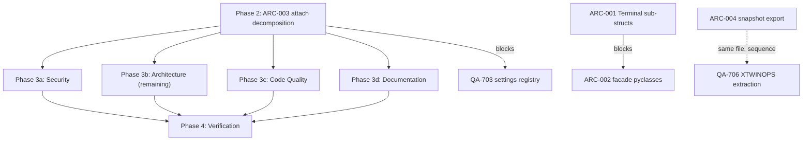

# Project Audit Report

> **Project**: par-term-emu-core-rust
> **Date**: 2026-10-29
> **Stack**: Rust (Cargo workspace: `par-term-emu-core` member, `par-mux` member, root shell), Python 3.12+ PyO3 bindings, C FFI, TypeScript (Next.js web frontend, VS Code extensions), protobuf streaming protocol
> **Audited by**: Claude Code Audit System
> **HEAD**: `bdbef990` (v0.71.1)

---

## Executive Summary

The project is in strong health across all four domains: zero critical findings anywhere, a verification-gate architecture (20+ named `make checkall` targets, nine fuzz targets, golden wire tests) that converts drift into build failures, and a security posture the assessor rated "strong". The single most important finding is SEC-001: the kitty graphics store retains attacker-proportioned pixel buffers (`shared_images`, animation frames, virtual placements) with no store-wide memory bound, so a long-lived par-mux daemon or streamer can be OOM-killed by terminal output alone. The top remediation items (SEC-001, SEC-002) are days-scale; the largest item, decomposing the attach input/render dispatch cluster, is a multi-week program the repo has already planned in `docs/opus/ENH-050`–`ENH-053`. The standout strength is that documentation, API-surface, FFI, and wire-format drift are all mechanically gated rather than policed by review.

### Issue Count by Severity

| Severity | Architecture | Security | Code Quality | Documentation | Total |
|----------|:-----------:|:--------:|:------------:|:-------------:|:-----:|
| 🔴 Critical | 0 | 0 | 0 | 0 | **0** |
| 🟠 High     | 4 | 1 | 5 | 0 | **10** |
| 🟡 Medium   | 5 | 1 | 4 | 3 | **13** |
| 🔵 Low      | 2 | 4 | 2 | 3 | **11** |
| **Total**   | **11** | **6** | **11** | **6** | **34** |

*Counts are actionable findings. Two cross-domain duplicates were merged for remediation (ARC-003+QA-701, ARC-006+QA-702), giving 32 distinct remediation items. Informational notes that are explicitly not defects (DOC-007, generated-artifact complexity outliers) are documented in Detailed Findings but carry no card.*

---

## 🔴 Critical Issues (Resolve Immediately)

None. No domain surfaced a critical-severity finding at HEAD `bdbef990`.

---

## 🟠 High Priority Issues

### [SEC-001] Unbounded retained graphics memory from terminal output
- **Area**: Security (CWE-770/CWE-400, OWASP A04)
- **Location**: `crates/par-term-emu-core/src/graphics/mod.rs:731` (`store_kitty_image`), `:842` (`add_animation_frame`), `:796` (`add_virtual_placement`); call sites `crates/par-term-emu-core/src/graphics/kitty/dispatch.rs:150,257`; limit field `crates/par-term-emu-core/src/terminal/graphics.rs:189`
- **Description**: `GraphicsStore` caps visible placements (1,000) and scrollback graphics (500), but three containers grow without any count or memory bound: `shared_images` (one decoded pixel buffer per kitty image ID, no eviction), `Animation.frames` (uncapped per animation), and `virtual_placements` (unbounded across distinct keys). The `max_total_memory` limit (256 MiB) is never consulted by the store — only the iTerm2 MultipartFile handler checks the *self-declared* `size=` against it. Kitty/iTerm2 inline images are not gated by `set_disable_insecure_sequences`, so the path is live by default. One PNG may decode to 268 MB of RGBA (16,384×4,096 within current caps).
- **Impact**: A program in any pane emitting kitty `a=t` transmits with incrementing image IDs permanently retains ~256 MiB per iteration; in a long-lived par-mux daemon or streamer this grows to OOM, killing every hosted session. Even 1×1 images add unbounded map entries. Sixel caps retained graphics (1,024); kitty is the hole in that scheme, and the generated Resource Limits Reference documents no store-wide cap.
- **Remedy**: Enforce `max_total_memory` as a real store budget inside `store_kitty_image`/`add_animation_frame` (track retained bytes; evict oldest or reject on exceed), cap frames per animation (e.g. 1,024), bound `virtual_placements`. Regenerate the caps table (`make caps-table`) and add rows so the new caps are documented. Keep fuzz seeds passing and add regression cases.

### [ARC-001] The `Terminal` monolith remains the integration point for every feature
- **Area**: Architecture
- **Location**: `crates/par-term-emu-core/src/terminal/mod.rs:195-337`, `crates/par-term-emu-core/src/terminal/state.rs`
- **Description**: `Terminal` still carries 55 fields (down from ~120 via the ARC-001 sub-struct program) spanning two dozen concerns: clipboard, notifications, progress bars, badges, triggers, macros, recording, search, profiling, mouse history, shell integration, tmux control, graphics. parsight rates its blast radius Critical: 1,055 direct upstream dependents, 1,929 transitive; it is both the top central symbol and an articulation point. ~30 `impl Terminal` blocks are smeared across themed sibling files, so cohesion is file-level, not type-level.
- **Impact**: Every core-behavior change fans out across the widest surface in the repo; the struct is the permanent merge point for all feature work and the hardest thing to change safely.
- **Remedy**: Continue the sub-struct extraction toward cohesive state objects; route new feature state through the `EventBroker`/observer seam (`terminal/event_broker.rs`; `trigger::TriggerState` is the pattern) instead of new `Terminal` fields; expose feature-scoped handles (the `ScreenshotConfig`/`StreamingConfig` pyclass precedent) so Terminal stops accruing methods.

### [ARC-002] Flat Python `Terminal` class: a 1,351-method interface at the binding boundary
- **Area**: Architecture
- **Location**: `python/par_term_emu_core_rust/_native.pyi` (10,050 lines; `Terminal` at line 4637); `scripts/check_api_surface.py`
- **Description**: The Python-facing `Terminal`/`PtyTerminal` classes form one flat interface covering text, mouse, clipboard, notifications, macros, triggers, search, recording, file transfer, and badges — an Interface Segregation violation for every consumer. The ARC-001 surface freeze (method-count baselines in `make checkall`) stops growth but does not fix the existing namespace.
- **Impact**: Discoverability and collision burden on all Python consumers; new API areas fragment into ad-hoc pyclasses over time.
- **Remedy**: Keep the freeze; introduce feature-scoped facades (`terminal.clipboard`, `terminal.notifications`) as thin delegating pyclasses, deprecate flat access gradually. No breaking change required. **Blocked by ARC-001**: facades must be new pyclasses, never methods on the frozen class, or `api-surface-check` fails.

### [ARC-003] par-mux attach TUI is the repo's complexity and churn hotspot *(merged with QA-701)*
- **Area**: Architecture + Code Quality
- **Location**: `crates/par-mux/src/mux/attach/render/input_route.rs:613` (`route_mouse`, complexity 52, 45-arm `Hit` match, 6–7 nesting levels; file: 1,405 lines, complexity 323), `crates/par-mux/src/mux/attach/mod.rs:564` (`route_bytes`, complexity 48, ~7 levels), `crates/par-mux/src/mux/attach/render/modal_settings.rs:546`, `crates/par-mux/src/mux/attach/render/mod.rs` (`pump`, `handle_event`)
- **Description**: parsight ranks this cluster first by churn × complexity on both the 14-day and 30-day windows (input_route.rs 30-day churn score 73,632; main.rs 75,834; `route_bytes` churn 364, `route_mouse` 310). Input routing, modal dispatch, and event pumping are concentrated in a few very large dispatch functions.
- **Impact**: Every attach TUI feature lands in the same functions; the code is correct and heavily tested today, but each change carries the repo's highest regression risk and its hardest diffs to review.
- **Remedy**: Execute the repo's own decomposition plans — `docs/opus/ENH-050-windowsession-substate-decomposition.md`, `ENH-051-management-chord-dispatch-table.md` (table-driven dispatch), `ENH-052-renderer-rs-decomposition.md`, `ENH-053-status-refresh-shared-builder.md`. The audit data independently confirms those four targets. Gate every step on the `mux_attach` suite. **Blocks QA-703** (same files).

### [ARC-004] Single-writer `Arc<RwLock<Terminal>>` is a throughput ceiling for embedders
- **Area**: Architecture
- **Location**: `crates/par-term-emu-core/src/pty_session/reader.rs` (write-lock `process()`), `crates/par-term-emu-core/src/pty_session/query.rs:29`
- **Description**: The PTY reader takes the write lock to apply output; every query — including full-scrollback exports — takes a read lock on the same `Terminal`. A large export under heavy output delays ingestion and vice versa. Documented and accepted in `crates/par-term-emu-core/DESIGN.md:144-160`, with chunking, `UpdateWaiter`, and generation counters as mitigations and snapshot-export as the stated remedy.
- **Impact**: Fine for interactive consumers; serializes all access for headless multi-consumer embedders (the `sim` audience).
- **Remedy**: Implement the documented remedy: snapshot-based export (`grid/snapshot.rs` machinery exists) so long reads never hold the live lock; evaluate an actor-style command queue only if headless server embedding becomes a real workload. **Sequences with QA-706** (same file — see File Conflict Map).

### [QA-702→ARC-006] CLI `main()` is a 66-complexity, ~370-line dispatcher *(merged with QA-702)*
- **Area**: Architecture + Code Quality
- **Location**: `crates/par-mux/src/bin/par_mux/main.rs:1111` (through ~1482); `run_daemon` at 1607 (complexity 47); file is 2,672 lines, complexity 277, 111 symbols
- **Description**: `main()` mixes CLI-mode resolution, daemon-vs-client dispatch, socket resolution, and reserved-name refusal; it is the second-highest churn symbol (1,017 touches in 14 days).
- **Impact**: The highest-traffic edit site in par-mux is also its least-readable function.
- **Remedy**: Split `main()` into per-verb runners behind one match, mirroring the existing `run_*` helpers and the daemon library's `dispatch/` pattern; move `run_daemon` setup/teardown into a struct. Covered by the `mux_daemon`/`mux_cli` suites.

### [QA-703] Stringly-typed settings accessor/setter pair
- **Area**: Code Quality
- **Location**: `crates/par-mux/src/mux/attach/render/modal_settings.rs:546` (`field`, complexity 62) and `settings_apply` (churn 402)
- **Description**: Both directions of ~50 settings route through string-keyed matches; the same string literals are duplicated across the Rust dialog, the schema generator, and docs. Adding a setting touches 4+ sites; a typo compiles. The `mux-docs-check`/`mux-schema-check` gates catch drift only after it exists.
- **Impact**: Setting work concentrates here (churn 801 on `field` in 14 days).
- **Remedy**: Introduce a settings-registry table (key enum/const + getter/setter closures) that dialog, schema, and docs all read from. Aligns with the standing invariant that every setting ships in the dialog. **Depends on ARC-003** (same file, inside the decomposition zone).

### [QA-704] Unmanaged copy-paste between the two agent-state VS Code extensions
- **Area**: Code Quality
- **Location**: `crates/par-mux/integrations/extensions/par-mux-agent-state.ts`, `par-mux-omp-agent-state.ts`
- **Description**: `sendRequestAttempt`, `sendRequestNow`, `drainStateQueue`, `updateSessionRef` are byte-identical copies; `reportSession`/`sendState`/`releaseAgent` are ≥0.98 near-copies. The measured retry ladder (500/1500/4000 ms) now lives as a manual template in two files.
- **Impact**: The next fix to retry/queue semantics can silently miss the twin file; the dialects then report subtly different state to the same daemon. The only exact-copy group in the repo.
- **Remedy**: Factor the shared engine into one module with a per-dialect config (endpoint, env-var names, log prefix).

### [QA-705] Stale completed-work worktree consuming 15 GB
- **Area**: Code Quality (repo hygiene)
- **Location**: `.claude/worktrees/streamer-otel-metrics` (branch `worktree-streamer-otel-metrics`)
- **Description**: The OTel metrics work merged to main at HEAD; the worktree still holds 4 merge commits unreachable from main and a full duplicate of every source file (it doubled file counts in every audit scan).
- **Impact**: 15 GB of disk, stale tooling reads, and every future audit/grep double-counts the repo. Violates the project's own worktree-removal-on-completion rule.
- **Remedy**: Confirm no live session owns it, then `git worktree remove --force`, delete the branch, verify with `git worktree list`. **Destructive — requires Paul's explicit confirmation before anyone runs it.** No code work depends on it, but every LOC metric in this report is inflated ~2× until it happens.

---

## 🟡 Medium Priority Issues

### Architecture

### [ARC-005] Streamer↔mux bridge is a 3,159-line root-crate module with Critical change risk
- **Location**: `src/streaming/mux_factory.rs` (94 functions, complexity 211; largest root-side file; the seam between streaming server and par-mux daemon)
- **Remedy**: Split by responsibility (session lifecycle vs row streaming vs mirror protocol), or move the mux-session factory into the `par-mux` member where the domain lives. Phase along the `MuxSessionFactory`/roster/stream seams.

### [ARC-006b] par-mux CLI god-file *(covered by the merged ARC-006 card above)*

### [ARC-007] Persistence layer is a single 5,231-line module
- **Location**: `crates/par-mux/src/mux/persist.rs` (172 functions: format definitions, save, restore, migration, snapshot validation; 2,784 test lines mitigate)
- **Remedy**: Split format/schema types from save/restore I/O; keep the wire format pinned by its existing tests.

### [ARC-008] New streaming message types require a five-site sync walk
- **Location**: `src/streaming/protocol.rs`, `src/streaming/proto.rs`, `src/python_bindings/streaming.rs`, `tests/test_streaming.rs`, `src/streaming/session.rs` (checklist in CLAUDE.md)
- **Description**: `ProtoConvert` derive + golden wire tests mitigate risk, but the change amplification is structural.
- **Remedy**: Extend the derive to generate the Python dict-conversion skeleton, collapsing one of the five sites. Any fix in `src/streaming/` must walk all five sites in one change — partial edits break the parity gates.

### [ARC-009] Triple version-lockstep train is process-fragile
- **Location**: root `Cargo.toml:66,69` (`=0.71.1` pins on both members), member manifests, four checks (`core-version-check`, `derive-version-check`)
- **Remedy**: A release script that reads the root version and rewrites all five manifests plus both pins in one step (the checks exist; add the writer). Any remediation that bumps a version must update all of it atomically.

### Security

### [SEC-002] Decompression-bomb transient: up to 512 MiB per crafted inline image before rejection
- **Area**: Security (CWE-409/CWE-770)
- **Location**: `crates/par-term-emu-core/src/graphics/kitty/decode.rs:202-223`, `crates/par-term-emu-core/src/graphics/iterm.rs:114-161`
- **Description**: Both PNG paths set width/height limits (16,384) but leave the image crate's default `max_alloc` (512 MiB) to bound the decode; the pixel-product check runs only *after* full decode. A few-hundred-KB PNG declaring 16,384×16,384 drives ~512 MiB before rejection (~2,000:1 amplification per sequence). Several panes can spike concurrently against the daemon.
- **Remedy**: Read declared dimensions before decoding (header probe / `into_dimensions()`) and reject when width×height exceeds `MAX_IMAGE_PIXELS`; or set `limits.max_alloc` to `MAX_IMAGE_PIXELS * 4`.

### Code Quality

### [QA-706] Device-query response filter buried inline under the PTY write lock
- **Location**: `crates/par-term-emu-core/src/pty_session/reader.rs:152-197`
- **Description**: A ~40-line nested loop (5 levels) runs inside the `terminal.write()` guard on every read with pending responses; pure byte logic, untestable in isolation, lengthens the critical section.
- **Remedy**: Extract `fn filter_xtwinops_replies(responses: Vec<u8>) -> Vec<u8>` with unit tests (collect-until-alphabetic-final, drop-if-`t` cases); call it after draining responses, still before guard drop. Preserve the ARC-027 response-promptness contract — extract, do not relocate past the guard drop. Shares `reader.rs` with ARC-004 (see conflict map).

### [QA-707] Structural near-duplicate families in integrations and IPC row parsing
- **Location**: `crates/par-mux/src/mux/integrations/mod.rs:869` vs `:917` (0.96), `:773` vs `:674` (0.95); `crates/par-mux/src/mux/ipc/rows.rs:38-473` (five near-identical parse/fmt impls, 0.93+)
- **Remedy**: Parameterize the array-lookup step (`root.get_array(event)` vs `hooks.get_array(event)`); consider a small macro/trait for the row parse/fmt pairs. Low urgency — shapes are individually simple.

### [QA-708] `scripts/check_*.py` harness boilerplate duplicated ~10×
- **Location**: `scripts/` (`self_test` in ≥10 scripts, `check` in 8, 0.91-0.99 similar; `scripts/check_api_surface.py` among them)
- **Remedy**: Extract `scripts/_gate_common.py` (self-test/assert harness); keep per-check logic in each script. Note: `check_api_surface.py` is also listed by ARC-002 — sequence edits in that file.

### [QA-709] Oversized test files
- **Location**: `crates/par-mux/tests/mux_attach.rs` (9,275 lines), `crates/par-mux/src/mux/persist.rs` (5,231 lines, 53% test), `crates/par-term-emu-core/src/terminal/tests/terminal_tests.rs` (4,772 lines)
- **Remedy**: Split `mux_attach.rs` by theme, as the mux tree already does (`attach/render/tests/`). No correctness risk; reduces edit-conflict probability in the highest-churn area.

### Documentation

### [DOC-001] Architecture doc's verification stamp is eight minor releases old
- **Location**: `docs/ARCHITECTURE.md:5` — "Last verified against v0.63.0 (commit `6358f60f`)"; tree is at v0.71.1. The stamped crate layout is still accurate, but struct details have had eight releases to drift.
- **Remedy**: Run a verification pass against HEAD, refresh the banner to v0.71.1, and add the banner refresh to the release checklist.

### [DOC-002] herdr comparison matrix cites the external tree as repo-relative paths
- **Location**: `MUX_FEATURE_MATRIX.md:166-276` — five herdr-repo paths (`scripts/config_reference_check.py`, `src/main.rs`, `skills/herdr/SKILL.md`, `distribution/agent-guide.md`, `docs/next/CHANGELOG.md`) flagged as high-confidence broken links.
- **Remedy**: Prefix each citation with its tree (e.g. "herdr: `src/main.rs`") or add snapshot copies under `docs/research/`; alternatively use the `<!-- doc-path: example -->` waiver the `check-doc-paths` gate honors.

### [DOC-003] CONTRIBUTING's Version Sync understates the version-lockstep requirement
- **Location**: `CONTRIBUTING.md:99-107` — says "all three files"; the real lockstep is five files plus `=X.Y.Z` pins, the derive-crate exception, and the publish order (verified: all five at 0.71.1).
- **Remedy**: Point the section at CLAUDE.md's full list or inline it; name `make core-version-check` and `make derive-version-check`.

---

## 🔵 Low Priority / Improvements

### Architecture

- **[ARC-010] Dual public surface is permanent facade debt.** `src/lib.rs` re-exports every historical `par_term_emu_core_rust::*` path alongside the member's `par_term_emu_core::*` (compatibility invariant 1 in DESIGN.md). Correct; consider documenting one canonical path for new embedder docs (`docs/RUST_USAGE.md`).
- **[ARC-011] VTE dispatch complexity concentration.** `csi_dispatch_impl` (complexity 43, `crates/par-term-emu-core/src/terminal/sequences/csi/mod.rs:36`) is inherent to protocol dispatch and already contained by the per-topic split; a final table indirection is optional polish.

### Security

- **[SEC-003] Legacy weak htpasswd formats accepted by default.** `src/streaming/auth_hash.rs:187` — `{SHA}` (unsalted SHA-1) and `$1$`/`$apr1$` (MD5-crypt) verify unless `--require-bcrypt`. Mitigated (startup warning, constant-time compare, documented deprecation intent). Remedy: land the promised default flip. (CWE-916)
- **[SEC-004] Frontend propagates `api_key` through URLs.** `web-terminal-frontend/app/page.tsx:112-118` copies `api_key` from the page URL into the WebSocket query — key material in browser history and streamer access logs when `--allow-api-key-in-query` is on. The CLI warns; SECURITY.md doesn't mention the frontend path. Remedy: header auth from the frontend, or document the residual. (CWE-598)
- **[SEC-005] Bind-warning loopback check is prefix-based.** `src/bin/streaming_server/bootstrap.rs:803` treats any host starting with `"127."` as loopback, so `127.example.com` suppresses the SEC-002 unauthenticated-bind warning. Warning-only (origin check uses exact equality). Remedy: exact literals plus a real loopback parse.
- **[SEC-006] Secrets in diagnostic logs (documented residual).** `PTY_SPAWN` logs full pane command lines at Info; `set-environment`/`new-session -e` values log verbatim at DEBUG≥3 and on stderr when rejected (documented in docs/SECURITY.md). Remedy: an eventual redaction pass.

### Code Quality

- **[QA-710] 225 `#[ignore]`d load-sensitive tests are discoverable only via the Makefile.** All carry documented reasons and are covered by `make test-rust-sensitive`/`checkall-ci`, but bare `cargo test` surprises. Remedy: a note in the README dev section.
- **[QA-711] Derive-macro builder `expand_py_dict_convert`** (`derive/src/lib.rs:209`, complexity 48) — a helper for the repeated `quote!` arms would trim it; macro code is review-gated and stable, so optional.

### Documentation

- **[DOC-004] Backtick typo in CONTRIBUTING's pinned-tests bullet** (`CONTRIBUTING.md:54`) — the first backtick opens a span that closes immediately. Remedy: rewrite as: Cite regression tests as "pinned by `<test_fn>`".
- **[DOC-005] Archived plan doc cites a pre-split source path** (`docs/opus/ENH-048-changelog-structure-lint.md:44` — `src/tmux_control.rs`, now `crates/par-term-emu-core/src/tmux_control/`). Frozen history; optional annotation or doc-path waiver.
- **[DOC-006] `docs/` has no index README.** 28 files plus four planning subdirectories with no orientation; the style guide lists `docs/README.md` in its recommended layout. Remedy: one line per doc plus a note that `fable/`, `opus/`, `superpowers/plans/`, `research/` are archives.

### Informational (no action, not defects)

- **[DOC-007]** parsight's broken-link list includes the style guide's formatting examples and MUX.md's runtime paths (`%APPDATA%\par-mux\config.toml`, `plugins/installed.json`) — intentional, not repo links.
- Generated artifacts score as complexity outliers (`crates/par-mux/completions/par-mux.bash` complexity 375; `_native.pyi` 10,050 lines) — regenerated and gated; exclude from remediation. `no_callers` rows in `benches/*.rs` are Criterion entry points. Exhaustive-variant guard tests (`proto_golden_fixtures_cover_every_variant`, complexity 64) are compile-drift tripwires by design. The unconditional `criterion` dev-dependency cannot be feature-gated in Cargo — accepted; do not "fix".

---

## Detailed Findings

### Architecture & Design

Audited at HEAD `bdbef990` via parsight graph analytics (12,684-node production graph, 48,000+ edges), workspace manifests, `Terminal` state composition, Makefile gates, and quality-audit rankings.

**Structural verdict**: the workspace DAG is clean and acyclic (core depends on nothing in-workspace; par-mux on core only; root on both — verified in manifests, matching `crates/par-term-emu-core/DESIGN.md:22-34`), the public surface is mechanically gated, and the build system is among the strongest audited. No critical structural findings. The High findings above (ARC-001 through ARC-004) plus Medium ARC-005 through ARC-009 constitute the full architecture list.

**Blocking notes from the agent**:
- ARC-001 → ARC-002: facade pyclasses must be new pyclasses, never methods on the frozen `Terminal` class; code-quality fixes touching `src/python_bindings/terminal/*` sequence after ARC-001's sub-struct decisions.
- ARC-003 conflicts with any code-quality work in `crates/par-mux/src/mux/attach/render/*` (top churn hotspots); the ENH-050–053 plan docs define the target shape — other-domain fixes there should wait for or adopt that split.
- ARC-004 touches `pty_session/query.rs`, the accessor every binding query path uses; export-snapshot changes land before any domain optimizes those call sites.
- ARC-008: any fix in `src/streaming/` walks all five sites in one change.
- ARC-009 gates every release-time edit: version bumps update five manifests plus two pins atomically.

**Also noted**: monorepo breadth is real (Rust workspace, Python package, C FFI, Next.js frontend, shell integrations, terminfo, packaging, 60+ docs) but coherent under the Makefile gates; the Next.js frontend's only coupling to Rust is the protobuf layer, which is the right seam. `main.rs` (2,672 lines) and `mux_factory.rs` (3,159) are the two largest non-generated files outside persist.rs.

### Security Assessment

Threat model per docs/SECURITY.md: everything a program writes to the terminal is untrusted input. Findings: SEC-001 (High), SEC-002 (Medium), SEC-003–006 (Low). All details above.

**Posture highlights the assessor verified**:
- Streaming server: loopback default bind with loud multi-line warning on unauthenticated non-loopback binds (SEC-002 lineage); origin allowlist defaulting to loopback-only on all three endpoints; constant-time comparison on every API-key/password path; dummy bcrypt on username mismatch against timing enumeration; pre-auth handshake slot reservation; rustls TLS with private-key permission rejection; X-Frame-Options DENY + full CSP; `hide_env_values` on all `--help` output.
- mux control socket: per-UID `0700` dir verified before bind *and* connect, socket `0600`, peer-euid check on accept plus mirrored client-side server-euid check, Windows owner-only SDDL + server-SID verification (`crates/par-mux/src/mux/ipc.rs:102-202`). Hook reports validate label/source against control and bidi-spoofing characters with 4 KiB caps before any lock (`crates/par-mux/src/mux/hooks/mod.rs:139-150`).
- Kitty file media: mode gate before any filesystem touch, temp-root + marker gate, `O_NOFOLLOW` handle-based validation with post-open re-gate, decode-before-delete pinned to the opened inode (SEC-130).
- Host probe git hardening (SEC-115): fsmonitor off, hooksPath=/dev/null, no ext transport, no optional locks, no prompts, three-way bounded execution with stdout caps.
- Supply chain: SHA-256-required self-updater and install.sh; `deny.toml` with documented exceptions; current dependency set; all nine fuzz targets present.
- No hardcoded secrets in tracked source; `unsafe` confined to the FFI surface, one documented ioctl, and tests, with `clippy::undocumented_unsafe_blocks` enforced.

**Blocking notes**: SEC-001 remediation precedes any caps-table/docs work (the Resource Limits Reference is generated from `/// cap:` doc comments — fix and regenerate in one change); keep the kitty fuzz target's seeds passing and add regression cases.

### Code Quality

Verified metrics: 0 TODO/FIXME in source; 33 `#[allow(...)]` attributes across ~575K LOC, nearly all narrow and justified; ~70 test files (43 Python / 679 functions + 4,346 Rust test functions), nine fuzz targets, golden wire tests, 19-target `make checkall`.

**Coverage assessment**: good (>70% behavior-level). Untested areas: the extracted-logic gap named in QA-706, platform-specific Windows ConPTY paths (validated via the Parallels VM playbook), usual fuzz blind spots. Test quality is high: regression tests document pre-fix behavior (e.g. `injected_terminal_read_error_stops_the_reader_without_spinning`, reader.rs:378), GIL-release probe with per-test timeout (tests/test_pty.py:130), deadline-based shared `wait_for` helper (tests/conftest.py:17), QA/ARC/ENH reference numbers tie tests to decisions.

**Lock-discipline exemplar**: the PTY reader thread — `process_deferred` keeps observer callbacks off the write guard (ARC-001 lineage), device-query writes staged inside and executed after guard drop (ARC-027), generation counter double-bump closes a stale-render race, reap record uses `try_lock` for deadlock-free ordering.

**Error handling**: typed error enums (`PtyError`, `ScreenshotError`, `GraphicsError`) with `From<…> for PyErr` conversions (`crates/par-term-emu-core/src/lib.rs:76-113`); EIO/BrokenPipe classified terminal with a unit-tested classifier, so a dead PTY cannot busy-spin. Bindings follow the thin-wrapper convention; the GIL is released around blocking PTY writes with a timing regression test (QA-224). One parsight 0.988 "duplicate" (`sample_half_block`) is a false positive — the binding delegates to the shared Rust function by design.

### Documentation Review

Inventory verdict: README excellent (What's New current through 0.71.1; every Quick Start method verified against `_native.pyi`; all ~39 example scripts exist); API_REFERENCE.md 2,625 lines, drift-gated; FFI_GUIDE.md with a complete ABI v1–v5 history and breaking-change migration section; CHANGELOG Keep-a-Changelog + SemVer with provenance-stamped entries; TROUBLESHOOTING.md follows the symptom/cause/fix/verify template; docstring coverage pervasive and gate-enforced (`stub-docs-check`, `check_docstring_examples.py`, `rustdoc-check -D warnings`).

Findings DOC-001–006 above; DOC-007 informational. Net: the doc set's differentiator is its ten-check documentation gate inside `make checkall`, which converts drift into build failure — the three Medium findings are maintenance debt on that otherwise self-enforcing system.

---

## Remediation Roadmap

### Immediate Actions (Before Next Release)
1. **SEC-001** — store-wide memory budget + frame/placement caps in the kitty graphics store, caps-table regen, fuzz regression cases.
2. **SEC-002** — pre-decode dimension rejection for PNG bombs.

### Short-term (Next 1–2 Sprints)
1. **QA-704** — dedupe the agent-state extension engine.
2. **QA-705** — remove the stale worktree (after Paul's confirmation).
3. **ARC-004** — snapshot-based export (also unblocks cleaner `reader.rs` work).
4. **QA-706**, **QA-708** — self-contained extractions.
5. **SEC-003** — land the legacy-hash default flip; **SEC-004/005/006** hardening.
6. **DOC-001/002/003** — documentation maintenance debt.

### Long-term (Backlog)
1. **ARC-003 + QA-703** — the attach decomposition program (ENH-050–053), settings registry after it.
2. **ARC-001 → ARC-002** — Terminal sub-struct continuation, then facade pyclasses.
3. **ARC-005/006/007/008/009** — structural splits and process automation.
4. **QA-707/709**, **ARC-010/011**, **QA-710/711**, **DOC-004/005/006**.

---

## Positive Highlights

1. **The verification gate is exceptional**: `make checkall` chains 20+ named gates (FFI header/surface vs cbindgen, version lockstep, API-surface freeze, `sim` feature isolation, OTel double-gating, doc-link integrity, rustdoc `-D warnings`, completions/schema/caps sync); `checkall-ci` adds Windows MSVC cross-target checks and CI-parity test legs.
2. **Security posture is strong and verifiable**: layered, fail-closed mux socket and hook-report validation; constant-time credential comparison throughout; TLS/CSP/origin checks; SHA-256-required supply chain; nine fuzz targets over every untrusted parser.
3. **Zero TODO/FIXME debt and only 33 lint suppressions across ~575K LOC**, with comments carrying decision provenance (ARC/QA/SEC numbers) instead of narration.
4. **Documentation drift is mechanically gated** — ten doc checks in the fast gate; README examples verified current; ABI history with migration guidance is the model for breaking-surface documentation.
5. **Disciplined dependency hygiene**: nearly every optional dependency comments why it exists, which feature needs it, and which RUSTSEC advisory it resolved; Python runtime deps are just `pillow`.
6. **Well-chosen patterns, consistently applied**: EventBroker observers, derive-macro wire conversion with golden bytes, builder for `Connected`, sub-struct composition, themed impl-file layout.
7. **Test quality is high**: regression tests document pre-fix behavior, deadline-based polling instead of bare sleeps, GIL-release timing probes, load-sensitive tests quarantined behind explicit targets rather than deleted.
8. **Performance instrumented as architecture**: damage tracking with generation counters, feature-gated benches per hot path, image-decode bounds caps.

---

## Audit Confidence

| Area | Files Reviewed | Confidence |
|------|---------------|-----------|
| Architecture | ~25 key files + full parsight graph (12,684 nodes) | High |
| Security | ~15 primary files + streaming/mux/graphics surfaces + manifests | High |
| Code Quality | parsight analytics repo-wide + ~20 hotspot/test files read | High |
| Documentation | ~30 docs + link graph + example verification against `_native.pyi` | High |

---

## Remediation Plan

> This section is generated by the audit and consumed directly by `/fix-audit`.
> It pre-computes phase assignments and file conflicts so the fix orchestrator
> can proceed without re-analyzing the codebase.

### Phase Assignments

#### Phase 1 — Critical Security (Sequential, Blocking)

None — no Critical Security findings this cycle.

#### Phase 2 — Critical Architecture (Sequential, Blocking)

No Critical Architecture findings; one High Architecture issue is promoted here because it explicitly blocks a Code Quality issue (QA-703) in the same files.

| ID | Title | File(s) | Severity | Blocks |
|----|-------|---------|----------|--------|
| ARC-003 | Decompose the attach input/render dispatch cluster (merged: QA-701) | `crates/par-mux/src/mux/attach/mod.rs`, `render/input_route.rs`, `render/modal_settings.rs`, `render/mod.rs` | High | QA-703 |

#### Phase 3 — Parallel Execution

**3a — Security (remaining)**
| ID | Title | File(s) | Severity |
|----|-------|---------|----------|
| SEC-001 | Store-wide memory budget for the kitty graphics store | `crates/par-term-emu-core/src/graphics/mod.rs`, `graphics/kitty/dispatch.rs`, `graphics/animation.rs`, `terminal/graphics.rs`, `docs/SECURITY.md` | High |
| SEC-002 | Pre-decode dimension rejection for PNG bombs | `crates/par-term-emu-core/src/graphics/kitty/decode.rs`, `graphics/iterm.rs` | Medium |
| SEC-003 | Land the legacy-hash default flip | `src/streaming/auth_hash.rs` | Low |
| SEC-004 | Move frontend auth off api_key-in-URL or document the residual | `web-terminal-frontend/app/page.tsx`, `docs/SECURITY.md` | Low |
| SEC-005 | Exact-literal loopback bind check | `src/bin/streaming_server/bootstrap.rs` | Low |
| SEC-006 | Redact environment values from mux diagnostic logs | `crates/par-mux/src/mux/` logging sites | Low |

**3b — Architecture (remaining)**
| ID | Title | File(s) | Severity |
|----|-------|---------|----------|
| ARC-001 | Terminal sub-struct continuation; no new Terminal fields | `crates/par-term-emu-core/src/terminal/mod.rs`, `terminal/state.rs` | High |
| ARC-002 | Feature-scoped facade pyclasses (depends on ARC-001) | `python/par_term_emu_core_rust/_native.pyi`, `src/python_bindings/`, `scripts/check_api_surface.py` | High |
| ARC-004 | Snapshot-based scrollback/graphics export | `crates/par-term-emu-core/src/pty_session/query.rs`, `reader.rs` | High |
| ARC-005 | Split `src/streaming/mux_factory.rs` by seam | `src/streaming/mux_factory.rs` | Medium |
| ARC-006 | Split the CLI `main()` god file (merged: QA-702) | `crates/par-mux/src/bin/par_mux/main.rs` | Medium |
| ARC-007 | Split persist.rs into format vs I/O modules | `crates/par-mux/src/mux/persist.rs` | Medium |
| ARC-008 | Derive-generate the Python dict-conversion site | `src/streaming/protocol.rs`, `proto.rs`, `python_bindings/streaming.rs` | Medium |
| ARC-009 | Release script rewriting the whole version train | `Cargo.toml`, member manifests | Medium |
| ARC-010 | Document the canonical embedder path | `src/lib.rs`, `docs/RUST_USAGE.md` | Low |
| ARC-011 | Optional csi_dispatch table indirection | `crates/par-term-emu-core/src/terminal/sequences/csi/mod.rs` | Low |

**3c — Code Quality (all)**
| ID | Title | File(s) | Severity |
|----|-------|---------|----------|
| QA-703 | Settings registry replacing stringly-typed accessors (depends on ARC-003) | `crates/par-mux/src/mux/attach/render/modal_settings.rs` | High |
| QA-704 | Shared agent-state extension engine | `crates/par-mux/integrations/extensions/*.ts` | High |
| QA-705 | Remove stale streamer-otel-metrics worktree — **requires Paul's confirmation; /fix-audit must not execute destructively** | `.claude/worktrees/streamer-otel-metrics` | High |
| QA-706 | Extract XTWINOPS reply filter (keep inside write-guard window; ARC-027 contract) | `crates/par-term-emu-core/src/pty_session/reader.rs` | Medium |
| QA-707 | Parameterize near-duplicate flat-cut and IPC row families | `crates/par-mux/src/mux/integrations/mod.rs`, `mux/ipc/rows.rs` | Medium |
| QA-708 | Extract `scripts/_gate_common.py` | `scripts/check_*.py` | Medium |
| QA-709 | Split mux_attach.rs by theme | `crates/par-mux/tests/mux_attach.rs` | Medium |
| QA-710 | Document the load-sensitive test workflow in README | `README.md` | Low |
| QA-711 | Trim derive builder with a quote!-arm helper | `derive/src/lib.rs` | Low |

**3d — Documentation (all)**
| ID | Title | File(s) | Severity |
|----|-------|---------|----------|
| DOC-001 | Refresh ARCHITECTURE.md verification stamp + release-checklist item | `docs/ARCHITECTURE.md` | Medium |
| DOC-002 | Prefix herdr citations with their tree | `MUX_FEATURE_MATRIX.md` | Medium |
| DOC-003 | Correct CONTRIBUTING version-sync to five-file lockstep | `CONTRIBUTING.md` | Medium |
| DOC-004 | Fix pinned-tests backtick typo | `CONTRIBUTING.md` | Low |
| DOC-005 | Annotate ENH-048's pre-split path | `docs/opus/ENH-048-changelog-structure-lint.md` | Low |
| DOC-006 | Add docs/README.md index | `docs/README.md` (new) | Low |

### File Conflict Map

| File | Domains | Issues | Risk |
|------|---------|--------|------|
| `crates/par-mux/src/mux/attach/mod.rs` | Architecture + Code Quality | ARC-003 + QA-701 (merged) | ⚠️ Read before edit |
| `crates/par-mux/src/mux/attach/render/input_route.rs` | Architecture + Code Quality | ARC-003 + QA-701 (merged) | ⚠️ Read before edit |
| `crates/par-mux/src/mux/attach/render/modal_settings.rs` | Architecture + Code Quality | ARC-003, QA-703 | ⚠️ Read before edit — QA-703 after ARC-003 |
| `crates/par-mux/src/bin/par_mux/main.rs` | Architecture + Code Quality | ARC-006 + QA-702 (merged) | ⚠️ Read before edit |
| `crates/par-term-emu-core/src/pty_session/reader.rs` | Architecture + Code Quality | ARC-004, QA-706 | ⚠️ Read before edit — sequence; QA-706 keeps logic inside the guard window |
| `scripts/check_api_surface.py` | Architecture + Code Quality | ARC-002, QA-708 | ⚠️ Read before edit |

### Blocking Relationships

- ARC-001 → ARC-002: facade pyclasses must be new pyclasses, never methods on the frozen `Terminal` class (`api-surface-check` baselines fail otherwise).
- ARC-003 → QA-703: `modal_settings.rs` sits inside the attach decomposition zone; QA-703 adopts or waits for the split.
- ARC-004 ⇢ QA-706: same file; QA-706 must preserve the ARC-027 response-promptness contract (extract, don't relocate past the guard drop).
- ARC-008 → any streaming-domain fix: five-site walk in one change (golden-wire and dict-conversion parity gates).
- ARC-009 → release-time edits: five manifests + two pins bump atomically.
- SEC-001 → docs/SECURITY.md: fix adds caps and regenerates the caps table in the same change.
- QA-705 → everything (metric hygiene): destructive removal needs Paul's explicit confirmation first.

### Dependency Diagram

