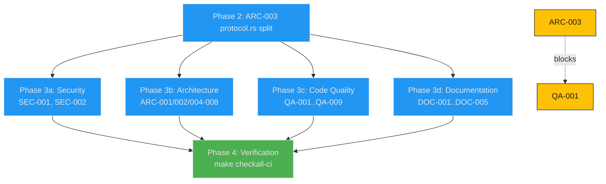

# Project Audit Report

> **Project**: par-term-emu-core-rust (v0.82.0, HEAD `3f1f395c`)
> **Date**: 2026-11-17
> **Stack**: Rust workspace (par-term-emu-core, par-mux, root) · PyO3 Python 3.12+ bindings · TypeScript integrations + web frontend · C FFI · WebSocket streaming server
> **Audited by**: Claude Code Audit System (four parallel domain agents; parsight graph + analytics at HEAD)

---

## Executive Summary

The codebase is in strong health across all four domains: zero Critical findings, exemplary panic-safety in the untrusted-input parsers, gate-enforced architecture and documentation discipline that most projects lack, and a clean three-crate workspace DAG with exact version pins. The most significant finding is structural: the par-mux daemon/client control protocol evolves every release with no connect-time version negotiation while old launchd-managed daemons remain a supported runtime state — the one boundary neither the type system nor the gates can see, and the root of the known attach-desync blocked card. Remediation of the six High issues is roughly two to three weeks of focused sessions; nothing requires emergency action before the next deployment.

### Issue Count by Severity

| Severity | Architecture | Security | Code Quality | Documentation | Total |
|----------|:-----------:|:--------:|:------------:|:-------------:|:-----:|
| 🔴 Critical | 0 | 0 | 0 | 0 | **0** |
| 🟠 High     | 3 | 0 | 2 | 1 | **6** |
| 🟡 Medium   | 2 | 1 | 5 | 2 | **10** |
| 🔵 Low      | 3 | 1 | 2 | 2 | **8** |
| **Total**   | **8** | **2** | **9** | **5** | **24** |

Plus three non-actionable observations (no cards filed): the frozen 389-method Python `Terminal` pyclass is correctly managed by the shrink-only ratchet (ARC note); 141 production files exceed 500 lines, kept coherent by the themed-file convention (context, not defect); three `#[allow(deprecated)]` sites are documented legacy-compatibility debt clocks.

### Known work in flight (not re-reported as findings)

The board already tracks: the cwd-token streaming test host-gating (in progress); attach TUI stale-frame ghosts, truncated escape sequences under burst, attach grid desync on version-skewed 0.80 daemon, resize reflow ordering, ci.yml mux-test retry parity, frontend vite/zod deps-audit (blocked); the release-cut card for the 0.82 opt-in APIs (backlog). ARC-001 below is the structural complement to the desync card, and DOC-001 complements the release-cut card — both cross-reference rather than duplicate.

---

## 🟠 High Priority Issues

### [ARC-001] No connect-time version negotiation on the par-mux control protocol
- **Area**: Architecture
- **Location**: `crates/par-mux/src/mux/client.rs:884`, `crates/par-mux/src/mux/dispatch/`, `src/streaming/mux_factory/control.rs`, `src/streaming/mux_factory/stream.rs:135`
- **Description**: The daemon, the attach client, and the streamer's `MuxSessionFactory` communicate over an evolving tmux-style line grammar with no connect-time handshake and no protocol-version negotiation (`client.rs:884`: "sends no handshake at connect"). `mux::build_stamp()` and the `version` verb are diagnostics-only; no client gates on a version before speaking. A launchd-managed old daemon is a supported runtime state (KeepAlive, version-guarded install), so grammar skew between a running 0.80 daemon and a current client is a normal deployment, not an error path. The streamer re-parses the grammar with a second `TmuxControlParser` in `spawn_drain`, so one grammar change must stay compatible across three consumers plus N running old daemons.
- **Impact**: The blocked card "attach client grid desync on re-attach (version-skewed 0.80 daemon)" is the user-visible symptom of exactly this gap. Each grammar extension risks a new skew class the type system cannot catch; compatibility is enforced only by convention and integration tests against the current daemon binary.
- **Remedy**: Add a connect-time version/feature exchange on the control socket (a `hello` reply carrying daemon version + supported verbs fits the existing `%end`-terminated grammar), and have clients degrade explicitly or refuse when a required reply shape is absent. Track the daemon version in every attach/streamer session log line so skew is diagnosable client-side.

### [ARC-002] 13 `#[doc(hidden)] pub` field promotions on the crates.io-published core
- **Area**: Architecture
- **Location**: `crates/par-term-emu-core/DESIGN.md:234-270` (baseline), `crates/par-term-emu-core/src/terminal/mod.rs:198`, `crates/par-term-emu-core/src/cell.rs:255`
- **Description**: The core member is published, and its documented private reach-in surface includes raw public fields: `Terminal::grid`, `Terminal::graphics`, `GraphicsState::{graphics_store, cell_dimensions}`, `PlacedPixels`' four fields, and `Cell::{c, flags, width}`. DESIGN.md policy says "promote methods, never fields", but unlike `api-surface-check` (which ratchets down), `doc-hidden-check` only freezes the set — nothing forces the promised field-to-accessor migration, and all in-workspace consumers (ffi, python_bindings, streaming session, mux pane) have been touched repeatedly since the policy was written.
- **Impact**: Any embedder of the published crate can write `terminal.grid` or `cell.flags` directly, bypassing every core invariant (damage tracking, wide-cell coherence, alt-screen rules). The field set is a de-facto public contract: tightening it later is a semver break against unknown downstream users.
- **Remedy**: Convert the 13 field entries to `#[doc(hidden)] pub fn` accessors (read-only where consumers only read; narrow setters for the ffi/mux write sites), then flip `doc-hidden-check` to a shrink-only ratchet mirroring `check_api_surface.py` so re-adding a field fails the gate.

### [ARC-003] `src/streaming/protocol.rs` is a 3,348-line message monolith
- **Area**: Architecture
- **Location**: `src/streaming/protocol.rs` (223 symbols, fan-in 30; `variant_name` at line 2970 is the crate's second most complex function at 49)
- **Description**: The three-layer protocol design (proto → app types → wire conversions) is sound and the conversions are derived, but the entire app-type layer — `ServerMessage`, `ClientMessage`, `EventType`, every nested struct and constructor — lives in one file. The repo's own god-object audit ranks it Critical-risk; every protocol touch (the most frequently changed surface per the changelog) lands in the same file.
- **Impact**: High churn concentration, merge friction across the many small protocol commits, and review quality drop because a 3,000-line diff context is the norm for any message change.
- **Remedy**: Split by direction and topic (`server_messages.rs`, `client_messages.rs`, `events.rs`, shared leaf types in place). The derived `ProtoConvert`/`PyDictConvert` plumbing and golden tests are orthogonal to file layout, so the split is mechanical and gate-verifiable (`stub-drift`, `proto_golden_tests`, `test_streaming.rs` prove identity).

### [QA-001] `spawn_drain` is a 326-line monolith and the repo's top churn hotspot *(Architecture + Code Quality)*
- **Area**: Code Quality (merged with the Architecture mirror-loop finding)
- **Location**: `src/streaming/mux_factory/stream.rs:135-461`
- **Description**: Cyclomatic complexity 43, nesting to 5-6 levels; parsight hotspot score 6493 with 151 churn events in 14 days — the highest change frequency in the repo on its most complex function (sibling `forward` churns 136 times). The `TmuxNotification::Output` arm alone inlines four concerns: deferred processing, adjacent-damage pairing, Bell forwarding, OSC 7 cwd forwarding, and inline-image frame assembly. Architecturally, the streamer is forced to re-implement a tmux-control consumer rather than share the daemon's dispatch layer because the boundary is a text socket, so every new daemon notification must be mirrored by hand — a miss is a silently dropped streamer event, not a compile error.
- **Impact**: Highest regression-risk surface in the codebase; every streaming fix edits the same deep nesting, and the mid-batch retarget/cwd/Bell ordering constraints are enforced only by the reader holding all 300 lines in mind.
- **Remedy**: Extract the per-notification event fan-out (Bell / CwdChanged / GraphicsAdded) into a named helper taking `(&link, &server, &session_id)`, and extract the reply-block scan (`%begin`/`%end`/`%error`) into its own function — removes ~120 lines and two nesting levels without touching ordering semantics. Longer term, consider a shared notification enum in the core member's `tmux_control` that both the daemon emitter and this consumer pattern-match.

### [QA-002] `input_route.rs` is a Critical-risk god file with proven split seams
- **Area**: Code Quality
- **Location**: `crates/par-mux/src/mux/attach/render/input_route.rs` (1650 production lines, total complexity 352, 49 functions, zero co-located test lines)
- **Description**: parsight god_objects ranks it Critical (max function complexity 31 in `route_plain`, hotspot score 2015). The decomposition analysis returns three clean structural clusters: keyboard routing (`route_plain`/`PrefixChord`/chord methods), mouse hit-testing (`Hit` enum + eleven `*_hit` methods), and hit application (`apply_*` + pointer/drag). The co-change data shows the file changes as one unit across all six structural clusters (350 co-change pairs), so the split has not happened organically.
- **Impact**: Every TUI input feature — and the actively bug-fixed attach client — touches this file; keyboard and mouse concerns are independently testable but share one compilation unit and one `WindowSession` borrow surface.
- **Remedy**: Split into `input_route/keyboard.rs`, `input_route/mouse.rs` (hit-testing + application), and `input_route/pointer.rs` along the proposed clusters. `route_plain` itself (103 lines, complexity 31) is acceptable after extraction — its density is inherent chord-dispatch that already delegates to named methods. **Sequence after the blocked attach-TUI corruption and resize-ordering cards land** (same methods, mid-fix decompose would force painful rebases).

### [DOC-001] The 0.82.0 Rust-side opt-in APIs have no curated documentation
- **Area**: Documentation
- **Location**: `docs/RUST_USAGE.md` (last modified pre-0.82), `docs/ADVANCED_FEATURES.md:2061` ("Scrollback Storage and Resize")
- **Description**: `Terminal::set_xterm_resize`, `Terminal::set_max_scrollback`, `Terminal::set_codepoint_widths`, `take_buffer_reflow`, and the compact scrollback storage mode shipped as headline 0.82.0 features but appear in zero curated docs — verified absent from RUST_USAGE.md, ADVANCED_FEATURES.md, and (correctly) API_REFERENCE.md and `_native.pyi`. Their only coverage is the CHANGELOG and FFI_GUIDE.md. The ADVANCED_FEATURES scrollback section still describes only the pre-0.82 default behavior.
- **Impact**: Pure-Rust embedders — a primary audience of the crates.io crate — must read source or changelogs to discover a headline release feature. CLAUDE.md's own rule ("Always add tests and update documentation for new features") marks this incomplete work; no gate catches it.
- **Remedy**: Add a "Resize and scrollback modes" section to RUST_USAGE.md covering the four opt-ins with a code sample; extend the ADVANCED_FEATURES scrollback section with the opt-in modes (default vs xterm-reflow vs compact storage). Consider adding these method names to a checkable docs-sync list like the mux commands already have. Complements the release-cut backlog card (01a1ebd6), which ships the APIs themselves.

---

## 🟡 Medium Priority Issues

### [ARC-004] Attach TUI render layer is the codebase's structural pressure point
- **Area**: Architecture
- **Location**: `crates/par-mux/src/mux/attach/render/mod.rs` (2166 lines, High risk), `render/session.rs` (1524 lines, Critical)
- **Description**: The renderer concentrates input routing, pane compositing, status rows, and modal settings in a few large files. The known blocked cards (stale-frame ghosts, truncated escape sequences under burst) are both renderer-state-machine failures that cluster here because the composite/renderer boundary carries frame invalidation, escape partiality, and re-attach state in one layer with no intermediate seam — unlike the daemon side, which has clean server/dispatch/command seams.
- **Impact**: Every new attach rendering feature thickens the same files; fixes for the blocked bugs will land in the highest-complexity code in the workspace.
- **Remedy**: When the blocked cards are worked, extract a frame/invalidation model (what owns "current composite is stale") separate from glyph rendering, mirroring the ENH-044 frame-baseline invariant discipline the tests already enforce.

### [ARC-005] Feature-combination space is verified at named profiles, not combinations
- **Area**: Architecture
- **Location**: `Cargo.toml:233-322`, `scripts/check_features.sh`, `.github/workflows/ci.yml`
- **Description**: ~20 root features forwarding into two member manifests. The gates are unusually good (sim isolation assertions, `python-features-check`, cross-target MSVC checks), but validation covers documented profiles only; pairwise combinations (`streaming` without `pty_session`, `ffi` + `mux`, `otel` on Windows) compile only if a developer happens to invoke them. The vault's "feature-gated code escapes default checks" incident is the recorded instance of this class.
- **Impact**: A cfg combination that fails to compile or silently changes behavior ships to an embedder using an untested profile before anyone in-repo sees it.
- **Remedy**: A cargo-hack-style `--feature-powerset --depth 2` check job (or a pinned list of the profiles real consumers use: par-term's, the TUI sister project's, par-hack's sim profile) wired into `checkall-ci`.

### [SEC-001] No logging of failed authentication and no client source-IP capture on the streaming server
- **Area**: Security (CWE-778 / OWASP A09:2021)
- **Location**: `src/streaming/server/http.rs:235-249` (auth failure path), `src/streaming/server/listen.rs:80`
- **Description**: Both auth rejection paths are silent: a failed credential check calls `auth_throttle.lock().record_failure()` (in-memory throttle state only) and returns 401 — no log record on the async path or in the tokio-tungstenite handshake callback (`http.rs:602-686`). The HTTP app is served without `into_make_service_with_connect_info::<SocketAddr>()`, no handler extracts `ConnectInfo`, and the direct-accept path never reads `peer_addr()` — session lifecycle logs carry only a generated client UUID. The throttle delays online guessing but erases its own evidence on restart.
- **Impact**: An attacker who can reach the port can brute-force the API key for hours with zero log output, and even successful connections leave no source IP anywhere in the diagnostics — post-incident attribution is impossible without an external proxy, which the default loopback deployment lacks.
- **Remedy**: Serve with `app.into_make_service_with_connect_info::<SocketAddr>()`, extract `ConnectInfo<SocketAddr>` in `ws_handler`/`stats_ws_handler`/`api_auth_middleware`, and emit one warn line per 401 naming the peer and path plus one Info line per accepted WS connection naming peer, session id, and readonly flag. Throttle state can stay in-memory; the log lines are the durable record.

### [QA-003] Parser dispatch complexity cluster (complexity 40-44)
- **Area**: Code Quality
- **Location**: `crates/par-term-emu-core/src/terminal/sequences/csi/mod.rs:36` (`csi_dispatch_impl`, 44), `crates/par-term-emu-core/src/tmux_control/parser.rs:161` (`parse_line`, 43), `crates/par-term-emu-core/src/graphics/kitty/parse.rs:57` (`apply_param`, 43), `crates/par-term-emu-core/src/terminal/apc_filter.rs:79` (`feed`, 40)
- **Description**: All four are match-heavy dispatch over untrusted input. Partly inherent (a terminal emulator's core job is dispatch tables) and bounded by the repo's own `xtask check-complexity` gate, but they remain where a new sequence handler lands in an already-long match.
- **Impact**: Moderate — review load per change, and the exhaustiveness testing that protects them is per-handler rather than per-dispatcher.
- **Remedy**: Where a numeric/parametric pattern exists (`apply_param`, `csi_dispatch_impl` final-intermediates), table-drive sub-dispatch; otherwise leave as-is and keep the complexity gate pinned.

### [QA-004] `handle_osc_color`: six-level if-let pyramids and refactor-fragile `unreachable!()`
- **Area**: Code Quality
- **Location**: `crates/par-term-emu-core/src/terminal/sequences/osc/color.rs:60-115`
- **Description**: The OSC 4 / OSC 104 arms nest `if let Ok(utf8) → if let Ok(index) → if index < 16 → if let Some(rgb)` up to four conditions deep, twice. Lines 98 and 115 use `_ => unreachable!()` in an inner match whose outer arm restricted `command` to `"10" | "11" | "12"` — unreachable today, but adding a fourth command string to the outer arm without touching the inner match converts untrusted PTY input into a panic. No wildcard-arm compile error protects the inner match.
- **Impact**: Latent panic path guarded only by an invariant stated in code layout, not in types.
- **Remedy**: Flatten the if-let chains with let-else/early return; replace the inner `unreachable!()` arms by restructuring to a small closure or lookup (`|c| match c { "10" => &mut theme.default_fg, ... }`) so the compiler enforces the mapping.

### [QA-005] Duplicated agent-state TypeScript extension (~100 lines copied)
- **Area**: Code Quality
- **Location**: `crates/par-mux/integrations/extensions/par-mux-agent-state.ts` vs `par-mux-omp-agent-state.ts` (4 exact-copy functions: `sendRequestAttempt`, `drainStateQueue`, `sendRequestNow`, `updateSessionRef`; plus 0.98-similar `reportSession`, `sendState`, `releaseAgent`); near-duplicate `install_entries` in `crates/par-mux/src/mux/integrations/codex.rs:111` vs `claude.rs:111` (0.957)
- **Description**: parsight exact-hash duplication found only here in the whole repo — the omp variant is a fork of the agent-state extension, and the two files have already drifted in the near-duplicate functions.
- **Impact**: Divergence risk in the agent-visibility contract: a wire fix landing in one extension silently misses the other.
- **Remedy**: Hoist the shared request/queue/state logic into a shared module both extensions import, keeping harness-specific entry points per file. The Rust `install_entries` pair is closer to genuine variation — diff before hoisting.

### [QA-006] `main` for the streaming server binary at complexity 32
- **Area**: Code Quality
- **Location**: `src/bin/streaming_server/main.rs:366-458+` (hotspot score 1056, 33 churn events / 14 days)
- **Description**: CLI parse + config resolution + TLS + listener setup + run in one function.
- **Impact**: Moderate — binary-only, no library consumers, but the fourth-highest hotspot.
- **Remedy**: Extract config-from-args resolution and the listener/TLS assembly into helpers; keep `main` as orchestration.

### [QA-007] Test-file concentration (three files over 3,900 lines)
- **Area**: Code Quality
- **Location**: `crates/par-mux/src/mux/attach/render/tests/session.rs` (7518), `crates/par-term-emu-core/src/terminal/tests/terminal_tests.rs` (4787), `crates/par-mux/src/mux/attach/tests.rs` (3920)
- **Description**: Individual tests reviewed test behavior through public surfaces with meaningful assertions — quality is good; organization is the issue. Files this size are slow to navigate and distort the god-objects test-line signal.
- **Impact**: Navigation and review latency, not coverage.
- **Remedy**: Where a tests file passes ~5K lines, split by topic into `tests/` submodules mirroring the source split the repo already uses elsewhere.

### [DOC-002] ARCHITECTURE.md verification banner is three releases stale
- **Area**: Documentation
- **Location**: `docs/ARCHITECTURE.md:5`
- **Description**: The banner reads "Last verified against v0.79.0 (2026-11-06)" while the tree is at 0.82.0. CONTRIBUTING.md's pre-tag checklist requires refreshing it before every tag; skipped for 0.80.0, 0.81.0, and 0.82.0. Spot-checks show content still accurate — currency-contract drift, not correctness failure.
- **Impact**: Readers cannot tell how far to trust hard-coded layouts, and the stated release process is not being followed.
- **Remedy**: Refresh to v0.82.0 with the current date, re-run the named checks, and batch the refresh at each release cut so it stops drifting.

### [DOC-003] MUX.md Module Map is missing roughly 15 modules that exist in the tree
- **Area**: Documentation
- **Location**: `docs/MUX.md:1687-1711`
- **Description**: The map lists ~17 entries; `crates/par-mux/src/mux/` contains ~40. Missing rows include `attach/` (the whole attach client tree), `config/`, `uploads.rs`, `worktree.rs`, `plugins.rs`, `theme.rs`, `popup.rs`, `metrics/`, `machine_config.rs`, `skill_installer.rs`, `shutdown_inhibit.rs`, `process_cpu.rs`, `git_status.rs`, `events.rs`, `pane_stream.rs`, `integrations/`, and the `ipc/` directory. Prose for several exists and is current, so the map table specifically lagged; `mux-docs-check` gates commands/flags, not the module map.
- **Impact**: A developer orienting via the map gets an incomplete picture and may conclude modules are undocumented when their prose lives elsewhere.
- **Remedy**: Extend the table with the missing rows (one line each, matching the role-column style), or scope the intro to daemon-core-only and point to per-feature sections.

---

## 🔵 Low Priority / Improvements

### [ARC-006] Root re-export facade is hand-maintained with no parity gate
- **Location**: `src/lib.rs:80-96`. A new core-member module does not appear at the historical path until someone adds the line; no `checkall` gate compares member module list against re-export list. **Remedy**: one-script parity check.

### [ARC-007] `full` feature excludes `mux`/`attach`
- **Location**: `Cargo.toml:322`. Naming surprise for embedders expecting "everything". **Remedy**: one-line doc note in the feature table or rename to `python-full`.

### [ARC-008] Generated completion script pollutes quality rankings
- **Location**: `crates/par-mux/completions/par-mux.bash` is the repo's #1 god-object (complexity 379) but is clap-generated. **Remedy**: add to parsight's ignore config so rankings reflect authored code.

### [SEC-002] Trigger ActionResults hand untrusted-output-derived commands to the embedder with no trust marker
- **Location**: `crates/par-term-emu-core/src/terminal/trigger.rs:507-548` (CWE-1427 considered / OWASP A04:2021). `TriggerAction::RunCommand`/`SendText`/`SplitPane` substitute regex captures from processed terminal output into `ActionResult`s a frontend polls and may auto-execute; the API-shape carries no trusted vs output-derived distinction. Not exploitable in this repo — the library defers execution. **Remedy**: document the trust boundary on `poll_action_results`, or add an `origin: Trusted | OutputDerived` flag embedders can gate on.

### [QA-008] Guarded `unwrap()` in a kitty parser path
- **Location**: `crates/par-term-emu-core/src/graphics/kitty/dispatch.rs:42`. Provably safe (`is_none()` returns at line 27) but let-else removes the proof obligation from the reader in untrusted-input code.

### [QA-009] `Vec` used as a queue with `remove(0)`/`insert(0)`
- **Location**: `crates/par-mux/src/mux/attach/render/mod.rs:953`, `input_route.rs:361-367`. `stdin_backlog` is backpressure-bounded so O(n) shifts are negligible; `VecDeque` is the honest structure.

### [DOC-004] Broken path references in the ENH-063 plan
- **Location**: `docs/opus/ENH-063-agent-state-vitest-harness.md:46-47`. Cites an `extensions/` directory that exists nowhere in the repo; `docs/opus/` is a declared point-in-time archive. **Remedy**: add a completion note naming where tests actually landed, or nothing.

### [DOC-005] docs/README.md understates the opus/ archive range
- **Location**: `docs/README.md:65`. Says "ENH-048 to ENH-061"; directory holds plans through ENH-064. **Remedy**: update the range or drop the upper bound.

---

## Detailed Findings

### Architecture & Design

Method: parsight `survey_repository` (stats/tree/central_symbols/bridge_symbols/communities) + `get_impact` blast radius + manifest review + source-level verification of the workspace boundaries, locking design, and protocol layers.

- **Workspace DAG is clean**: core depends on nothing in-workspace; par-mux depends only on core; root depends on both plus derive. Cargo makes cycles impossible. The historically risky decisions (single-lock PTY design, surface freezes, version train) are documented in DESIGN.md with executable gates enforcing them.
- `Terminal` is the graph's top articulation point (in-degree 172) but is actively decomposed: ~40 `pub(crate)` state sub-structs grouped by feature area under a field-count ceiling, plus the `EventBroker` capability (Observer pattern done right).
- The three-layer streaming protocol design (proto → app types → derived wire conversions, pinned by golden tests) is sound; the file layout, not the layering, is the finding (ARC-003).
- Attach render layer analysis and streamer mirror-loop analysis are folded into ARC-004 and QA-001 above.
- Feature flag surface: ~20 forwarding features, strong named-profile gates, untested pairwise space (ARC-005).

### Security Assessment

Method: parsight `find_code`/`get_symbol_context` on auth/crypto/validation call sites + `git log` recency + direct source verification. Static analysis only; no live processes touched. docs/SECURITY.md's threat model was read first; its documented residuals (URL api-key residual, Windows t=f window, CSP connect-src, legacy hash verification for embedders, deny.toml ignores) were verified in code and deliberately not re-reported — they are recorded with rationale.

- **Critical/High: none.** Auth crypto hygiene is strong: every key comparison uses `subtle::ConstantTimeEq`, query keys percent-decoded before comparison, Basic Auth via maintained RustCrypto crates, binary refuses weak hashes at startup.
- Fail-closed startup verified verbatim: non-loopback bind without auth refuses to start; auth without TLS on non-loopback refuses; group/other-readable key files rejected.
- Both WS mount points behind auth (axum route under the middleware layer; tokio-tungstenite handshake callback validates credentials and records throttle state without sleeping on a runtime worker).
- Origin/CSRF and DNS-rebinding: exact-match allowlist, correct IPv6 literal and `localhost.evil.com` fail-closed handling, static-route Host allowlist.
- Path traversal defense in depth: uploads strip to bare filename with caps and `create_new` 0600 spools; frontend tarball extraction rejects links/devices/FIFOs and bounds per-entry reads; kitty file media gates mode, temp-root, canonicalize, `O_NOFOLLOW`, handle revalidation, inode-pinned delete.
- Local privilege boundary: par-mux peer euid checks fail closed with tests; sockets 0600 in per-UID 0700 dirs; state files 0600 with quarantine on corruption.
- Resource exhaustion: generated-from-code caps table with drift gate, decompression-bomb and pixel-product caps on every graphics decode path, per-line/per-queue budgets, WS frame caps.
- Supply chain: all Actions `uses:` refs SHA-pinned with version comments; deny.toml documents each accepted advisory; audit-deps weekly in CI; no hardcoded secrets (only benign `.env.example` tracked).
- FFI: 200 unsafe sites each carry SAFETY comments under `clippy::undocumented_unsafe_blocks`; feature off by default so Python wheels export no C symbols.

### Code Quality

Method: parsight `audit_repository` (dead_code, god_objects, most_complex_functions, duplicate_code, hotspots, decomposition) verified against direct file reads; every dead-code candidate and unwrap call site individually confirmed.

- **Critical: none.** No unguarded panic path reachable from untrusted PTY output, no swallowed-exception patterns in I/O paths, no lock-held-across-await.
- Debt markers: zero TODO/FIXME/HACK in ~240K production lines (the single "XXX" grep hit quotes a spec's DCS response format in a comment). 25 `#[allow(...)]` locations, 20 with explicit reason strings, `missing_docs` allows centrally registered. Unsafe confined to `src/ffi.rs` (C ABI boundary, inherent). Effectively zero unguarded production unwraps on untrusted-input paths; nine cargo-fuzz targets back the panic-safety claim.
- Exhaustive-match policy (`variant_name` complexity 49, `variants_are_exhaustively_converted`) looks like a complexity smell but is a deliberate no-wildcard guard — unnamed protocol variants fail to compile. The high scores are the policy working.
- Test coverage: ~4,834 `#[test]` + 129 `#[tokio::test]` Rust tests, 668 Python test functions, 13 par-mux integration suites, TS vitest suites, 9 fuzz targets, proto golden wire tests. Quality strong: assertions on observable behavior, flaky/timing tests pinned behind `#[ignore = "load-sensitive"]` labels, reference-implementation equivalence oracle for the paste encoder. Gaps: attach TUI visual output lacks pixel assertions (exactly where the blocked corruption cards live); OTel path tested via structure gates, not a live collector.

### Documentation Review

Method: parsight `doc_links` (broken + list; 235 live doc-to-doc edges, 3 high-confidence broken links repo-wide, all in one archived plan) + docstring coverage sampling + full doc inventory and spot-verification against code.

- Inventory is complete and current: README (excellent — badges, four consumption modes, quickstart verified against the pyi, examples inventory accurate), API_REFERENCE.md (2,650 lines), RUST_USAGE.md, FFI_GUIDE.md (v6 ABI row matches `TERM_CORE_ABI_VERSION 6`), generated `_native.pyi` (10,438 lines), ARCHITECTURE.md, DESIGN.md, MUX.md + MUX_DECISIONS.md, BUILDING/TROUBLESHOOTING/STREAMING/BENCHMARKING/MANUAL-PASS, CONTRIBUTING (excellent — every target checked exists), Keep-a-Changelog CHANGELOG with the standing `[Unreleased]` convention satisfied.
- Docstring coverage: 99% rustdoc on public items (2,437/2,471; core 100%, par-mux 99%, root 95%); pyi docstrings Google-style with per-arg defaults, gate-enforced.
- Doc drift is gate-enforced (`mux-docs-check`, `stub-docs-check`, `api-surface-check`, `ffi-header-check`, release-notes linter): every control verb and config key sampled exists in both code and doc. Past-audit drift (XTPUSHCOLORS/XTPOPCOLORS) verified fixed and consistently documented.
- Findings DOC-001 through DOC-005 above; the most impactful gap is the undocumented 0.82.0 opt-in APIs for the docs their primary audience reads.

---

## Remediation Roadmap

### Immediate Actions (Before Next Deployment)
1. None required — zero Critical findings. SEC-001 is the only network-adjacent gap and is Medium (default deployments are loopback-only behind fail-closed startup checks).

### Short-term (Next 1-2 Sprints)
1. ARC-003: split `protocol.rs` (mechanical, gate-verifiable; unblocks clean QA work on importers)
2. QA-001: decompose `spawn_drain` (top regression-risk surface; coordinate with the in-flight cwd-token host-gating card)
3. SEC-001: auth-failure logging + peer-IP capture (small, self-contained)
4. DOC-001: document the 0.82.0 opt-in APIs (pairs naturally with the release-cut backlog card)
5. ARC-002: doc-hidden field → accessor migration + shrink-only ratchet
6. ARC-001: control-protocol version handshake (design first; touches daemon + two clients)

### Long-term (Backlog)
1. QA-002: `input_route.rs` split — after the blocked attach-TUI cards land
2. ARC-004: attach renderer frame/invalidation seam — extract while working those same blocked cards
3. ARC-005: feature-powerset depth-2 CI check
4. QA-003/QA-004/QA-005/QA-006/QA-007 and the Low items as capacity allows
5. DOC-002 batches at the next release cut

---

## Positive Highlights

1. **Executable architecture governance**: decisions enforced by gates, not prose — `api-surface-check`, `terminal-fields-check`, `doc-hidden-check`, `core-version-check`, `completions-check`, `stub-drift`. The ARC-007 split's "zero public-path breaks" invariant survived three phases because the gates would have caught drift.
2. **Clean layered workspace with exact version pins**: core → par-mux → root DAG with `=X.Y.Z` pins and a one-command version train; publish order encoded in workflows with registry polling.
3. **Panic-safety discipline in untrusted-input parsers**: typed Result flows, bounds checks before every grid access, provably-guarded unwraps, nine fuzz targets — exemplary.
4. **The compiler as a coverage gate**: no-wildcard exhaustive matches turn unnamed protocol variants into compile errors.
5. **Derived cross-format conversions**: `ProtoConvert`/`PyDictConvert` derive protobuf and Python dict shapes from one definition site, pinned by golden wire tests.
6. **Security posture is strong**: constant-time comparisons, fail-closed startup, origin/DNS-rebinding defenses, layered path-traversal protection, euid-checked local sockets, SHA-pinned CI supply chain.
7. **Documentation drift is gate-enforced**: mux commands/flags, stub docstrings, FFI surface, and release notes all have checkall gates — 99% rustdoc coverage with quality contracts, not just presence.
8. **Locking and performance tradeoffs are documented decisions**: the single `Arc<RwLock<Terminal>>` contention analysis with snapshot-bounded exports and `UpdateWaiter` generation counters shows a reasoned, measured scalability envelope.

---

## Audit Confidence

| Area | Files Reviewed | Confidence |
|------|---------------|-----------|
| Architecture | ~15 + full graph analytics | High |
| Security | ~28 (auth/crypto/sockets/parsers/CI) | High |
| Code Quality | ~32 + parsight analytics, call sites verified | High |
| Documentation | ~22 (full doc inventory + link graph) | High |

All four agents verified claims against source at HEAD `3f1f395c`; parsight index was current at that commit with working churn analytics.

---

## Remediation Plan

> This section is generated by the audit and consumed directly by `/fix-audit`.
> It pre-computes phase assignments and file conflicts so the fix orchestrator
> can proceed without re-analyzing the codebase.

### Phase Assignments

#### Phase 1 — Critical Security (Sequential, Blocking)
None. Zero Critical Security findings, and no Security issue touches a Code Quality conflict file (SEC-001/SEC-002 files are untouched by other domains), so no promotions apply.

#### Phase 2 — Critical Architecture (Sequential, Blocking)
| ID | Title | File(s) | Severity | Blocks |
|----|-------|---------|----------|--------|
| ARC-003 | Split `protocol.rs` into per-direction modules | `src/streaming/protocol.rs` (+ import sites across `src/streaming/`) | High | QA-001 |

Promoted per rule: ARC-003's import-site rewrite explicitly blocks Code Quality work on `src/streaming/` importers (QA-001's `stream.rs` is one), so it runs first.

#### Phase 3 — Parallel Execution

**3a — Security (remaining)**
| ID | Title | File(s) | Severity |
|----|-------|---------|----------|
| SEC-001 | Log streaming auth failures + capture client peer addresses | `src/streaming/server/http.rs`, `src/streaming/server/listen.rs` | Medium |
| SEC-002 | Trust marker/docs for trigger ActionResults | `crates/par-term-emu-core/src/terminal/trigger.rs` | Low |

**3b — Architecture (remaining)**
| ID | Title | File(s) | Severity |
|----|-------|---------|----------|
| ARC-001 | Connect-time version handshake on the par-mux control protocol | `crates/par-mux/src/mux/client.rs`, `crates/par-mux/src/mux/mod.rs`, `src/streaming/mux_factory/{control,stream}.rs` | High |
| ARC-002 | Migrate 13 doc-hidden pub fields to accessors; shrink-only ratchet | `crates/par-term-emu-core/src/terminal/mod.rs`, `crates/par-term-emu-core/src/cell.rs`, `DESIGN.md` baseline | High |
| ARC-004 | Extract frame/invalidation model from attach renderer | `crates/par-mux/src/mux/attach/render/{mod,session}.rs` | Medium |
| ARC-005 | Feature-powerset depth-2 compile check in CI | `Cargo.toml`, `scripts/check_features.sh`, `.github/workflows/ci.yml` | Medium |
| ARC-006 | Root re-export parity gate | `src/lib.rs`, new script | Low |
| ARC-007 | Document `full` feature scope | `Cargo.toml` feature table | Low |
| ARC-008 | Exclude generated completions from parsight rankings | parsight ignore config | Low |

**3c — Code Quality (all)**
| ID | Title | File(s) | Severity |
|----|-------|---------|----------|
| QA-001 | Decompose `spawn_drain` (depends on ARC-003) | `src/streaming/mux_factory/stream.rs` | High |
| QA-002 | Split `input_route.rs` into keyboard/mouse/pointer (run after the blocked attach-TUI cards land) | `crates/par-mux/src/mux/attach/render/input_route.rs` | High |
| QA-003 | Table-drive parser dispatch cluster | `sequences/csi/mod.rs`, `tmux_control/parser.rs`, `graphics/kitty/parse.rs`, `terminal/apc_filter.rs` | Medium |
| QA-004 | Flatten `handle_osc_color`; compiler-enforced command mapping | `crates/par-term-emu-core/src/terminal/sequences/osc/color.rs` | Medium |
| QA-005 | Hoist shared agent-state TS logic | `crates/par-mux/integrations/extensions/*.ts`, `mux/integrations/{codex,claude}.rs` | Medium |
| QA-006 | Extract config/TLS/listener assembly from `main` | `src/bin/streaming_server/main.rs` | Medium |
| QA-007 | Split >3900-line test files by topic | `render/tests/session.rs`, `terminal/tests/terminal_tests.rs`, `attach/tests.rs` | Medium |
| QA-008 | let-else the guarded kitty unwrap | `crates/par-term-emu-core/src/graphics/kitty/dispatch.rs` | Low |
| QA-009 | `VecDeque` for the attach stdin backlog | `crates/par-mux/src/mux/attach/render/mod.rs` | Low |

**3d — Documentation (all)**
| ID | Title | File(s) | Severity |
|----|-------|---------|----------|
| DOC-001 | Document the 0.82.0 opt-in APIs | `docs/RUST_USAGE.md`, `docs/ADVANCED_FEATURES.md` | High |
| DOC-002 | Refresh ARCHITECTURE.md banner (batch at release cut) | `docs/ARCHITECTURE.md` | Medium |
| DOC-003 | Complete the MUX.md module map | `docs/MUX.md` | Medium |
| DOC-004 | Completion note on ENH-063 plan | `docs/opus/ENH-063-agent-state-vitest-harness.md` | Low |
| DOC-005 | Fix opus archive range | `docs/README.md` | Low |

### File Conflict Map

| File | Domains | Issues | Risk |
|------|---------|--------|------|
| `src/streaming/mux_factory/stream.rs` | Architecture + Code Quality | ARC-001, QA-001 | ⚠️ Read before edit |
| `crates/par-mux/src/mux/attach/render/input_route.rs` | Architecture + Code Quality | ARC-004, QA-002, QA-009 | ⚠️ Read before edit |
| `crates/par-mux/src/mux/attach/render/mod.rs` | Architecture + Code Quality | ARC-004, QA-009 | ⚠️ Read before edit |

Fix agents must read current file state before editing these — a prior agent (or the in-flight blocked-card work) may have already changed them.

### Blocking Relationships

- ARC-003 → QA-001: the protocol split rewrites import sites across `src/streaming/`; extracting `spawn_drain` before it doubles the rebase.
- ARC-002 → (advisory) future QA work on `ffi.rs`, `python_bindings/`, `src/streaming/session.rs`, mux pane call sites: the accessor migration changes those call sites. No current QA finding targets them.
- External to this audit: QA-002 must run after the blocked attach-TUI corruption and resize-ordering cards (same methods); QA-001's cwd-arm work overlaps the in-flight cwd-token host-gating card — sequence the extraction after or carve the cwd arm out first.

### Dependency Diagram

