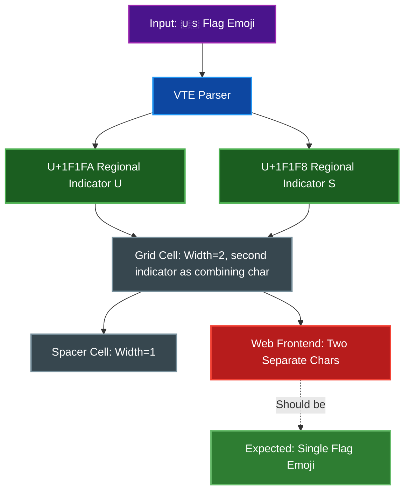

# Regional Indicator Flag Emoji - Frontend Rendering Limitation

Regional indicator flag emojis (🇺🇸, 🇨🇳, 🇯🇵, etc.) are correctly stored as single width-2 cells in the backend, but may not render correctly in the web terminal clients. Both shipped clients (HTML and Next.js) rely on `@xterm/addon-unicode11`, which does not cluster grapheme sequences; the addon that does (`@xterm/addon-unicode-graphemes`) is published but still marked experimental upstream, so it has not been integrated here.

## Table of Contents
- [Technical Background](#technical-background)
  - [What Are Regional Indicator Flags?](#what-are-regional-indicator-flags)
  - [The Terminal Grid Problem](#the-terminal-grid-problem)
  - [What Happens Now](#what-happens-now)
- [Why Can't We Fix This Now?](#why-cant-we-fix-this-now)
  - [xterm.js Grapheme Cluster Addon](#xtermjs-grapheme-cluster-addon)
  - [Tracking Issues](#tracking-issues)
- [Other Affected Emoji](#other-affected-emoji)
- [What Works Now](#what-works-now)
- [Workarounds](#workarounds)
- [Future Resolution](#future-resolution)
- [Implementation Details](#implementation-details)
- [Related Documentation](#related-documentation)

## Technical Background

### What Are Regional Indicator Flags?

Regional indicator flag emojis are composed of two Unicode codepoints:
- Each codepoint is a Regional Indicator Symbol (U+1F1E6 to U+1F1FF)
- The pair represents a country code (e.g., 🇺🇸 = US = U+1F1FA + U+1F1F8)
- Visually, they should render as a single flag emoji

### The Terminal Grid Problem

Terminals use a fixed character grid where:
- Each cell can hold one character
- Each character has a fixed width (1 or 2 cells for wide chars)

Regional indicator flags would violate this model if each codepoint were stored naively:
1. **Two codepoints**: The flag is made of 2 separate Unicode characters
2. **Width 1 each**: Each regional indicator has width 1 (per `unicode-width` crate)
3. **Should be width 2**: Visually, they should render as a single wide (2-cell) emoji

The backend resolves this by combining the pair into one cell (see [What Happens Now](#what-happens-now) below); the remaining problem is on the frontend side.



### What Happens Now

**Backend (Rust):**

The backend correctly handles regional indicator flag emoji as grapheme clusters:
- Receives the flag emoji (e.g., "🇺🇸")
- Detects regional indicator pairs (two consecutive regional indicators)
- Stores both regional indicators in a **single cell** (first as base char, second in combining vector)
- Calculates width 2 for the combined flag emoji
- Creates a spacer cell for the second position
- Works correctly with all flag emoji (🇺🇸, 🇬🇧, 🇯🇵, etc.)

**Frontend (xterm.js):**

The frontend receives the data correctly but may not render properly:
- Receives the combined flag emoji via WebSocket
- Lacks grapheme cluster support to treat them as a visual unit
- Browser/font may render them as separate characters or not at all
- This limitation is in xterm.js, not the backend

## Why Can't We Fix This Now?

### xterm.js Grapheme Cluster Addon

The xterm.js team developed a solution: `@xterm/addon-unicode-graphemes`

**Current Status (verified 2026-10):**
- Published to npm on 2025-12-22: `0.4.0` is the `latest` tag; an active `0.5.0-beta` line is in progress
- Available on CDN (jsDelivr, unpkg) at `lib/addon-unicode-graphemes.js` <!-- doc-path: example -->
- **Still flagged experimental upstream**: the package is published with the warning "This addon is currently experimental and may introduce unexpected and non-standard behavior"
- Not yet integrated into this project's web clients (both still use `@xterm/addon-unicode11`, which handles widths but not grapheme clustering)

> **Warning:** A malicious typosquatting package exists (`xterm-addon-unicode-graphemes` without the `@xterm/` prefix). Do not install this package. See [Snyk Security Advisory](https://security.snyk.io/vuln/SNYK-JS-XTERMADDONUNICODEGRAPHEMES-6044724).

### Tracking Issues

- [Issue #5147](https://github.com/xtermjs/xterm.js/issues/5147) - Missing npm package @xterm/addon-unicode-graphemes (resolved by the 0.4.0 publication)
- [Issue #3304](https://github.com/xtermjs/xterm.js/issues/3304) - Grapheme cluster & Unicode v13 support
- [Issue #4797](https://github.com/xtermjs/xterm.js/issues/4797) - Set up publishing for unicode graphemes addon
- [Issue #1468](https://github.com/xtermjs/xterm.js/issues/1468) - Grapheme support (original request)

## Other Affected Emoji

Regional indicators are just one type of grapheme cluster. Other affected emoji include:

1. **Emoji with skin tone modifiers** (e.g., 👍🏻, 👋🏽)
   - Base emoji + skin tone modifier (U+1F3FB to U+1F3FF)

2. **Zero-Width Joiner (ZWJ) sequences** (e.g., 👨‍👩‍👧‍👦, 🏳️‍🌈)
   - Multiple emoji joined with U+200D (ZWJ)

3. **Emoji with variation selectors** (e.g., ❤️, ☀️)
   - Base character + U+FE0F (variation selector)

4. **Keycap sequences** (e.g., 1️⃣, #️⃣)
   - Digit/symbol + U+FE0F + U+20E3 (combining enclosing keycap)

## What Works Now

**Simple Emoji (single codepoint, width 2):**
- Coffee: ☕ (U+2615)
- Rocket: 🚀 (U+1F680)
- Smiley: 😀 (U+1F600)
- Heart: ❤ (U+2764)
- Thumbs up: 👍 (U+1F44D)

**Wide Characters (CJK, etc.):**
- Chinese: 你好世界
- Japanese: 日本語
- Korean: 한국어

## Workarounds

There are no workarounds in the shipped clients yet:
- Cannot modify the backend to "uncombine" characters (breaks the terminal grid model)
- The grapheme addon is published but experimental; this project's clients have not integrated it
- Cannot implement custom grapheme clustering in the clients (extremely complex)
- Cannot use alternative rendering (xterm.js is the standard)

### What Users See

When a regional indicator flag is sent to the terminal:
- **Best case**: Two separate regional indicator symbols (🇺🇸 renders as "🇺" and "🇸")
- **Common case**: Empty boxes or missing characters
- **Worst case**: Rendering artifacts or incorrect spacing

## Future Resolution

### Integrating the Published Addon

`@xterm/addon-unicode-graphemes` is on npm (see [Why Can't We Fix This Now?](#why-cant-we-fix-this-now) for current status). Integration would require:

**Step 1: Load the addon**

Add to HTML client:
```html
<script src="https://cdn.jsdelivr.net/npm/@xterm/addon-unicode-graphemes@0.4.0/lib/addon-unicode-graphemes.js"></script>
```

Add to Next.js client:
```bash
npm install @xterm/addon-unicode-graphemes
```

**Step 2: Activate the addon**

```javascript
const graphemesAddon = new UnicodeGraphemesAddon.UnicodeGraphemesAddon();
term.loadAddon(graphemesAddon);
term.unicode.activeVersion = '15-graphemes';
```

The addon registers a Unicode 15 provider under the version string `15-graphemes` (and a plain `15` provider without grapheme clustering); setting `term.unicode.activeVersion` to `15-graphemes` switches width measurement and rendering to grapheme-cluster-aware rules.

### Alternative: Wait for xterm.js Core Support

The xterm.js team may eventually integrate grapheme cluster support directly into the core library, eliminating the need for an addon.

## Implementation Details

### Backend Implementation

**Grapheme Cluster Utilities:**

The Rust backend includes a dedicated `grapheme` module (`crates/par-term-emu-core/src/grapheme.rs`) with utility functions for detecting and handling various Unicode grapheme cluster components:

- `is_regional_indicator(c)` - Detects regional indicator symbols (U+1F1E6-U+1F1FF)
- `is_variation_selector(c)` - Detects variation selectors (U+FE0E, U+FE0F)
- `is_zwj(c)` - Detects Zero Width Joiner (U+200D)
- `is_skin_tone_modifier(c)` - Detects skin tone modifiers (U+1F3FB-U+1F3FF)
- `is_combining_mark(c)` - Detects combining diacritical marks
- `is_wide_grapheme(grapheme)` - Determines if a grapheme cluster should occupy 2 cells

**Unicode Width Calculation:**

The backend uses the `unicode-width` crate (v0.2.2) to calculate individual character widths via the `unicode_width_config` module:

```rust
// From crates/par-term-emu-core/src/unicode_width_config.rs
use unicode_width::UnicodeWidthChar;
```

**Combining Character Handling:**

The terminal writer (`crates/par-term-emu-core/src/terminal/write.rs`) detects combining characters and adds them to the previous cell:

```rust
// Variation selectors, ZWJ, skin tone modifiers, and combining marks
// are added to the previous cell instead of creating a new cell
if grapheme::is_variation_selector(c)
    || grapheme::is_zwj(c)
    || grapheme::is_skin_tone_modifier(c)
    || grapheme::is_combining_mark(c)
{
    // Add to previous cell's combining character list
    // and recalculate width if needed
}
```

**Regional Indicator Pair Handling:**

The terminal writer correctly handles regional indicator pairs:

```rust
// Regional indicators are detected and combined into single cells
if grapheme::is_regional_indicator(c) {
    // Check if previous cell is also a regional indicator
    // If so, combine them into a single width-2 cell
    // with the second indicator in the combining vector
}
```

**Regional Indicator Detection:**

The screenshot renderer includes special detection for regional indicators to enable shaped rendering:

```rust
// From crates/par-term-emu-core/src/screenshot/renderer.rs
fn row_has_regional_indicators(grid: &Grid, row: usize) -> bool {
    // scans cells (and their combining chars) directly for U+1F1E6..=U+1F1FF,
    // avoiding a per-row String allocation
}
```

**Shaped Line Rendering:**

Rows containing regional indicators are rendered through the swash text shaper (`crates/par-term-emu-core/src/screenshot/shaper.rs`) instead of cell-by-cell glyph painting, so a flag renders as a single shaped glyph:

- `Renderer::render_grid` routes a row to `render_shaped_line` when the `TextShaper` is available and `row_has_regional_indicators` is true; all other rows use normal cell rendering
- `render_shaped_line` takes the row's text (`grid.row_text`), and `TextShaper::shape_line` splits it into same-font runs (regular, emoji, CJK — the "line sharding" step) before shaping each run with swash
- Shaped glyph clusters are byte offsets, mapped back through a character index to a grid column (via `unicode_width_config::char_width`) so each glyph lands on its cell's x position
- Backgrounds and text decorations are still drawn from the grid cells; the shaped pass only replaces the glyph painting

### Frontend Implementation

**HTML Streaming Client:**

Located in `examples/streaming_client.html`:
- xterm.js version: 5.5.0
- Addons: fit, web-links, WebGL (loaded when available), Unicode11
- Unicode11 addon activated (`term.unicode.activeVersion = '11'`)
- Font stack: NerdFontsSymbols Nerd Font, JetBrains Mono, Fira Code, Noto Sans Mono, Cascadia Code, Cascadia Code PL, DejaVu Sans Mono, Consolas, Courier New, Segoe UI Emoji, Noto Color Emoji, Apple Color Emoji, Symbola, monospace
- `rescaleOverlappingGlyphs` option enabled

**Next.js Web Terminal:**

Located in `web-terminal-frontend/components/Terminal.tsx`:
- xterm.js version: 6.0.0
- Same addon configuration as the HTML client plus `@xterm/addon-image`
- Unicode11 addon activated (`term.unicode.activeVersion = '11'`)
- React-based implementation with TypeScript
- Note: `@xterm/addon-unicode-graphemes` is now published (see [Why Can't We Fix This Now?](#why-cant-we-fix-this-now)) but not yet integrated in either client

## Related Documentation

- [ARCHITECTURE.md](ARCHITECTURE.md) - Overall system architecture
- [VT_SEQUENCES.md](VT_SEQUENCES.md) - Supported VT sequences
- [xterm.js Issue #5147](https://github.com/xtermjs/xterm.js/issues/5147) - Missing npm package issue (resolved by the 0.4.0 publication)
- [xterm.js Issue #3304](https://github.com/xtermjs/xterm.js/issues/3304) - Grapheme cluster support request
- [Snyk Security Advisory](https://security.snyk.io/vuln/SNYK-JS-XTERMADDONUNICODEGRAPHEMES-6044724) - Malicious typosquatting package warning

---

**Last Updated**: 2026-10-22
**xterm.js Version**: 6.0.0 (Next.js), 5.5.0 (HTML client)
**unicode-width Crate**: 0.2.2
**Status**: Grapheme addon published upstream (0.4.0, experimental) but not yet integrated into this project's web clients
