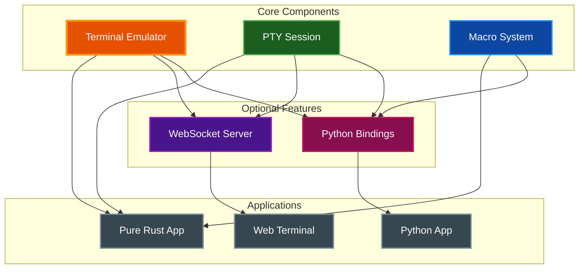

# Using par-term-emu-core-rust in Pure Rust Projects

A comprehensive guide for using the par-term-emu-core-rust library in pure Rust applications without Python bindings.

## Table of Contents
- [Overview](#overview)
  - [Which Crate Path to Import](#which-crate-path-to-import)
- [Quick Start](#quick-start)
  - [Feature Combinations](#feature-combinations)
  - [Build Commands](#build-commands)
- [Basic Terminal Usage](#basic-terminal-usage)
- [Resize and Scrollback Modes](#resize-and-scrollback-modes)
- [PTY Session](#pty-session-shell-interaction)
- [Macro Recording and Playback](#macro-recording-and-playback)
- [WebSocket Streaming Server](#websocket-streaming-server)
- [Terminal Multiplexer (par-mux)](#terminal-multiplexer-par-mux)
- [File Transfer Tracking](#file-transfer-tracking)
- [Feature Flags](#feature-flags)
- [Building](#building)
- [Example Projects](#example-projects)
- [API Documentation](#api-documentation)
- [Core Components](#core-components)
- [C FFI](#c-ffi)
- [Related Documentation](#related-documentation)

## Overview

This library provides full VT100/VT220/VT320/VT420/VT520 terminal emulation in pure Rust with Python 3.12+ bindings. It can be used with or without Python bindings, making it suitable for pure Rust applications, embedded terminals, and CLI tools.

> **Note:** The `Cell` struct implements `Clone` but not `Copy` to support variable-length grapheme cluster storage (combining characters, emoji sequences). All cell copy operations require explicit `.clone()` calls. Python bindings are unaffected.

### Which Crate Path to Import

Depend on `par-term-emu-core-rust` and import through `par_term_emu_core_rust::…`. That is the canonical embedder path, and every example in this guide uses it: `use par_term_emu_core_rust::prelude::*;` for the core types, then module paths (`par_term_emu_core_rust::terminal::…`, `::pty_session::…`, `::streaming::…`, `::mux::…`) for the rest.

The same core types are also reachable as `par_term_emu_core::…`, because the terminal core lives in the `par-term-emu-core` workspace member and the root crate re-exports it whole (`crates/par-term-emu-core/DESIGN.md`, invariant 1). That second path is an implementation boundary, not a second API:

- Write new code and docs against `par_term_emu_core_rust::…`. Both paths name the same types, so mixing them compiles, but one spelling keeps code searchable.
- Depend on `par-term-emu-core` directly only when you want the terminal core without the root crate's streaming, Python, and FFI dependency tree, and you need none of those modules. It versions in lockstep with the root (`=X.Y.Z` pins), so the two never disagree.
- `par-mux` (the multiplexer member) follows the same rule: reach it as `par_term_emu_core_rust::mux::…` with the `mux` feature.

### Architecture Overview



## Quick Start

### Feature Combinations

Choose the feature set that matches your needs:

#### Rust Only (No Python)
```bash
cargo add par-term-emu-core-rust --no-default-features --features pty_session
```
**Includes:** Terminal emulation, PTY support, Macros
**Use for:** Pure Rust applications, embedded terminals, CLI tools

> **Note:** Since v0.46.0 the `pty_session` module is gated behind the `pty_session` feature. Omit it only if you do not need `PtySession` (see the headless `sim` profile in the [Feature Flags](#feature-flags) table).

#### Rust with Streaming (No Python)
```bash
cargo add par-term-emu-core-rust --no-default-features --features streaming,pty_session
```
**Includes:** Everything in "Rust Only" + WebSocket server, HTTP server, Axum, Tokio, Protocol Buffers
**Use for:** Web-based terminals, remote terminal access, terminal sharing

#### Python Only
```bash
# default features include python
cargo add par-term-emu-core-rust
```
**Includes:** Terminal emulation, PTY support, Macros + Python bindings (PyO3)
**Use for:** Python applications, TUI frameworks, Jupyter kernels

#### Python with Streaming
```bash
cargo add par-term-emu-core-rust --features python,streaming
# or: cargo add par-term-emu-core-rust --features full  (also pulls the par-term-streamer CLI deps)
```
**Includes:** Everything + Python bindings + WebSocket/HTTP server + Protocol Buffers
**Use for:** Full-featured terminal applications with remote access

### Build Commands

**Rust only (terminal + PTY + macros):**
```bash
cargo build --no-default-features --features pty_session
```

**Headless, no PTY (grid + terminal only; screenshot rendering is opt-in since 0.54.0):**
```bash
cargo build --no-default-features --features sim
# render-capable embedders add screenshot:
cargo build --no-default-features --features sim,screenshot
```

**Rust with streaming:**
```bash
cargo build --no-default-features --features streaming,pty_session
```

**Python (wheel feature set):**
```bash
# streaming is included: pyproject.toml [tool.maturin] features apply to every maturin build
uv run maturin develop --release
```

**Python with streaming:**
```bash
cargo build --features "python,streaming"
```

## Basic Terminal Usage

The `Terminal` struct provides the core terminal emulation functionality.

> **Tip:** For custom scrollback size, use `Terminal::with_scrollback(cols, rows, scrollback_lines)` instead of `Terminal::new()`.

> **Imports:** `use par_term_emu_core_rust::prelude::*;` brings in the core types (`Terminal`, `Grid`, `Cell`, `Color`, `Cursor`, `TerminalEvent`, `TerminalObserver`, `TerminalGraphic`, `TmuxNotification`, width configuration, and `PtySession` with the `pty_session` feature). Peripheral types live at their module paths (`terminal::…`, `graphics::…`, `streaming::…`, `mux::…`); the `prelude` module docs list them. The older crate-root re-exports still resolve.

```rust
use par_term_emu_core_rust::terminal::Terminal;

fn main() {
    // Create an 80x24 terminal with default scrollback (10000 lines)
    let mut terminal = Terminal::new(80, 24);

    // Or create with custom scrollback
    // let mut terminal = Terminal::with_scrollback(80, 24, 50000);

    // Process ANSI sequences
    terminal.process(b"\x1b[31mRed text\x1b[0m\n");
    terminal.process(b"Normal text\n");

    // Get terminal content
    let content = terminal.export_text();
    println!("{}", content);

    // Get cursor position
    let cursor = terminal.cursor();
    println!("Cursor at column {}, row {}", cursor.col, cursor.row);

    // Resize terminal (the visible screen reflows when width changes)
    terminal.resize(100, 30);
}
```

> **Note:** The `process()` method is thread-safe for reading but requires `&mut self` for modifications. For concurrent access, wrap `Terminal` in `Arc<Mutex<Terminal>>`.

> **Resize Behavior:** When terminal width changes, the visible screen is reflowed--wrapped lines are unwrapped (width increase) or re-wrapped (width decrease). Stored scrollback lines keep the width they scrolled off at and are not rebuilt. All cell attributes are preserved. Height-only changes do not trigger reflow. To reflow the scrollback together with the screen, see [Resize and Scrollback Modes](#resize-and-scrollback-modes).

## Resize and Scrollback Modes

Four opt-in settings change how a `Terminal` resizes, stores scrollback, and counts emoji widths. All are plain Rust methods on `Terminal`: the flat Python `Terminal` class is frozen, so there are no Python bindings for them. The C embedding surface exposes every setting except compact scrollback through `ptec_terminal_set_*` exports (see [FFI_GUIDE.md](FFI_GUIDE.md)).

| Method | Default | Survives RIS | Effect |
|--------|---------|--------------|--------|
| `set_xterm_resize(bool)` | `false` | Yes | Resize like xterm.js: the primary screen and its scrollback reflow as one buffer |
| `set_compact_scrollback(bool)` | `false` | Yes | Store scrolled lines without their trailing default cells |
| `set_max_scrollback(usize)` | Constructor value (10000 for `Terminal::new`) | Yes (RIS keeps the current capacity) | Change the scrollback capacity of a running terminal |
| `set_codepoint_widths(bool)` | `false` | Yes | Count emoji sequences per code point (`wcwidth`-style) instead of per grapheme cluster |

```rust
use par_term_emu_core_rust::terminal::Terminal;

fn main() {
    let mut terminal = Terminal::with_scrollback(80, 24, 10_000);

    // Resize like xterm.js: the cursor follows its line, and scrollback
    // lines return to the screen when it grows taller.
    terminal.set_xterm_resize(true);

    // Store scrolled lines in proportion to their text, not the screen width.
    terminal.set_compact_scrollback(true);

    // Agree with hosts that count with wcwidth: the heart emoji with a
    // variation selector is 1 column, a ZWJ sequence counts per code point.
    terminal.set_codepoint_widths(true);

    for i in 0..100 {
        terminal.process(format!("line {i}\r\n").as_bytes());
    }

    // Shrink the history while the terminal runs. The oldest lines drop
    // like a scroll at capacity.
    terminal.set_max_scrollback(2_000);

    // Track where the resize moved each buffer line.
    terminal.resize(100, 30);
    if let Some(reflow) = terminal.take_buffer_reflow() {
        // Old buffer line 5 (scrollback first) -> its line after the resize,
        // or the nearest surviving line above it.
        let new_line = reflow.follow(5);
        println!("line 5 is now line {new_line:?}, {} trimmed off the top", reflow.trimmed);
    }
}
```

### Xterm-style resize

By default a resize reflows only the visible screen and leaves stored scrollback lines at the width they scrolled off with (see the Resize Behavior note under [Basic Terminal Usage](#basic-terminal-usage)). With `set_xterm_resize(true)`:

- The primary screen and its scrollback are one list of lines. A taller screen pulls lines back from the scrollback, and a shorter one drops blank rows below the cursor before it pushes rows into the scrollback.
- On a width change every logical line except the cursor's is rewrapped across the scrollback and the screen.
- The cursor, the saved cursor, and the viewport follow their lines. A pending wrap ends on resize.
- Images on the primary screen keep their lines. The alternate screen has no scrollback and resizes without reflow.

`resize_with_viewport(cols, rows, viewport_top)` is `resize` for a host whose viewport is scrolled to buffer line `viewport_top` (scrollback first). It returns the viewport's new top line.

`take_buffer_reflow()` returns a `BufferReflow` once after an xterm-style resize that changed the size, and `None` otherwise, including when `set_xterm_resize` is off. `BufferReflow::lines` maps every old buffer line (scrollback first, then the screen) to `Some(new_line)` or `None` when the line was joined into another, dropped below the cursor, or trimmed off the top. `BufferReflow::trimmed` counts lines trimmed off the top. `BufferReflow::follow(old)` returns the new line for `old`, or the nearest surviving line above it. Use these to keep a host's own line-number bookkeeping (selections, search hits, bookmarks) valid across a resize.

### Compact scrollback

Without `set_compact_scrollback(true)` each stored line keeps the full width it had on screen. With it, trailing default cells (never written, or erased with the default background) are dropped as a line enters the scrollback, so memory and copy cost follow the text length. A short line reads exactly like one padded with default cells, so readers that pad short lines see no difference. Wrapped lines keep their full width, and lines already stored are left as they are. Snapshots are byte-compatible with the default mode. `compact_scrollback()` reads the setting back.

### Live scrollback capacity

`set_max_scrollback(n)` changes the capacity of the primary screen's scrollback. A larger value keeps every stored line and lets more in. A smaller value drops the oldest lines exactly as a scroll at capacity would: absolute line numbering, zones, and the scroll log stay valid, and graphics anchored to dropped lines leave the store while survivors rebase. The alternate screen keeps no scrollback.

### Per-code-point widths

By default an emoji sequence is one grapheme cluster: a variation selector 16 or a ZWJ continuation widens a narrow cell to two columns. With `set_codepoint_widths(true)` every character keeps the width it has on its own, and only zero-width characters (combining marks, variation selectors, ZWJ) attach to the previous cell without changing its width. A heart with VS16 is then 1 column and a ZWJ family sequence counts per code point (the technologist sequence is 4 columns). Regional-indicator pairs stay one two-column cell either way. The setting applies to text written after it changes.

Enable it when the host measures text with `wcwidth` (shells, readline, editors, ncurses) or mirrors xterm, VTE, or xterm.js with Unicode 11 widths, so the cursor stays where the writing program expects. Leave it off for programs that negotiate grapheme clustering through mode 2027. `codepoint_widths()` reads the setting back.

## PTY Session (Shell Interaction)

The `PtySession` manages an interactive shell process with bidirectional I/O.

> **Security:** PTY sessions execute shell commands with the same privileges as your application. Always validate and sanitize any user input before sending it to the PTY. See [SECURITY.md](SECURITY.md) for best practices.

```rust
use par_term_emu_core_rust::pty_session::PtySession;
use par_term_emu_core_rust::pty_error::PtyError;
use std::sync::Arc;
use std::io::Write;

fn main() -> Result<(), PtyError> {
    // Create PTY session: 80 cols, 24 rows, 10000 lines scrollback
    let mut pty = PtySession::new(80, 24, 10000);

    // Spawn a shell
    pty.spawn_shell()?;

    // Set output callback
    pty.set_output_callback(Arc::new(|data| {
        print!("{}", String::from_utf8_lossy(data));
    }));

    // Send input to shell
    if let Some(writer) = pty.get_writer() {
        let mut w = writer.lock();
        writeln!(w, "echo 'Hello from Rust!'")?;
        w.flush()?;
    }

    // Keep running while shell is active
    while pty.is_running() {
        std::thread::sleep(std::time::Duration::from_millis(100));
    }

    Ok(())
}
```

### Spawning with Environment Variables

```rust
use par_term_emu_core_rust::pty_session::PtySession;
use std::collections::HashMap;

fn main() -> Result<(), Box<dyn std::error::Error>> {
    let mut session = PtySession::new(80, 24, 10000);

    // Set environment variables before spawning
    session.set_env("MY_VAR", "hello");

    // Or pass environment variables directly when spawning
    let mut env = HashMap::new();
    env.insert("MY_VAR".to_string(), "hello".to_string());
    session.spawn_shell_with_env(Some(&env), Some("/tmp"))?;

    Ok(())
}
```

## Macro Recording and Playback

The macro system allows recording and playback of keyboard events with YAML serialization.

> **Note:** YAML save/load (`save_yaml`, `load_yaml`, `to_yaml`, `from_yaml`) requires the `macro-yaml` feature. `python`, `python-test`, and `streaming-bin` enable it; `rust-only`, `sim`, and `mux` builds must add it explicitly.

```rust
use par_term_emu_core_rust::macros::{Macro, MacroEvent, KeyParser};

fn main() -> std::io::Result<()> {
    // Create a macro. The with_* builders consume and return self;
    // the add_* mutators borrow and return &mut self, so chain them
    // on the bound value.
    let mut macro_seq = Macro::new("Demo Macro")
        .with_description("A simple demo")
        .with_terminal_size(80, 24);
    macro_seq
        .add_key("e")
        .add_key("c")
        .add_key("h")
        .add_key("o")
        .add_key("space")
        .add_key("'")
        .add_key("H")
        .add_key("e")
        .add_key("l")
        .add_key("l")
        .add_key("o")
        .add_key("'")
        .add_key("enter")
        .add_delay(1000)
        .add_screenshot();

    // Save to YAML
    macro_seq.save_yaml("demo.yaml")?;

    // Load and playback
    let loaded = Macro::load_yaml("demo.yaml")?;

    // Iterate through events
    for event in &loaded.events {
        match event {
            MacroEvent::KeyPress { key, .. } => {
                let bytes = KeyParser::parse_key(key);
                println!("Key: {} -> {:?}", key, bytes);
            }
            MacroEvent::Delay { duration, .. } => {
                println!("Delay: {}ms", duration);
            }
            MacroEvent::Screenshot { label, .. } => {
                println!("Screenshot: {:?}", label);
            }
        }
    }

    Ok(())
}
```

## WebSocket Streaming Server

> **Note:** Requires the `streaming` feature flag.

> **Security:** The streaming server supports TLS/SSL for secure WebSocket connections (WSS) and HTTPS. Configure using `TlsConfig::from_files()` or `TlsConfig::from_pem()`.

> **Performance:** Server uses Protocol Buffers for efficient binary messaging (~80% smaller than JSON). Messages are automatically encoded/decoded by the server.

### Basic Streaming Server

```bash
cargo add par-term-emu-core-rust --no-default-features --features streaming,pty_session
cargo add tokio --features macros,rt-multi-thread
# The crate uses parking_lot internally; PtySession::get_writer() and
# terminal() return parking_lot locks, so reuse it for your own wrappers.
cargo add parking_lot
```

```rust
use par_term_emu_core_rust::{
    terminal::Terminal,
    pty_session::PtySession,
    streaming::{StreamingConfig, StreamingServer},
};
use parking_lot::Mutex;
use std::sync::Arc;

#[tokio::main]
async fn main() -> Result<(), Box<dyn std::error::Error>> {
    // Create terminal and PTY
    let pty_session = PtySession::new(80, 24, 10000);
    let terminal = pty_session.terminal();
    let pty_session = Arc::new(Mutex::new(pty_session));

    // Create streaming server with configuration
    let config = StreamingConfig {
        max_clients: 100,
        send_initial_screen: true,
        keepalive_interval: 30,
        default_read_only: false,
        enable_http: true,
        web_root: "./web_term".to_string(),
        initial_cols: 0,  // 0 = use terminal's current size
        initial_rows: 0,  // 0 = use terminal's current size
        tls: None,
        http_basic_auth: None,
        max_sessions: 10,
        session_idle_timeout: 900,
        presets: std::collections::HashMap::new(),
        max_clients_per_session: 0,
        input_rate_limit_bytes_per_sec: 0,
        enable_system_stats: false,
        system_stats_interval_secs: 5,
        api_key: None,
        allow_api_key_in_query: false,
        allowed_origins: None,
        kitty_file_media: Default::default(),  // Kitty file-media gate (SEC-101)
    };

    let server = StreamingServer::with_config(
        terminal,
        "127.0.0.1:8099".to_string(),
        config
    );

    // Start shell
    {
        let mut session = pty_session.lock();
        session.spawn_shell()?;
    }

    // Setup output callback
    let output_sender = server.get_output_sender();
    {
        let mut session = pty_session.lock();
        session.set_output_callback(Arc::new(move |data| {
            // try_send: the callback is sync, so it cannot await a tokio channel
            let _ = output_sender.try_send(String::from_utf8_lossy(data).to_string());
        }));
    }

    // Get PTY writer for client input
    if let Some(writer) = pty_session.lock().get_writer() {
        server.set_pty_writer(writer);
    }

    let server = Arc::new(server);

    // Start server
    println!("Server listening on ws://127.0.0.1:8099");
    server.start().await?;

    Ok(())
}
```

### TLS Configuration

```rust
use par_term_emu_core_rust::streaming::{StreamingConfig, TlsConfig};

// From separate certificate and key files
let tls = TlsConfig::from_files("cert.pem", "key.pem")?;

// Or from a combined PEM file
let tls = TlsConfig::from_pem("combined.pem")?;

let config = StreamingConfig {
    tls: Some(tls),
    ..Default::default()
};
```

### HTTP Basic Authentication

```rust
use par_term_emu_core_rust::streaming::{StreamingConfig, HttpBasicAuthConfig};

// With clear text password
let auth = HttpBasicAuthConfig::with_password(
    "admin".to_string(),
    "secret".to_string()
);

// Or with htpasswd hash (bcrypt, apr1, SHA1, MD5 crypt)
let auth = HttpBasicAuthConfig::with_hash(
    "admin".to_string(),
    "$2y$10$...bcrypt_hash...".to_string()
);

let config = StreamingConfig {
    http_basic_auth: Some(auth),
    ..Default::default()
};
```

## Terminal Multiplexer (par-mux)

> **Note:** The library API requires the `mux` feature flag (Rust only; not part of the default build). The `par-mux` daemon binary requires `mux-bin`.

The crate ships a tmux-control-mode multiplexer: sessions, windows, and split panes of real PTYs served over a local socket, with an agent layer on top (state hook reports, a scrape fallback for agents without hooks, and session resume across daemon restarts).

```rust
use par_term_emu_core_rust::mux::MuxClient;

// Attach to the daemon for a named socket, spawning one if none is running
let mut client = MuxClient::connect_or_spawn("default")?;

// Run a command; the reply is the block's body lines
let panes = client.send("list-panes")?;

// Pushed notifications (%output, %layout-change, …) arrive on this channel
while let Ok(note) = client.notifications().try_recv() {
    // …
}
```

The server side (`MuxServer`), the full command table, hook-report JSON contract, persistence/quarantine, and shutdown semantics are documented in [MUX.md](MUX.md).

## File Transfer Tracking

The `Terminal` tracks host-to-terminal file downloads and upload requests initiated by OSC 1337 sequences: `File=`/`MultipartFile=`/`FilePart=` with `inline=0` start downloads, and `RequestUpload` raises an `upload_requested` event the host answers through the response buffer. Every transfer is visible to the embedder through a small set of `Terminal` methods; the types live in `terminal::file_transfer`.

A `FileTransferManager` holds in-progress transfers in a map and finished ones in a bounded ring (32 entries by default), so finished results survive several polls but never grow unbounded. Transfers exceeding the 50 MB default size cap fail, and no more than 8 transfers run at once.

```rust
use par_term_emu_core_rust::terminal::file_transfer::TransferStatus;
use par_term_emu_core_rust::terminal::Terminal;

let mut term = Terminal::new(80, 24);

// Poll without copying payload bytes: FileTransferSummary carries identity,
// filename, direction, status, byte counts, and timestamps — never `data`.
// It takes &self, so it is callable through a read guard on a shared terminal.
let summaries = term.transfer_summaries();
for t in &summaries.active {
    println!("{}: {:?} ({} bytes so far)", t.filename, t.status, t.bytes_transferred);
}

// Finished downloads stay in the completed ring until taken
for t in summaries.completed {
    if let Some(transfer) = term.take_completed_transfer(t.id) {
        if transfer.status == TransferStatus::Completed {
            std::fs::write(&transfer.filename, &transfer.data)?;
        }
    }
}
```

> **Tip:** Poll `transfer_summaries()` for progress UI and call `take_completed_transfer(id)` only when a consumer needs the payload. The older `get_transfer(id)`, `get_active_transfers()`, and `get_completed_transfers()` accessors clone the accumulated `data` bytes on every call, which a frequent poller pays for on every poll.

> **Note:** `transfer_summaries()` and `get_transfer()` take `&self`; `take_completed_transfer()`, `cancel_file_transfer()`, and the upload repliers take `&mut self`. Under a `parking_lot::RwLock<Terminal>`, summaries work through `read()`, payload-taking through `write()`.

The remaining methods cover the rest of the lifecycle:

| Method | Effect |
|--------|--------|
| `get_transfer(id)` | Clone of an active or completed transfer, payload included |
| `cancel_file_transfer(id)` | Cancel an active transfer; returns `true` when it existed |
| `send_upload_data(data)` | Answer an `upload_requested` event: writes `ok\n`, the base64-encoded `data`, and a blank line to the response buffer |
| `cancel_upload()` | Abort a pending upload: writes Ctrl-C (0x03) to the response buffer |
| `set_max_transfer_size(bytes)` / `get_max_transfer_size()` | Cap for one transfer payload; host configuration, survives RIS |

> **Note:** The Python bindings mirror this API (`get_active_transfers()`, `take_completed_transfer()`, …) and deliver `file_transfer_started` / `file_transfer_progress` / `file_transfer_completed` / `file_transfer_failed` observer events; both are documented in [API_REFERENCE.md](API_REFERENCE.md) (File Transfer) and [STREAMING.md](STREAMING.md) (File Transfer Events).

## Feature Flags

| Feature | Description | Includes |
|---------|-------------|----------|
| `python` | Python bindings via PyO3 | `pyo3`, `pyo3/extension-module`, `par-term-emu-derive`, `pty_session`, `screenshot`, `macro-yaml` |
| `python-test` | The `python` feature's deps with `pyo3/auto-initialize` instead of `extension-module`, so the bindings link a real interpreter under `cargo test` | `pyo3`, `pyo3/auto-initialize`, `par-term-emu-derive`, `pty_session`, `screenshot`, `macro-yaml` |
| `screenshot` | Terminal-to-image renderer (`screenshot::render_terminal` / `save_terminal`, embedded fonts). Enabled by `python` and `python-test`; opt-in for `sim` (`features = ["sim", "screenshot"]`) | `swash` |
| `pty_session` | Real PTY backend (`PtySession`): portable-pty. Auto-enabled by `python`, `streaming-bin`, and `mux` | `portable-pty` |
| `streaming` | WebSocket streaming server with binary protocol (library) | `tokio`, `tokio-tungstenite`, `axum`, `tower-http`, `futures-util`, `prost`, `rustls`, `tokio-rustls`, `axum-server`, `bcrypt`, `md-5`, `sha1`, `headers`, `sysinfo`, `subtle`, `zeroize` |
| `streaming-bin` | CLI/logging/download deps for the standalone `par-term-streamer` binary (depends on `streaming` and `pty_session`) | `streaming`, `clap`, `anyhow`, `tracing`, `tracing-subscriber`, `reqwest`, `tar`, `sha2`, `pty_session`, `macro-yaml` |
| `mux` | `par-mux` multiplexer library: PTYs, session tree, control-mode socket, on-disk persistence (Rust only; not part of the default build) | `pty_session`, `interprocess`, `serde`, `dirs`, `toml`, `nix` (Unix only), `widestring` and `windows-sys` (Windows only) |
| `mux-bin` | The `par-mux` daemon binary: the CLI parser on top of `mux` plus the agent-integration / skill installers its one-shot flags run (mirroring `streaming`/`streaming-bin`) | `mux`, `clap`, `clap_complete`, `jsonc-parser`, `toml_edit`, `tempfile` |
| `attach` | The `par-mux attach` client TUI (`mux::attach`); rides the daemon binary's clap surface | `mux-bin`, `crossterm`, `ratatui`, `toml_edit` |
| `shutdown-inhibit` | Linux-only host-shutdown safety for the `par-mux` daemon: holds a logind delay lock and saves the session tree when the host announces shutdown (par-mux.md D9). A `par-mux` member feature, not forwarded by this crate — enable it with `cargo build -p par-mux --features shutdown-inhibit` | `zbus` |
| `macro-yaml` | `Macro` YAML save/load (`save_yaml`, `load_yaml`, `to_yaml`, `from_yaml`). Enabled by `python`, `python-test`, and `streaming-bin` | `serde_yaml_ng` |
| `serde` | Serde derives on the replay-snapshot types (`TerminalSnapshot`/`GridSnapshot` and their leaves) — the on-disk format for par-mux persistence | `smallvec/serde`, `bitflags/serde` |
| `rust-only` | Pure Rust, no Python (empty convenience feature) | (none) |
| `sim` | Headless profile: grid + terminal only — no PTY, Python, streaming, or screenshot (screenshot is opt-in since 0.54.0, ENH-024). Cannot be combined with `python` | (none — names the profile only) |
| `full` | All features | `python`, `streaming`, `streaming-bin` |
| `jemalloc` | Better server performance (non-Windows) | `tikv-jemallocator` |
| `regenerate-proto` | Rebuild protobuf from `proto/terminal.proto` | `prost-build` |
| `ffi` | C ABI surface (`ptec_terminal_*` exports in `src/ffi.rs`) for the xcframework and C/Swift embedders; off by default so Python wheels export no unprefixed C symbols | (forwards to `par-term-emu-core/ffi`) |
| `default` | Default features | `python` |

## Building

**Pure Rust binary (par-term-streamer, no Python):**
```bash
cargo build --no-default-features --features streaming-bin
```

**Rust library only:**
```bash
cargo build --no-default-features
```

**Everything:**
```bash
cargo build --features full
```

**With jemalloc for better server performance:**
```bash
cargo build --no-default-features --features "streaming,jemalloc"
```

## Example Projects

The repository includes example binaries:

- **`par-term-streamer`** - Full-featured WebSocket streaming server with TLS support and binary protocol
  ```bash
  # View all options
  cargo run --bin par-term-streamer --no-default-features --features streaming-bin -- --help

  # Run with HTTP server
  cargo run --bin par-term-streamer --no-default-features --features streaming-bin -- --enable-http

  # Run with TLS/SSL
  cargo run --bin par-term-streamer --no-default-features --features streaming-bin -- \
    --enable-http --tls-cert cert.pem --tls-key key.pem

  # Download web frontend (no Node.js required)
  cargo run --bin par-term-streamer --no-default-features --features streaming-bin -- --download-frontend

  # With HTTP Basic Auth
  cargo run --bin par-term-streamer --no-default-features --features streaming-bin -- \
    --enable-http --http-user admin --http-password secret
  ```

## API Documentation

Generate Rust API documentation:
```bash
cargo doc --no-default-features --open
```

With all features:
```bash
cargo doc --all-features --open
```

## Core Components

### Terminal
- **VT Compatibility**: VT100/VT220/VT320/VT420/VT520 compatible
- **Color Support**: ANSI 16-color, 256-color palette, and 24-bit RGB (true color)
- **Unicode Support**: Full Unicode with wide character support, grapheme cluster preservation, combining characters, variation selectors, Zero-Width Joiners (ZWJ), and emoji sequences
- **Scrollback Buffer**: Configurable scrollback (capacity changeable at runtime); the visible screen reflows on width changes, and an opt-in xterm.js-style mode reflows the scrollback with it
- **Mouse Support**: X10, Normal, Button, and Any modes with multiple encodings (Default, UTF-8, SGR, URXVT)
- **Graphics Support**: Sixel, iTerm2 inline images, and Kitty Graphics Protocol
- **Shell Integration**: OSC 133 support for command tracking and navigation
- **Triggers**: Regex-based pattern matching on terminal output with configurable actions
- **Recording**: Terminal session recording and export in multiple formats

### PtySession
- **Cross-platform PTY**: Unix and Windows support via `portable-pty`
- **Shell Management**: Spawning, lifecycle management, and exit code handling
- **Async I/O**: Callback-based output handling with thread-safe writer access
- **Terminal Resizing**: Dynamic resize support with PTY coordination
- **Process Control**: Start, stop, and status monitoring
- **Environment Variables**: Pass environment variables safely without modifying parent process

### Macros
- **Recording**: Capture keyboard events with timestamps
- **Playback**: Variable speed playback with pause/resume
- **Serialization**: YAML format for human-readable macro files
- **Screenshots**: Trigger screenshot capture at specific points
- **Key Parser**: Parse key names to ANSI escape sequences

### Streaming
- **WebSocket Server**: Real-time terminal streaming with multiple client support
- **Binary Protocol**: Protocol Buffers for efficient messaging (~80% size reduction vs JSON)
- **TLS/SSL Support**: Secure WebSocket (WSS) and HTTPS with rustls
- **HTTP Server**: Static file serving for web frontend with automatic frontend download
- **Client Control**: Read-only mode, resize events, theme customization
- **Multi-Session**: Support for multiple independent terminal sessions
- **Authentication**: HTTP Basic Auth with htpasswd hash support (bcrypt, apr1, SHA1, MD5 crypt)
- **Rate Limiting**: Input rate limiting to prevent abuse
- **System Stats**: Optional system resource monitoring

## C FFI

The library ships a C embedding surface: the cbindgen-generated header [`include/terminal_core.h`](../include/terminal_core.h) (generated from `src/ffi.rs` by `make ffi-header`; the `TERM_*` constants and layout asserts live in the hand-written `terminal_core_layout.h`), with a damage-driven render loop (`ptec_terminal_feed` / `ptec_terminal_dirty_ranges` / `ptec_terminal_read_row`), key encoding, snapshots, and observers. Build it for Apple platforms with `make xcframework`, or as a static library with `cargo rustc --lib --crate-type staticlib`.

See the [FFI Guide](FFI_GUIDE.md) for the full surface, contracts, and examples.

## Related Documentation

- [README.md](../README.md) - Project overview and Python quickstart
- [ARCHITECTURE.md](ARCHITECTURE.md) - Internal architecture and design
- [VT_SEQUENCES.md](VT_SEQUENCES.md) - ANSI/VT sequence reference
- [VT_TECHNICAL_REFERENCE.md](VT_TECHNICAL_REFERENCE.md) - Detailed VT terminal specifications
- [ADVANCED_FEATURES.md](ADVANCED_FEATURES.md) - Detailed feature guides
- [BUILDING.md](BUILDING.md) - Build instructions and requirements
- [API_REFERENCE.md](API_REFERENCE.md) - Python API documentation
- [STREAMING.md](STREAMING.md) - WebSocket streaming server guide
- [MUX.md](MUX.md) - par-mux multiplexer daemon reference
- [MACROS.md](MACROS.md) - Macro recording and playback documentation
- [SECURITY.md](SECURITY.md) - Security considerations for PTY usage

## License

MIT License - See [LICENSE](../LICENSE) for details.
